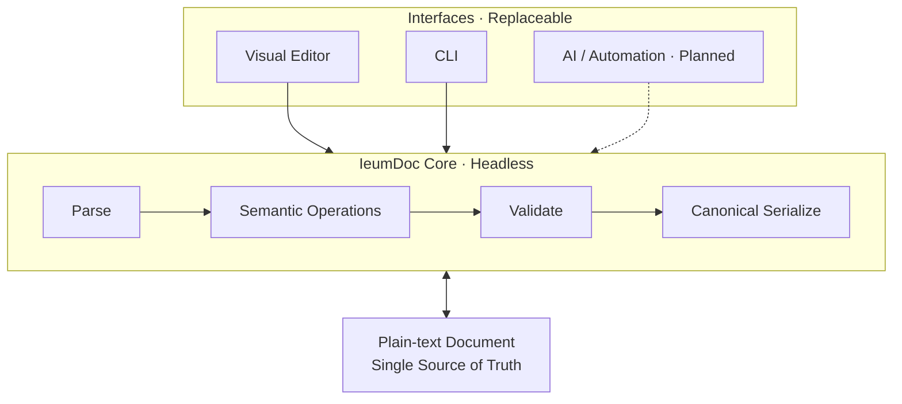

# IeumDoc

> Document first. Semantics in Core. Interfaces replaceable.
>
> **Status: Beta** — [v0.0.1-beta.4](https://github.com/ieumbird/ieumdoc/releases/tag/v0.0.1-beta.4)가 Windows x64 설치형 앱으로 공개되었습니다. Stable은 아직 없습니다. 공개 API·문서 지원 범위는 바뀔 수 있습니다.

IeumDoc은 Git의 plain-text 문서를 단일 진실 공급원(SSOT)으로 사용하는 구조화 기술문서 시스템입니다.

사람은 WYSIWYG Visual Editor로 작성하고 CLI는 동일한 headless semantic Core로 문서를 읽고 수정합니다. AI·automation도 같은 Core를 사용하도록 설계되어 있지만, 전용 AI/MCP interface는 아직 제공하지 않습니다.


2026-10-06 Visual Language v2의 실제 Editor capture입니다. 이후 추가된 Open folder와 Wide document control은 이 이미지에 포함되지 않습니다.

## Why IeumDoc

사람에게는 편하게 작성할 수 있는 문서이고, 기계에게는 신뢰성 있게 이해하고 수정할 수 있는 문서를 만드는 것이 목표입니다.

- Git에서 관리 가능한 사람이 읽을 수 있는 plain-text 문서
- 복잡한 기술문서를 위한 WYSIWYG 편집 환경
- 표, 그림, 수식, 참조 등 구조화된 콘텐츠
- Editor, CLI와 향후 AI·automation이 공유하는 하나의 headless Core
- 신뢰할 수 있는 문서 변경을 위한 검증과 canonical serialization

## Current capabilities

현재 master에 구현된 범위입니다. 블록 종류별 세부 지원 조건은 [문서 색인](docs/README.md#current-implemented-contracts)의 current contract를 따릅니다.

- **Headless Core / CLI**: parse, semantic operation, validation, canonical MyST Markdown. 공식 파일 write는 UTF-8 / LF이며 의미를 보존할 수 없으면 fail-closed로 거부합니다.
- **Visual Editor**: 하나의 Tiptap/ProseMirror 문서 상태에서 H1–H6, paragraph, nested list, quote, code, divider, standard admonition과 지원되는 inline formatting을 편집합니다. split/join, hard break, selection/clipboard, Undo/Redo, Markdown input shortcut과 block/section 이동을 지원합니다.
- **Table / Figure / Equation**: table cell·행·열·정렬, caption·label·reference, Figure 속성과 수식 편집. Figure·Equation·caption/label이 있는 Table의 번호는 계산해 표시합니다. PNG·JPEG·GIF·WebP 이미지 붙여넣기·drop은 문서 옆 `assets/`에 저장합니다([Asset Host contract](docs/design/filesystem-host-boundary-v1.md#asset-host-contract-v1-59)).
- **Pending Figure**: 이미지 없이 caption 또는 label을 Apply해 저장·참조하고, Reload 후 기존 Edit Figure에서 이미지를 연결합니다. CLI 생성·수정·readiness 경고는 [Figure authoring](docs/design/figure-authoring-v1.md)을 참고합니다.
- **Heading / footnote**: heading reference와 선택 가능한 H2–H6 numbering(H1은 제목), footnote 삽입(`/` Endnote, CLI `insert-footnote`)과 한 문단 definition의 문서 내 편집. MyST footnote는 미주로 표시되고, 모든 저장은 정의를 본문 뒤 첫 참조 순서로 씁니다. 그 밖의 definition은 block source editing으로 고칩니다.
- **Preservation / Save**: 네이티브 문서 검증, canonical Source preview, 외부 변경의 Save conflict와 미저장 작업 이탈 보호. Save 뒤에도 selection과 Undo/Redo history를 유지합니다.
- **Local file navigation**: Markdown 열기·새 파일 생성, 선택한 folder의 한 단계 목록과 하위 folder 이동, 현재 문서 Outline. workspace나 Git UI는 아닙니다.

## Architecture

현재 Editor와 CLI가 공유하는 Core와, 향후 연결할 interface의 관계입니다. 점선은 계획된 interface입니다.



> Document First — 문서가 본체다.
>
> Core Owns Semantics — 문서의 의미와 변경 규칙은 Core가 책임진다.
>
> Interfaces Are Replaceable — 인터페이스 교체가 Core 의미 계약을 바꾸지 않도록 한다.
>
> Writes Are Valid and Canonical — 공식 경로로 저장된 문서는 유효하고 안정적으로 다시 처리 가능해야 한다.

Architecture decisions:

- [ADR-0001: Single-document editor architecture](docs/adr/0001-single-document-editor-architecture.md)
- [ADR-0002: Document persistence and semantic ownership](docs/adr/0002-document-persistence-semantic-ownership.md)
- [ADR-0003: Document addressing and identity boundary](docs/adr/0003-document-addressing-identity-boundary.md)
- [ADR-0004: Desktop Host and distribution](docs/adr/0004-desktop-host-distribution.md)
- [ADR-0005: Standalone HTTP Host](docs/adr/0005-http-host.md)

## Getting started

아래는 저장소를 clone한 뒤 사용하는 **개발 실행 절차**입니다. 일반 사용자용 설치나 배포 패키지가 아닙니다.

### Requirements

Node.js `>=24.21.0 <25`, pnpm `12.5.1`이 필요합니다. 기준은 루트 `package.json`입니다.

### Install

```bash
git clone https://github.com/ieumbird/ieumdoc.git
cd ieumdoc
pnpm install --frozen-lockfile
```

### Core and CLI

Headless document Core는 `packages/core`, 파일 명령은 `packages/cli`에 있습니다.

```bash
pnpm ieumdoc help
pnpm ieumdoc check packages/core/test/fixtures/document.md
pnpm ieumdoc inspect packages/core/test/fixtures/technical-document.md
pnpm ieumdoc help split-paragraph
```

`help <command>`에서 옵션을 확인합니다. paragraph offset은 UTF-16이고 NodePath는 snapshot locator입니다. `check`는 대상이 없는 `{eq}`/`{numref}`/`{ref}` reference를 warning으로 알립니다. 이 warning만으로 check가 실패하지는 않습니다. 파일을 바꾸는 명령은 fixture가 아닌 문서 사본에서 실행합니다. 명령이 파일을 읽은 뒤 다른 곳에서 바뀌었거나 쓰기 도중 실패하면 원본을 그대로 두고 실패합니다([File commit](docs/design/filesystem-host-boundary-v1.md#file-commit-v1)).

AI·자동화 호출자는 `inspect <file> --format json`의 `revision`과 `nodes`의 경로를 함께 사용합니다. `revision`은 inspect가 읽은 원본 UTF-8 text의 SHA-256(64자리 소문자 hex)입니다. 모든 문서 변경 명령(`format` 포함, `create` 제외)은 선택적 `--if-revision <revision>`을 받으며, 현재 원본과 다르면 Core operation 전에 거부합니다. 생략하면 기존 동작을 유지합니다.

```bash
pnpm ieumdoc inspect document.md --format json
pnpm ieumdoc update-heading document.md --path <inspect에서 얻은 경로> --text "New heading" --if-revision <inspect에서 얻은 revision>
```

단건 변경 명령은 성공 후 새 revision을 출력하지 않습니다. 후속 변경 전에는 `inspect`를 다시 실행해 새 revision과 경로를 함께 얻습니다. 오래된 NodePath를 영속 ID로 사용하거나 새 위치로 추측해 재지정하지 않습니다. 잘못된 revision 인자는 `--if-revision must be 64 lowercase hexadecimal characters`, revision 불일치는 `revision mismatch; run inspect again; nothing was written`을 stderr에 출력하고 exit 1로 종료하며 파일을 변경하지 않습니다. 전체 사전조건 계약은 [CLI revision precondition](docs/design/filesystem-host-boundary-v1.md#cli-revision-precondition-214)에 있습니다.

여러 변경은 `apply-batch`로 한 번에 적용합니다. 예를 들어 `operations.json`에 다음을 저장합니다(아래 인덱스는 제목만 있는 문서 기준).

```json
[
  { "command": "insert-heading", "at": 2, "level": 2, "text": "Method" },
  { "command": "update-heading", "path": "2", "content": [{ "kind": "text", "text": "Verified method" }] },
  { "command": "move-block", "from": 2, "to": 1 }
]
```

```bash
pnpm ieumdoc apply-batch document.md --operations operations.json --if-revision <inspect에서 얻은 revision> --format json
```

옵션 키는 기존 플래그에서 `--`를 뺀 이름입니다. 스칼라 옵션은 string/number/boolean만, JSON 옵션은 객체/배열/문자열만 허용하며 모든 옵션의 `null` 값은 거부합니다. 모든 단건 변경 명령(`format` 포함)을 사용할 수 있고, 중첩 배치·operation별 `if-revision`·비변경 명령은 거부합니다. 각 경로·인덱스는 직전 단계의 canonical 재파싱 결과를 기준으로 하며 자동 추적하지 않습니다. 최초 원본의 revision을 한 번 확인하고 최종 결과만 한 번 커밋합니다. 실패하면 부분 결과를 쓰지 않고 exit 1을 반환합니다. 각 원소의 입력·옵션·Core 처리·검증·직렬화·재파싱 실패에만 `operation N (command): <오류>; nothing was written`을 출력합니다. 원본 read/parse·revision·최종 커밋 오류는 prefix 없이 단건과 같은 메시지를 출력합니다(예: `revision mismatch; run inspect again; nothing was written`, 커밋 충돌은 `... changed after it was read; nothing was written`). JSON 성공 출력은 `{"ok":true,"command":"apply-batch","applied":3,"revision":"<결과 revision>"}` 한 줄이며 text 모드는 출력이 없습니다. 입력은 비어 있지 않은 JSON 배열 파일이어야 하며 stdin은 지원하지 않습니다. 상세 계약은 [CLI batch application](docs/design/filesystem-host-boundary-v1.md#cli-batch-application-215)에 있습니다.

### Visual Editor

```bash
pnpm editor
```

`pnpm --filter @ieumdoc/editor dev`와 같습니다. `http://127.0.0.1:5173`을 열면 기본 문서는 `apps/editor/document/technical-document.md`입니다. 검증 시에는 [scratch fixture 절차](docs/test/TEST_GUIDE.md#browser-regression)를 사용합니다.

```bash
pnpm docs:check
pnpm typecheck
pnpm test
pnpm --filter @ieumdoc/editor build
```

관련 browser regression과 수동 확인은 [검증 안내](docs/test/README.md)에 있습니다.

### Standalone HTTP Editor

서버에서 production Editor와 파일 API를 함께 실행할 수 있습니다. 배포물을 만든 뒤에는 Node.js `>=24.21.0 <25`만 필요하며, Vite나 Electron을 띄우지 않습니다.

```powershell
pnpm --filter @ieumdoc/cli package
node packages/cli/dist/cli.mjs serve --port 5180 --root "C:\project" --root "C:\document"
```

기본 주소는 `http://127.0.0.1:5180`입니다. `--root`는 서버가 접근을 허용하는 기존 폴더 목록이며, **Open Folder에서 그중 하나 또는 하위 폴더를 선택**합니다. 처음에는 문서를 열지 않습니다. Linux에서도 서버 경로로 같은 명령을 사용합니다.

`packages/cli/dist/*.tgz`를 다른 PC에 복사해 offline 설치할 수 있습니다. 내장 인증은 없으므로 원격 접속에는 접근 제어된 프록시/사설망과 명시적 `--public-origin`이 필요합니다. 설치·프록시 설정·파일 경계·지원 범위는 [HTTP Host contract](docs/design/http-host-v1.md)를 따릅니다. CI/local 산출물이며 npm registry 게시나 NAS 자동 배포는 제공하지 않습니다.

### Windows Desktop

일반 사용자는 [공개 Beta Release](https://github.com/ieumbird/ieumdoc/releases/tag/v0.0.1-beta.4)의 **Assets**에서 `IeumDoc-Setup-0.0.1-beta.4.exe`를 다운로드하고 실행하면 됩니다. Windows x64에서 현재 사용자에게 설치하며 관리자 권한이 필요하지 않습니다. 이 Beta 설치 파일은 unsigned이므로 Windows의 알 수 없는 게시자 또는 SmartScreen 경고가 나타날 수 있습니다. 공식 저장소의 다운로드인지 확인하고 PC의 보안 정책을 따르세요.

설치된 앱에는 별도 Node.js, pnpm, 브라우저나 Vite 서버가 필요 없습니다. `.md` 실행 인자가 없으면 문서를 열지 않고 시작 화면에서 폴더·최근 폴더·sample을 고릅니다. 일반 문서는 Open folder로 폴더를 열고 Sidebar의 `.md` 파일을 선택하며, New file과 Save를 사용합니다. Sidebar 하단 **Settings → About**에서 버전, Stable/Beta 채널, Check for updates와 Release notes를 확인합니다. Beta 설치본은 첫 실행 시 Beta 채널을 기본 선택하며, 저장된 채널 선택은 유지합니다. 업데이트 확인은 자동이며 **Download update**와 **Restart to update**는 각각 사용자 요청 후 실행합니다. 미저장 편집이나 Draft가 있으면 재시작을 거부하며, 일반 종료는 다운로드한 업데이트를 설치하지 않습니다.

현재 공개 버전은 `0.0.1-beta.4`입니다. Stable 미출시는 **No Stable release has been published yet.**로 안내하며 Beta로 전환해 업데이트를 검색할 수 있습니다. 기존 beta.3에서 공개 beta.4로 다운로드·저장·설치·재실행과 데이터 보존을 검증했습니다. beta.4부터 이전 버전 문서는 열리지 않습니다(아래 네이티브 문서 안내 참고). 개발자용 로컬 패키징은 아래 Contributing 절차를 따릅니다.

빌드·서명·수동 릴리즈 절차는 [Contributing](CONTRIBUTING.md#windows-desktop-builds-and-releases), 정확한 동작과 미검증 범위는 [Desktop contract](docs/design/desktop-distribution-v1.md)를 참고합니다.

## Document compatibility and preservation

IeumDoc은 **byte-preserving Markdown editor가 아닙니다**. 지원 가능한 Markdown/MyST를 semantic document로 읽고 공식 write path에서 canonical Markdown을 생성합니다. 파일 출력은 UTF-8이며, CRLF와 mixed EOL은 LF로 정규화합니다. formatting과 원래 bytes를 그대로 유지하는 계약은 아닙니다.

[ADR-0006](docs/adr/0006-native-document-boundary.md)에 따라 `ieumdoc: 1` 표식과 지원되는 본문을 가진 네이티브 문서만 엽니다. 미지원 내용·메타데이터가 있으면 문서 전체를 거부하며, 기존 편집 내용은 유지합니다. New file 또는 `ieumdoc create <file>`로 새 문서를 만듭니다.

**이전 버전 문서라도 표식이 없으면 거부하며 Migration은 제공하지 않습니다.** 부분 편집·미지원 문서의 read-only 화면·block source editing은 제거되었습니다. 문서 전체 Source는 적용된 내용을 Core로 직렬화한 읽기 전용 preview입니다. [v0.0.1-beta.4 릴리스 기록](docs/releases/v0.0.1-beta.4.md)를 참고하세요.

외부 앱의 rich HTML clipboard에는 별도 import 정책이 적용됩니다. 지원되는 구조로 붙여넣고, 보존하지 못하는 formatting은 안내하며, 표현할 수 없는 구조는 이유와 함께 거부합니다. 자세한 범위는 [Document support](docs/design/document-support-v1.md), [Continuous editing](docs/design/document-editing-v1.md)을 참고합니다.

## Project status and non-goals

현재 Beta 배포 버전은 `0.0.1-beta.4`이며 배포 위치는 [GitHub Prerelease](https://github.com/ieumbird/ieumdoc/releases/tag/v0.0.1-beta.4)입니다. 초기 Beta는 CI에서 검증한 unsigned Windows x64 installer로 공개하며 설치 시 Windows 경고가 나타날 수 있습니다. 서명된 릴리즈와 Stable 공개는 후속 작업입니다. 패키징과 업데이트는 [ADR-0004](docs/adr/0004-desktop-host-distribution.md)에 따라 구현되었습니다. `apps/editor/server`의 stateless 파일 handler는 Vite, Desktop, HTTP Host가 재사용하며 장기 backend 결정이 아닙니다.

**Planned direction:** AI/MCP integration과 broader automation, cross-document identity, transclusion·requirement semantics는 후속 설계 대상입니다. [Desktop/VS Code spikes](docs/README.md#historical-reviews-and-spikes)는 당시 실험 근거입니다. Desktop 제품 채택의 현재 authority는 ADR-0004이며 공개 출시와는 구분합니다.

현재 autosave, durable draft recovery, collaboration, workspace/Git 관리 UI는 제공하지 않습니다. 문서의 의미는 Core가 소유하고 인터페이스는 이를 연결한다는 원칙을 유지합니다.

## Documentation

[docs/README.md](docs/README.md)에서 Accepted ADR, current design contract, historical review와 검증 문서를 찾을 수 있습니다. 문서의 권위와 갱신 규칙은 [Documentation governance](docs/contributing/documentation-governance.md)를 따릅니다.

## Contributing

개발 환경·검증·PR 절차는 [CONTRIBUTING.md](CONTRIBUTING.md), 작업·아키텍처 제약과 AI commit provenance는 [AGENTS.md](AGENTS.md)를 먼저 읽어 주세요. [표준 issue template](https://github.com/ieumbird/ieumdoc/issues/new/choose)과 [이슈 작성 안내](docs/contributing/issues.md)를 제공합니다.

## License

[MIT License](LICENSE). 누구나 license 조건에 따라 사용·수정·재배포할 수 있습니다.
