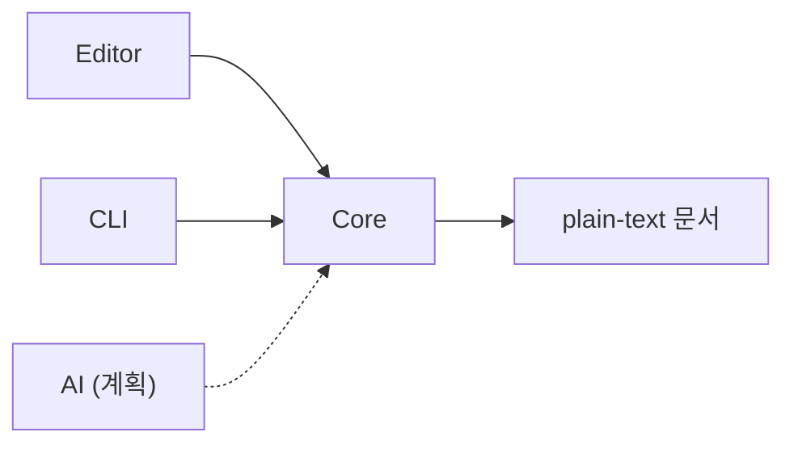

# Litzio

> Document first. Semantics in Core. Interfaces replaceable.

Litzio is a visual editor for structured technical documents, backed by a shared headless Core and Git-friendly plain text.
Currently available as a Windows Beta. The primary documentation is in Korean.

The name Litzio means connecting input/output (I/O) with Litz wire.
Litzio(리치오)는 Litz wire로 입출력(I/O)을 잇는다는 뜻입니다.

표·수식·참조가 있는 기술문서를 시각적으로 작성하고, 사람이 읽을 수 있는 plain-text 파일로 Git에서 관리합니다. Editor와 CLI·자동화는 같은 Core로 문서를 읽고 수정합니다.
**Litzio 네이티브 문서만 열 수 있으며, 일반 Markdown 편집기나 Import 도구는 아닙니다.** Windows x64 Beta 단계이고 Stable은 아직 없습니다. 공개 API와 문서 지원 범위는 바뀔 수 있습니다.


<a id="windows-desktop"></a>

소스 빌드의 제품 이름·CLI·설치 식별자는 [brand.ts](brand.ts)에서 정하며 공식 기본값은 Litzio다. [패키저 안내](docs/guides/branding.md)를 따른다. 아래 공개 Beta 기록은 #859 이전 이름을 유지하며 새 식별자로의 이전을 제공하지 않는다.

## 설치하고 시작하기

1. [Releases 목록](https://github.com/litzio/litzio/releases)에서 사용할 Beta의 **Assets**를 열고 `IeumDoc-Setup-<버전>.exe`를 내려받아 실행합니다. 현재 사용자에게 설치하며 관리자 권한이나 별도 Node.js·pnpm이 필요하지 않습니다.
2. **unsigned Beta**이므로 알 수 없는 게시자 또는 SmartScreen 경고가 나타날 수 있습니다. 공식 저장소의 다운로드인지 확인하고 PC의 보안 정책을 따르세요.
3. 시작 화면에서 sample을 선택하거나 **Open folder**로 폴더를 연 뒤 Sidebar의 `.md` 또는 `.txt` 파일을 선택합니다. **New file**로 새 문서를 만들고, 편집 후 **Save**로 저장할 수 있습니다.

Desktop 시작 화면이나 Command center의 **샘플 문서 열기**에서 현재 UI 언어에 맞는
한국어·영어 전력 변환기 제어 설계 노트를 열어 직접 고칠 수 있습니다. 표·수식·그림·Mermaid,
상호참조·미주·인용과 참고문헌을 함께 담습니다. 수정한 사본은 앱에 포함된 샘플 버전이
바뀔 때 앱이 소유를 확인한 경우에만 교체됩니다. 개발 Editor에서도 같은 샘플을 제공하며 HTTP Host는 제외합니다.
[샘플 배포 계약](docs/design/desktop-distribution-v1.md#native-sample)을 따릅니다.

Settings → About에서 버전·업데이트를 확인합니다. 업데이트 다운로드와 설치는 사용자 요청 후 진행합니다([Desktop 계약](docs/design/desktop-distribution-v1.md)). 공개 설치본의 변경 사항과 검증 범위는 각 Release 본문과 [릴리스 기록](docs/README.md#verification)을 확인하세요. 현재 공개 [v0.0.2-beta.4의 배포·검증 기록](docs/releases/v0.0.2-beta.4.md)과 직전 [v0.0.2-beta.3 기록](docs/releases/v0.0.2-beta.3.md)을 확인할 수 있습니다.
지원 대상은 최소 **640px**의 데스크톱급 창과 키보드·포인터 입력입니다([ADR-0010](docs/adr/0010-supported-viewport-and-input.md)).

<a id="document-compatibility-and-preservation"></a>

## 문서와 저장

- **네이티브 편집과 텍스트 모드:** 구조화 편집에는 YAML frontmatter의 `litzio: 1` 표식과 지원되는 본문이 모두 필요합니다. 미호환 `.md`와 `.txt`는 서식·미리보기 없는 텍스트 모드로 열며, 입력한 텍스트를 저장합니다. 네이티브 문서는 계속 Core의 검증·canonical 저장을 따릅니다. 일반 Markdown 자동 변환이나 Migration은 제공하지 않습니다([문서 지원 계약](docs/design/document-support-v1.md)).
- **Canonical 저장:** 의미를 검증한 Markdown/MyST를 UTF-8·LF로 저장합니다. 원래 formatting이나 바이트를 그대로 보존하는 계약은 아닙니다.
- **명시적 저장과 로컬 복구:** 복구 기록은 원본과 분리된 미저장 작업의 사본이며 **자동 저장이 아닙니다**. 보관·복원 범위와 한계는 [세션·저장 계약](docs/design/editing-session-save-v1.md#local-recovery-records-296-pr2)을 따릅니다.
- **파일과 assets:** 원본 `.md`가 저장의 기준입니다. 붙여넣기·drop한 이미지는 문서 옆 `assets/`에 저장되므로 문서와 함께 옮겨야 상대 경로가 유지됩니다([파일·asset 계약](docs/design/filesystem-host-boundary-v1.md#asset-host-contract-v1-59)).

<a id="why-litzio"></a>
<a id="current-capabilities"></a>
<a id="project-status-and-non-goals"></a>

## 할 수 있는 일과 현재 제한

아래는 현재 master의 기능 개요입니다. 공개 설치본의 기능은 해당 Release를 확인하세요.

- **시각적 편집:** 제목·문단·중첩 목록·코드·인용문·admonition과 inline formatting, 연속 편집·Undo/Redo·블록/섹션 이동.
- **기술문서 저작:** 표·그림·수식, caption·label·상호참조·번호, 미주·인용과 BibTeX 참고문헌.
- **로컬 파일 작업:** 여러 폴더·문서 탭, Outline·읽기 전용 Source, 외부 변경 충돌 확인과 미저장 작업 보호.
- **CLI·자동화:** Editor와 같은 Core를 이용한 문서 검사·의미 기반 수정·검증과 canonical 저장.

블록별 지원 조건은 [현재 계약 색인](docs/README.md#current-implemented-contracts)을 따릅니다. 전용 AI/MCP 인터페이스, 자동 저장, 협업, workspace/Git 관리 UI는 아직 제공하지 않습니다.

<a id="getting-started"></a>
<a id="core-and-cli"></a>
<a id="requirements"></a>
<a id="install"></a>
<a id="visual-editor"></a>

## CLI·개발 실행·HTTP

개발 checkout의 시작 예입니다. Node.js·pnpm 요구 버전과 검증 절차는 [기여 안내](CONTRIBUTING.md#development-requirements)를 먼저 확인하세요.

```bash
git clone https://github.com/litzio/litzio.git
cd litzio
pnpm install --frozen-lockfile
pnpm editor
```

`http://127.0.0.1:5173`에서 개발 Editor를 엽니다. 소스 실행은 공개 설치본과 기능 시점이 다를 수 있습니다.

```bash
pnpm cli help
pnpm cli check apps/editor/document/technical-document.md
pnpm cli inspect apps/editor/samples/ko/converter-control.md --format json
pnpm cli docling convert /path/to/document.json --output /path/to/new-folder
```

문서를 수정할 때는 저장소 밖의 사본을 사용하세요. 단건 명령은 `help <command>`, 여러 수정은 [배치 예제](docs/design/filesystem-host-boundary-v1.md#cli-batch-application-215)를 참고합니다.
`inspect`로 경로와 revision을 확인하고 [`--if-revision`](docs/design/filesystem-host-boundary-v1.md#cli-revision-precondition-214)으로 외부 변경을 보호하며, [`--dry-run`](docs/design/filesystem-host-boundary-v1.md#cli-dry-run-292)으로 쓰기 전에 확인할 수 있습니다. [버전 출력·Desktop CLI 설정](docs/design/desktop-distribution-v1.md#optional-command-line-tools-604)도 제공합니다.

[Docling 변환](docs/design/docling-conversion-v1.md)은 DoclingDocument 1.10.0 문서 전체를 새 폴더의 Litzio 문서·블록 대응표·이미지로 만듭니다. 변환하지 못한 요소와 장식 요소는 대응표에서 구분합니다.

<a id="standalone-http-editor"></a>

서버에서 실행하려면 [HTTP Host 빌드·실행](docs/design/http-host-v1.md#build-and-run)을 따릅니다. CI/local 배포물이며 공개 npm 패키지는 아닙니다. 서버의 허용 폴더에 접근하고 내장 인증이 없으므로 원격 사용에는 접근 제어된 프록시/사설망과 명시적 `--public-origin`이 필요합니다([접근 경계](docs/design/http-host-v1.md#http-and-remote-access)).

<a id="architecture"></a>

## 설계 방향



문서가 본체이며 사람이 읽을 수 있는 plain-text를 단일 진실 공급원으로 유지합니다.
문서의 의미·변경 규칙·검증·canonical 직렬화는 UI에 종속되지 않는 Core가 소유합니다.
Editor와 CLI는 Core를 연결하며, 향후 AI 인터페이스도 같은 의미 계약을 사용하도록 설계합니다.
승인된 결정과 구현 계약은 [문서 색인](docs/README.md)에서 확인합니다.

<a id="documentation"></a>
<a id="contributing"></a>
<a id="license"></a>

## 문서·기여·라이선스

[문서 색인](docs/README.md)에서 현재 계약·설계 결정·릴리스 기록·검증 안내를 찾을 수 있습니다.
개발·검증·PR 절차는 [CONTRIBUTING](CONTRIBUTING.md), AI agent의 작업 제약은 [AGENTS](AGENTS.md)를 따릅니다. 제안과 문제 보고에는 [이슈 작성 안내](docs/contributing/issues.md)와 [표준 템플릿](https://github.com/litzio/litzio/issues/new/choose)을 사용하세요.
[MIT License](LICENSE)에 따라 사용·수정·재배포할 수 있습니다.
