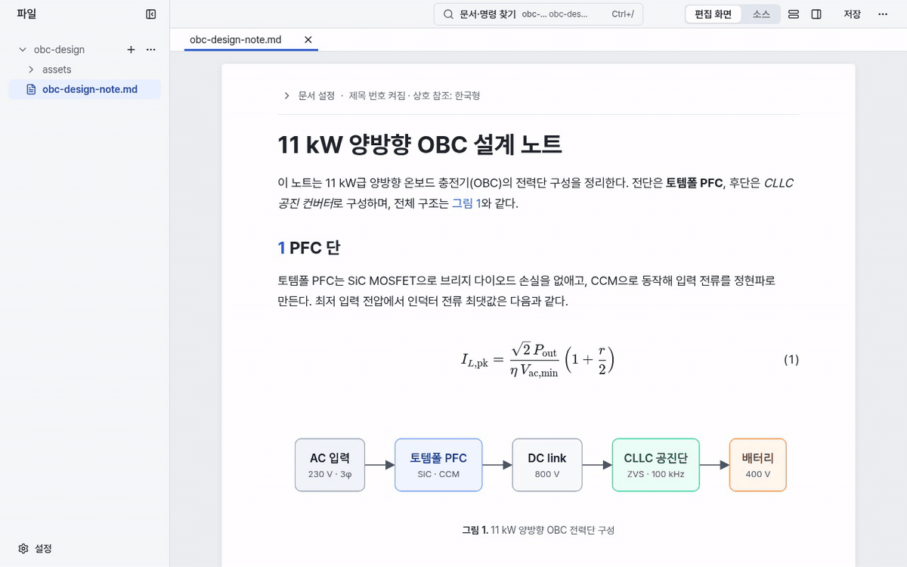
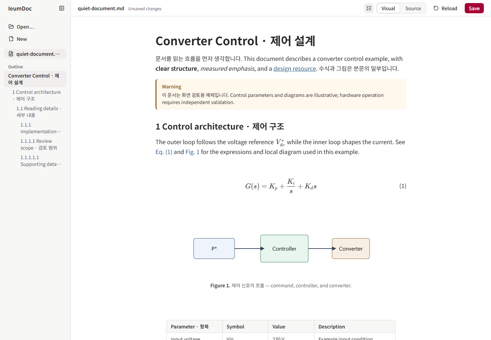
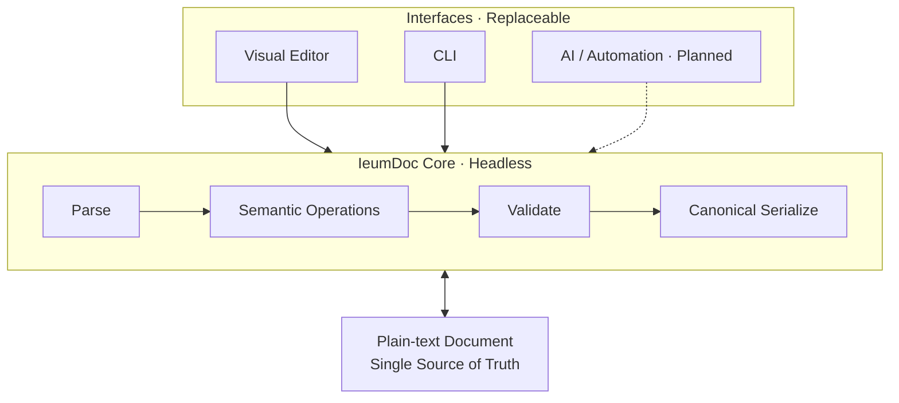

# IeumDoc

> Document first. Semantics in Core. Interfaces replaceable.
>
> **Status: Beta** — [v0.1.0-beta.2](https://github.com/ieumbird/ieumdoc/releases/tag/v0.1.0-beta.2)가 Windows x64 설치형 앱으로 공개되었습니다. Stable은 아직 없습니다. 공개 API·문서 지원 범위는 바뀔 수 있습니다.

IeumDoc은 Git의 plain-text 문서를 단일 진실 공급원(SSOT)으로 사용하는 구조화 기술문서 에디터입니다.

사람은 WYSIWYG Visual Editor로 작성하고 CLI는 동일한 headless semantic Core로 문서를 읽고 수정합니다. AI·automation도 같은 Core를 사용하도록 설계되어 있지만, 전용 AI/MCP interface는 아직 제공하지 않습니다.



먼저 원하는 경로를 선택하세요.

- **설치해서 사용하기**: [Windows Desktop](#windows-desktop)
- **기존 문서를 열기 전 확인하기**: [문서 호환성과 저장](#document-compatibility-and-preservation)
- **현재 master 개발 실행하기**: [Getting started](#getting-started)
- **CLI로 문서 확인·수정하기**: [Core and CLI](#core-and-cli)



2026-10-06 Visual Language v2의 실제 Editor capture입니다. 이후 추가된 Open folder와 Wide document control은 이 이미지에 포함되지 않습니다.

## Windows Desktop

일반 사용자용 공개 버전은 **v0.1.0-beta.2** Windows x64 Beta입니다. Stable은 아직 없습니다. 아래 개발 실행과 달리, 설치된 앱에는 별도 Node.js, pnpm, 브라우저나 Vite 서버가 필요 없습니다.

1. [공개 Beta Release](https://github.com/ieumbird/ieumdoc/releases/tag/v0.1.0-beta.2)의 **Assets**에서 `IeumDoc-Setup-0.1.0-beta.2.exe`를 다운로드하고 실행합니다. 현재 사용자에게 설치하며 관리자 권한이 필요하지 않습니다.
2. 설치 파일은 unsigned이므로 알 수 없는 게시자 또는 SmartScreen 경고가 나타날 수 있습니다. 공식 저장소의 다운로드인지 확인하고 PC의 보안 정책을 따르세요.
3. 시작 화면에서 폴더 또는 sample을 선택합니다. **Open folder**로 폴더를 열고 Sidebar의 네이티브 `.md` 파일을 선택하거나 **New file**로 새 문서를 만듭니다. 편집 후 **Save**로 저장합니다. 기억한 탭이 있으면 시작 시 복원합니다.

이 공개 버전에는 표·그림·수식·참조와 인용/BibTeX 참고문헌 저작, 한국어·영어 UI, 여러 폴더·문서 탭, 미저장 작업의 로컬 복구가 포함됩니다. **복구는 원본 파일의 자동 저장이 아닙니다.** 변경 사항과 알려진 제한은 [v0.1.0-beta.2 릴리스 기록](docs/releases/v0.1.0-beta.2.md)을 확인하세요. 아래 [Current capabilities](#current-capabilities)와 설계 계약은 현재 master 기준이며 공개 버전의 기능 목록을 대신하지 않습니다.

beta.2는 테마·문서 표현 설정, 표·그림 목록 탐색과 선택적 내장 CLI를 제공합니다. 개발 단계이므로 beta.1에서 저장한 문서·복구 기록·설정과의 하위 호환성을 보장하지 않으며 자동 migration을 제공하지 않습니다. 실제 GitHub beta.1→beta.2 업데이트는 이번 릴리스에서 미검증입니다.

Sidebar 하단 **Settings → About**에서 버전, Stable/Beta 채널과 업데이트를 확인합니다. Beta 설치본은 첫 실행에 Beta 채널을 선택하며 저장된 선택은 유지합니다. 업데이트 확인은 자동이고, **Download update**와 **Restart to update**는 각각 사용자 요청 후 실행합니다. 미저장 작업이 있으면 업데이트 재시작을 거부합니다. 상세 동작은 [Desktop contract](docs/design/desktop-distribution-v1.md), 개발자 빌드·릴리즈는 [Contributing](CONTRIBUTING.md#windows-desktop-builds-and-releases)을 따릅니다.

## Document compatibility and preservation

IeumDoc은 **byte-preserving Markdown editor가 아닙니다**. 지원 가능한 Markdown/MyST를 semantic document로 읽고 공식 write path에서 canonical Markdown을 생성합니다. 파일 출력은 UTF-8이며, CRLF와 mixed EOL은 LF로 정규화합니다. formatting과 원래 bytes를 그대로 유지하는 계약은 아닙니다.

[ADR-0006](docs/adr/0006-native-document-boundary.md)에 따라 `ieumdoc: 1` 표식과 지원되는 본문을 가진 네이티브 문서만 엽니다. 미지원 내용·메타데이터가 있으면 문서 전체를 거부하며, 기존 편집 내용은 유지합니다. New file 또는 `ieumdoc create <file>`로 새 문서를 만듭니다.

**이전 버전 문서라도 표식이 없으면 거부하며 Migration은 제공하지 않습니다.** 부분 편집·미지원 문서의 read-only 화면·block source editing은 제거되었습니다. 문서 전체 Source는 적용된 내용을 Core로 직렬화한 읽기 전용 preview입니다. [v0.0.1-beta.4 릴리스 기록](docs/releases/v0.0.1-beta.4.md)를 참고하세요.

외부 앱의 rich HTML clipboard에는 별도 import 정책이 적용됩니다. 지원되는 구조로 붙여넣고, 보존하지 못하는 formatting은 안내하며, 표현할 수 없는 구조는 이유와 함께 거부합니다. 자세한 범위는 [Document support](docs/design/document-support-v1.md), [Continuous editing](docs/design/document-editing-v1.md)을 참고합니다.

원본 `.md` 파일이 저장의 기준이며 이미지 붙여넣기·drop은 문서 옆 `assets/`에 저장합니다. 함께 옮겨야 상대 경로가 유지됩니다([파일·asset 계약](docs/design/filesystem-host-boundary-v1.md)). 명시적 Save와 원본에서 분리된 로컬 복구의 범위·한계는 [Editing session and Save](docs/design/editing-session-save-v1.md#local-recovery-records-296-pr2)를 따릅니다.

## Why IeumDoc

사람에게는 편하게 작성할 수 있는 문서이고, 기계에게는 신뢰성 있게 이해하고 수정할 수 있는 문서를 만드는 것이 목표입니다.

- Git에서 관리 가능한 사람이 읽을 수 있는 plain-text 문서
- 복잡한 기술문서를 위한 WYSIWYG 편집 환경
- 표, 그림, 수식, 참조 등 구조화된 콘텐츠
- Editor, CLI와 향후 AI·automation이 공유하는 하나의 headless Core
- 신뢰할 수 있는 문서 변경을 위한 검증과 canonical serialization

## Current capabilities

**현재 master에 구현된 범위**입니다. 공개 설치본의 변경 사항은 위 릴리스 기록, 블록별 세부 지원 조건은 [문서 지원 계약](docs/design/document-support-v1.md)을 따릅니다.

- **공유 Core / CLI**: 문서 읽기, 의미 기반 수정, 검증과 canonical MyST Markdown 저장. Editor와 CLI가 같은 headless Core를 사용합니다.
- **Visual Editor**: H1–H6, 문단, 중첩 목록, 인용문, 코드, 구분선, standard admonition과 지원되는 inline formatting. 연속 편집, hard break, selection/clipboard, Undo/Redo, Markdown shortcut과 block/section 이동을 제공합니다([편집 계약](docs/design/document-editing-v1.md)).
- **기술문서 저작**: 표·그림·수식의 편집, caption·label·reference와 표시 번호, H2–H6 번호, 미주, 인용과 BibTeX 기반 참고문헌. 이미지 없는 Pending Figure도 저장·참조한 뒤 이미지를 연결할 수 있습니다. 각 지원 조건은 [현재 계약 색인](docs/README.md#current-implemented-contracts)에서 확인합니다.
- **로컬 파일 작업**: 여러 폴더와 문서 탭, 현재 문서 Outline, Source preview, 외부 변경의 Save conflict와 미저장 작업 보호. Save 뒤에도 selection과 Undo/Redo history를 유지합니다([세션·저장 계약](docs/design/editing-session-save-v1.md)).

## Getting started

아래는 **현재 master를 clone해 개발 실행하는 절차**입니다. 공개 설치본과 시점이 다를 수 있습니다. 일반 사용자용 설치는 위 [Windows Desktop](#windows-desktop)을 따릅니다.

### Requirements

Node.js `>=24.21.0 <25`, pnpm `12.5.1`이 필요합니다. 기준은 루트 `package.json`입니다.

### Install

```bash
git clone https://github.com/ieumbird/ieumdoc.git
cd ieumdoc
pnpm install --frozen-lockfile
```

### Visual Editor

```bash
pnpm editor
```

`http://127.0.0.1:5173`을 엽니다. 명시적 시작 경로와 유효한 탭 탐색 기억이 없는 첫 실행에는 기본 문서 `apps/editor/document/technical-document.md`를 엽니다. 이후 시작·탭 복원은 [세션 계약](docs/design/editing-session-save-v1.md#tab-navigation-memory-383)을 따릅니다. 검증에는 원본 문서 대신 [scratch fixture 절차](docs/test/TEST_GUIDE.md#browser-regression)를 사용합니다.

검증 명령과 작업별 필수 범위는 [Contributing의 verification matrix](CONTRIBUTING.md#verification-matrix), browser·수동 확인은 [검증 안내](docs/test/README.md)에 있습니다.

### Core and CLI

개발 checkout에서 같은 Core로 문서를 검사합니다. 파일을 수정하는 명령은 fixture 대신 저장소 밖의 문서 사본에서 실행하세요.

```bash
pnpm ieumdoc help
pnpm ieumdoc --version
pnpm ieumdoc check apps/editor/document/technical-document.md
pnpm ieumdoc inspect apps/editor/document/technical-document.md
pnpm ieumdoc help apply-batch
```

단건 수정은 `pnpm ieumdoc help <command>`, 여러 수정은 `apply-batch`를 사용합니다. 편집 전 `inspect --format json`으로 현재 경로와 revision을 확인하고, `--if-revision`으로 변경을 보호하며 `--dry-run`으로 미리 확인할 수 있습니다. 옵션·출력·오류의 상세는 CLI help와 [revision 계약](docs/design/filesystem-host-boundary-v1.md#cli-revision-precondition-214), [배치 계약](docs/design/filesystem-host-boundary-v1.md#cli-batch-application-215), [미리보기 계약](docs/design/filesystem-host-boundary-v1.md#cli-dry-run-292)을 참고하세요.

`--version`은 단독으로 사용하며 빌드된 CLI는 `ieumdoc <패키지 버전> (<빌드 커밋>)`, Desktop 내장 CLI는 `ieumdoc <Desktop 버전> (desktop, <빌드 커밋>)` 한 줄을 출력합니다. Git을 사용할 수 없는 빌드는 커밋을 `unknown`으로 표시합니다. 소스 checkout의 `pnpm ieumdoc --version`은 `ieumdoc development (unknown)`입니다.

여러 변경은 `apply-batch`로 한 번에 적용합니다. 아래 예제는 저장소 밖의 기존 임시 폴더에 아직 없는 `document.md`를 만들고, H1 제목만 추가한 상태에서 시작합니다. 명령은 저장소 루트에서 실행하며, `<임시 폴더>`는 실제 절대 경로로 바꿉니다.

```bash
pnpm ieumdoc create "<임시 폴더>/document.md"
pnpm ieumdoc insert-heading "<임시 폴더>/document.md" --at end --level 1 --text "Example document"
pnpm ieumdoc inspect "<임시 폴더>/document.md" --format json
```

이 상태의 Core snapshot은 metadata가 인덱스 0, H1 제목이 경로 `[1]`이며 다른 본문은 없습니다. 다음 두 작업은 H2를 끝(인덱스 2)에 삽입한 뒤 그 heading을 수정합니다. 제목은 첫 본문 위치에 유지합니다. 같은 임시 폴더의 `operations.json`에 저장합니다.

```json
[
  { "command": "insert-heading", "at": "end", "level": 2, "text": "Method" },
  { "command": "update-heading", "path": "2", "content": [{ "kind": "text", "text": "Verified method" }] }
]
```

```bash
pnpm ieumdoc apply-batch "<임시 폴더>/document.md" --operations "<임시 폴더>/operations.json" --if-revision <위 inspect에서 얻은 revision> --format json
pnpm ieumdoc check "<임시 폴더>/document.md"
```

배치의 경로·인덱스는 직전 단계 결과 기준이며 자동 추적되지 않습니다. 후속 변경 전에는 `inspect`를 다시 실행해 새 revision과 경로를 함께 얻습니다.

### Standalone HTTP Editor

현재 master에서 Node 기반 production Editor와 파일 API를 함께 실행하는 배포물을 만들 수 있습니다. [HTTP Host의 빌드·설치·실행](docs/design/http-host-v1.md#build-and-run)과 [Contributing](CONTRIBUTING.md#http-host-builds)을 따릅니다. 이것은 CI/local 산출물이며 공개 npm 패키지나 NAS 자동 배포가 아닙니다.

HTTP Host는 서버의 허용된 폴더에 접근하며 내장 인증이 없습니다. 원격 접속에는 접근 제어된 프록시/사설망과 명시적 `--public-origin`이 필요합니다([접근 경계](docs/design/http-host-v1.md#http-and-remote-access)).

## Architecture

현재 Editor와 CLI가 공유하는 Core와, 향후 연결할 interface의 관계입니다. 점선은 계획된 interface입니다.



> Document First — 문서가 본체다.
>
> Core Owns Semantics — 문서의 의미와 변경 규칙은 Core가 책임진다.
>
> Interfaces Are Replaceable — 인터페이스 교체가 Core 의미 계약을 바꾸지 않도록 한다.
>
> Writes Are Valid and Canonical — 공식 경로로 저장된 문서는 유효하고 안정적으로 다시 처리 가능해야 한다.

Architecture decisions:

- [ADR-0001: Single-document editor architecture](docs/adr/0001-single-document-editor-architecture.md)
- [ADR-0002: Document persistence and semantic ownership](docs/adr/0002-document-persistence-semantic-ownership.md)
- [ADR-0003: Document addressing and identity boundary](docs/adr/0003-document-addressing-identity-boundary.md)
- [ADR-0004: Desktop Host and distribution](docs/adr/0004-desktop-host-distribution.md)
- [ADR-0005: Standalone HTTP Host](docs/adr/0005-http-host.md)

## Project status and non-goals

`apps/editor/server`의 stateless 파일 handler는 Vite, Desktop, HTTP Host가 재사용하며 장기 backend 결정이 아닙니다.

**Planned direction:** AI/MCP integration과 broader automation, cross-document identity, transclusion·requirement semantics는 후속 설계 대상입니다. 다음 milestone 후보인 [두 문서의 Requirement·TestCase 연결 → CLI 누락 조회 → Editor 관계 탐색](https://github.com/ieumbird/ieumdoc/issues/347)은 범위와 identity 선행 결정이 필요한 Proposed 상태이며 구현 승인이 아닙니다. [Desktop/VS Code spikes](docs/README.md#historical-reviews-and-spikes)는 당시 실험 근거이며, Desktop 제품 채택의 현재 authority는 [ADR-0004](docs/adr/0004-desktop-host-distribution.md)입니다.

자동 저장은 [보류](docs/adr/0007-editing-session-lifetime.md#1-저장은-명시적-동작이며-자동-저장은-보류한다)되어 있으며 collaboration, workspace/Git 관리 UI는 제공하지 않습니다. 문서의 의미는 Core가 소유하고 인터페이스는 이를 연결한다는 원칙을 유지합니다.

## Documentation

[docs/README.md](docs/README.md)에서 Accepted ADR, current design contract, historical review와 검증 문서를 찾을 수 있습니다. 문서의 권위와 갱신 규칙은 [Documentation governance](docs/contributing/documentation-governance.md)를 따릅니다.

## Contributing

개발 환경·검증·PR 절차는 [CONTRIBUTING.md](CONTRIBUTING.md), 작업·아키텍처 제약과 AI commit provenance는 [AGENTS.md](AGENTS.md)를 먼저 읽어 주세요. [표준 issue template](https://github.com/ieumbird/ieumdoc/issues/new/choose)과 [이슈 작성 안내](docs/contributing/issues.md)를 제공합니다.

## License

[MIT License](LICENSE). 누구나 license 조건에 따라 사용·수정·재배포할 수 있습니다.
