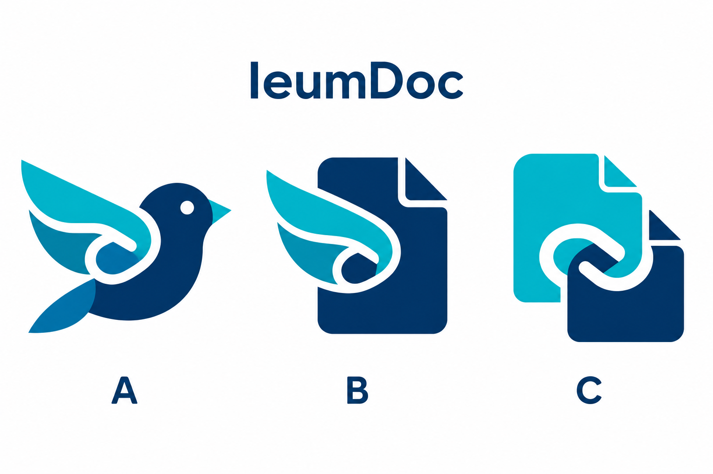

# Desktop app icon: selection and implementation plan

- Status: Historical
- Last verified: 2026-10-13 (live GitHub avatar/social preview and current Desktop packaging inspected; the user selected B — wing and document).
- Scope: preparation and the selected icon direction for [#170](https://github.com/ieumbird/ieumdoc/issues/170). B was selected as the concept. The subsequent [app icon contract](app-icon-v1.md) owns production artwork, integration and verification. No release is authorized by this document.
- Authority: [AGENTS.md](../../AGENTS.md), [Desktop distribution](desktop-distribution-v1.md), and the user's visual selection.

## Working state

Worktree: `C:\Projects\ieumdoc-170-icon`; branch: `design/170-app-icon`; starting commit: `980f60e7b8d0dfb9caedc5150039ae7a616f5cb4`.

This stage prepared three alternatives. The user selected **B — 날개와 문서 결합** on 2026-10-13 without additional modifications. Existing application assets, packaging behavior and public releases are unchanged.

## Existing GitHub identity

The current [Ieumbird organization](https://github.com/ieumbird) avatar is a right-facing bird: dark navy head/body, cyan/teal wing and beak, and a white flowing link-shaped gap inside the wing. The live [IeumDoc repository](https://github.com/ieumbird/ieumdoc) header and generated social preview use that same organization avatar. No separate IeumDoc product mark was found in the repository's tracked assets or README. The Windows packaging configuration currently specifies no custom icon.

- [Downloaded organization reference](assets/app-icon-170/github-ieumbird-reference.png), from [GitHub avatar](https://avatars.githubusercontent.com/u/331890781?v=4).
- [Downloaded repository social preview](assets/app-icon-170/github-ieumdoc-reference.png), retrieved from the live repository's `og:image` metadata.
- These are source references, not newly authored icons. The original SVG or other editable logo source has not been located in this repository.

## Concepts for selection

| Choice | Direction | Decision to make |
| --- | --- | --- |
| [A — 새 계승형](assets/app-icon-170/concept-a-bird.png) | A simplified edition of the existing bird, retaining the wing/link gesture | Strongest direct continuity with Ieumbird |
| [B — 문서 결합형](assets/app-icon-170/concept-b-wing-document.png) | A document and folded wing form one mark, carrying the link-shaped gap | Give IeumDoc a document identity within the bird family |
| [C — 연결고리 중심형](assets/app-icon-170/concept-c-linked-pages.png) | Two page-like forms connect through one open channel | Emphasize connected document structure with an abstract mark |

Shared exploration constraints: navy/cyan/white, generous negative space, bold silhouettes, no lettering, no tiny document lines, and an opaque light tile with transparent outer corners. Palette values in the prompts are visual approximations for exploration, not measured brand specifications.

The built-in `image_gen` tool creates raster concepts using the downloaded organization avatar as a reference. The complete [prompt set](assets/app-icon-170/prompts.json) and [comparison-sheet prompt](assets/app-icon-170/comparison-prompt.txt) are retained. These pictures are selection material; they are not editable production SVG or verified Windows icons. The generated transparent-edge fringe and small-size optical details will be resolved in the chosen vector original, rather than treated as production-quality alpha.

**Selected direction: B — 날개와 문서 결합.** The user explicitly selected B after viewing the comparison. It retains the family's recognizable cyan wing and white connection-shaped gap, together with a navy document silhouette and folded corner. Use [the B source concept](assets/app-icon-170/concept-b-wing-document.png) as the production design reference. A and C are retained only as rejected exploration alternatives.

Preserve B's document/wing relationship, cyan/navy palette and open white gap during vector refinement. Clean transparent edges and optically simplify small-size details; do not silently switch to the bird-only A or linked-pages C direction.

## Implementation preparation

1. Refine the chosen silhouette and prepare an editable vector original. Record creation method and the provenance of the existing brand reference.
2. Export PNG/ICO representations for Windows packaging, including small icon sizes. Check actual 16/20/24/32/48 px readability and light/dark surfaces; large concept renders alone cannot establish this.
3. Apply only the selected icon to Desktop packaging and the runtime window where needed. Keep app identity, update channels, document semantics and public release assets intact.
4. Build a clean Windows package and check the EXE, installer, shortcuts and taskbar display. Run relevant Desktop package/runtime regressions and documentation checks. Browser branding is outside #170 unless separately included.

Preparation was completed with B selected and all references/prompts retained. The [implementation contract and verification](app-icon-v1.md) records the next stage. Release publication remains a separate action.
