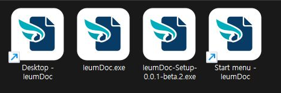
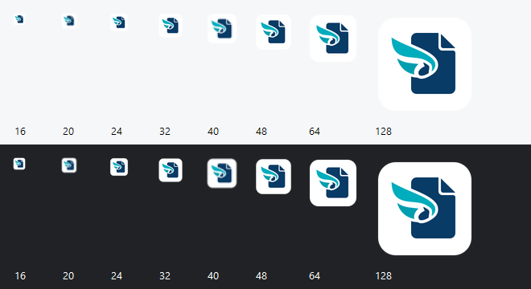

# Desktop app icon v1

- Status: Implemented
- Last verified: 2026-10-13 (Windows implementation for #170; validation evidence below).
- Scope: Windows Desktop EXE, NSIS installer/uninstaller, shortcuts and runtime window. Browser branding, app identity, versions and release publication are outside this change.
- Authority: [ADR-0004](../adr/0004-desktop-host-distribution.md), [Desktop distribution](desktop-distribution-v1.md), and the user's [B concept selection](app-icon-v1-plan.md).

## Artwork and provenance

The mark combines a navy document with a folded corner, a cyan wing and an open white connecting gap. The white rounded tile preserves contrast on light and dark Windows surfaces; outside its corners is transparent. It has no text, fonts, embedded bitmap or external SVG resources.

- Editable original: [icon.svg](../../apps/desktop/assets/icon.svg).
- Windows asset: [icon.ico](../../apps/desktop/assets/icon.ico), with 16, 24, 32, 48, 64, 128 and 256 px frames.
- [Production preview](assets/app-icon-170/production.png).
- Palette: navy `#083b66`, cyan `#00adbd`, lower wing `#009eaf`, white `#ffffff`.

The SVG paths were authored for IeumDoc on 2026-10-13 by Codex, refining the B raster concept explicitly selected by the user. The concept was created with the built-in image generation tool; the [prompts and input references](app-icon-v1-plan.md#existing-github-identity) are retained. The original GitHub organization avatar informed the family colors and wing/link motif. Its downloaded pixels and the rejected concepts are review references and are not shipped in the application. No stock icon pack, external font, or third-party SVG was used. The authored SVG and derived ICO are supplied under the repository's [MIT license](../../LICENSE).

## Regeneration and integration

From the repository root after the frozen install:

```powershell
pnpm --filter @ieumdoc/desktop icons
pnpm --filter @ieumdoc/desktop package
```

`icons` uses the icon toolset already pinned and checksum-verified by electron-builder 26.15.3 (icons 1.1.0). It renders the SVG and writes the tracked ICO; no additional image dependency or custom encoder is introduced. The helper uses an internal builder entry point, so a builder upgrade must recheck regeneration. Packaging uses the committed ICO and does not need icon conversion. Commit the SVG and regenerated ICO together.

The same ICO is configured for `win.icon`, `nsis.installerIcon` and `nsis.uninstallerIcon`. The Desktop build copies it beside the bundled main module, and `BrowserWindow.icon` uses that copy for development and packaged windows. NSIS shortcuts continue to point to the application EXE; product name, App ID, shortcut name, update channels and package version stay unchanged.

This is Host artwork only. It introduces no document semantic operation and therefore no Core or CLI command.

## Verification

Verified on Windows 11 build 26200, at 2560 × 1440 and 96 DPI (100%), on 2026-10-13:

| Check | Result |
| --- | --- |
| Frozen dependency install, Desktop typecheck and existing Desktop tests | Passed; 38 tests |
| Clean normal-version Windows package | Passed; no default-icon fallback; native extraction shows the B mark in both EXE and installer |
| `verify-release.ts --tag v0.0.1-beta.2` | Passed: executable versions, metadata, size, SHA-512 and recomputed blockmap |
| Existing packaged regressions | 8 passed, including Save/reopen, image assets, conflict, close protection and update settings |
| Actual NSIS install/update regression | Passed: local-feed 0.0.1 → 0.0.2, saved document preservation, relaunch and uninstall; followed by another clean normal-version package |
| Separate normal-version install and visual inspection | EXE, installer, NSIS-created Desktop/Start menu shortcuts, running window and taskbar show the same mark |
| Repeated `icons` export | Byte-identical ICO; SHA-256 `7e46053a059187d8eaf7835df88ed7cbbf8a2442060bc5fb111e571cb69934e9` |
| Documentation and diff whitespace checks | Passed |



The Explorer capture shows unmodified hard links to the installed EXE and built installer, and byte-preserving copies of the two shortcuts created by NSIS, gathered in a temporary inspection folder. The shortcut copies are named by origin for comparison. Both originals had target and icon location pointing to the installed `IeumDoc.exe` (icon index 0). This is a native Explorer capture, not a rendered mockup.

- [Installed window and title-bar icon](assets/app-icon-170/windows-app.png)
- [Running taskbar button](assets/app-icon-170/windows-taskbar.png)
- [Installer in its original build folder](assets/app-icon-170/windows-installer.png)



The size sheet uses Windows `System.Drawing.Icon` loading/drawing from the actual ICO. 16/20/24/32 px cover the pixel sizes of a 16 px slot at 100/125/150/200%. The document/wing silhouette remains identifiable; the finest gap detail naturally reduces at 16 px. 20 and 40 px are interpolated by Windows because the converter supplies the standard seven frames; they are softer than native-size frames. The OS display scale itself was left at 100%; the sheet is a size/contrast check, not evidence of changing every system scale setting.

The test installation, registry entry, original shortcuts, app data, updater cache and task-started app/Explorer windows were removed after verification. Existing published Beta assets were not replaced; a subsequent approved Beta release will carry the icon.
