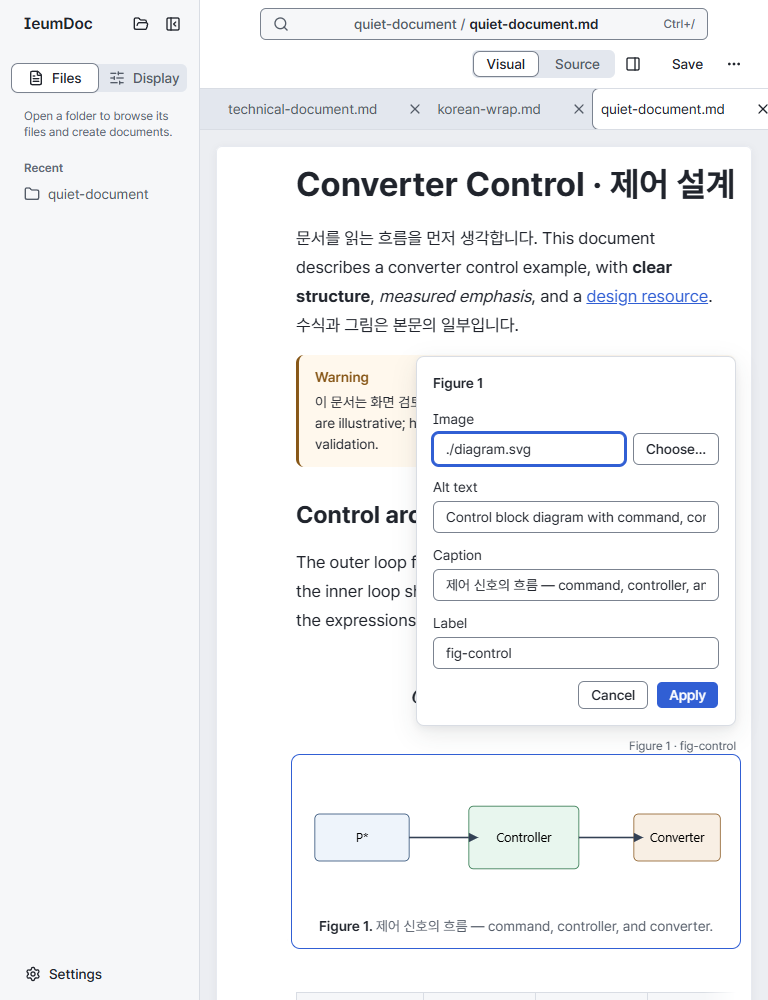
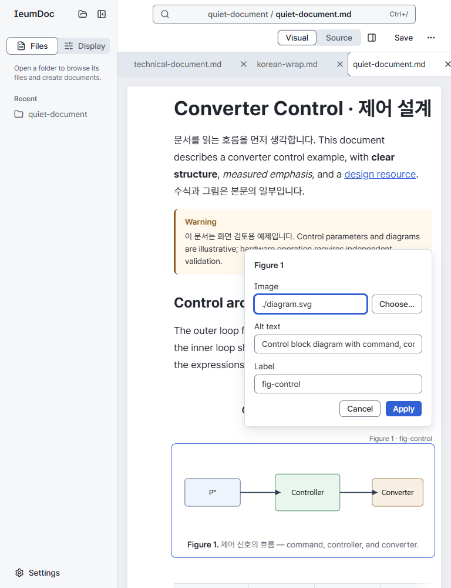
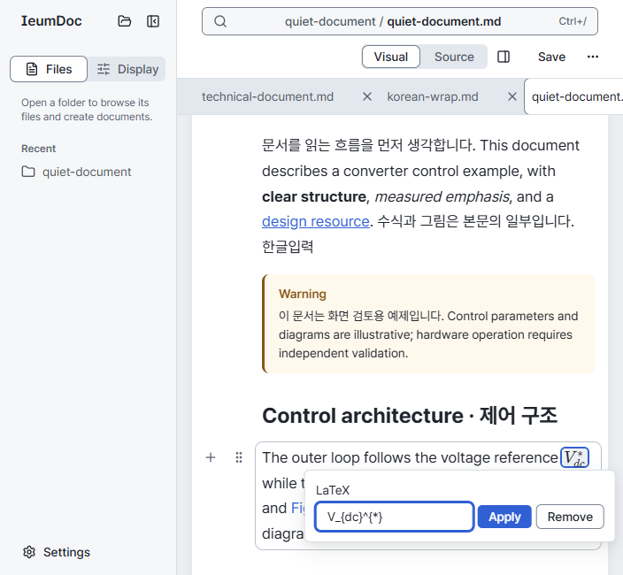
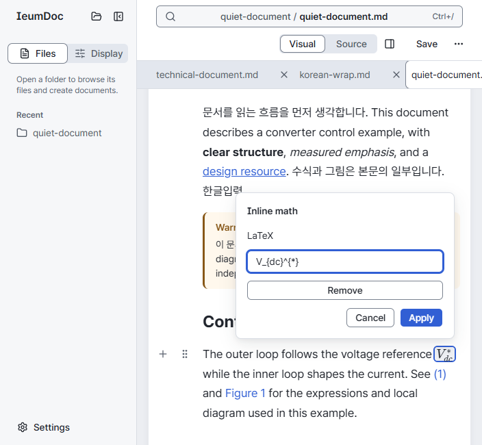

# Editor Visual Language — Quiet Document

- Status: Implemented
- Save refusal verification: 2026-10-28 (#578 phase 1: real collection/Host refusals, danger block/cell overlays, snapshot invalidation, keyboard reveal and [640/1440px light/dark captures](#save-refusal-highlights-578)).
- Block outline verification: 2026-10-28 (#469 follow-up: 1440px/640px full outer-edge and inset-stroke comparison, stationary-pointer scroll suppression; [evidence](#typing-and-outline-verification-469)).
- Last verified: 2026-10-28 (#637: full-column code-style source and draft preview; wider wrapping inline-math popover, with 1440/640px same-state comparison).
- Segment verification: 2026-10-27 (#620: semibold/surface/shadow selection and quiet Command Center border; [checks and Before/After](#quiet-segments-and-command-center-620)).
- File operations verification: 2026-10-27 (#505 / #504 PR A: Editor/Host/Desktop unit tests, workspace typecheck, production Editor build and targeted persistent-Chrome browser checks; packaged Desktop is CI-only).
- Theme verification: 2026-10-27 (#595: System/Light/Dark, six dark accents, independent paper roles, live preferences and native appearance bridge; [values, contrast and captures](#system-light-and-dark-595)).
- Document tab verification: 2026-10-27 (#581: flat bottom accent marker and adjustable 32px height; [comparison and measurements](#slim-document-tabs-581)).
- Document settings verification: 2026-10-27 (#580: inline settings, per-tab expansion, notation previews and existing document operations; [integration, checks and captures](editor-ux-shell-v1.md#document-settings-placement-554)).
- Type-scale verification: 2026-10-27 ([#558](https://github.com/ieumbird/ieumdoc/issues/558): Editor tests, typecheck/build, layout-rules and quiet-document pass; 1440px 15/16px manual comparison remains pending because the Windows account failure counter reached the owner stop threshold of 6).
- Accent verification: 2026-10-27 (#559: six local accent presets, shared interaction/selection/number colors and neutral information states; [contract and contrast results](#single-accent-presets-559)).
- Table handle verification: 2026-10-26 (#517: B2 transparent-rest line handles with S4 neutral current/open states, accessible address names/tooltips, keyboard discovery and touch fallback; [verification and actual Before/After](table-interaction-v1.md#light-handle-verification-and-comparison)).
- Previous verification: 2026-10-26 (#515 P1/P3 owner review correction: contrast-qualified tab edges, 600 list cue and stable Outline row extent; targeted regressions and [1440/390px comparison](editor-visual-language-v1.md#selection-cue-review-correction-515)).
- Previous verification: 2026-10-26 (#515: owner A1 raised tab groups and background-only current lists; targeted browser regressions, Editor tests/typecheck/build and [1440/390px manual comparison](editor-visual-language-v1.md#selection-expression-verification-515)).
- Previous verification: 2026-10-26 (#506: Korean eojeol wrapping with oversized-token fallback; [verification and same-state 1440px/375px captures](#korean-document-wrapping-506)).
- Menu verification: 2026-10-26 (#516: unified action icons/row metrics, destructive token colors, layout-rules/quiet-document regressions and [1440px manual pairs](editor-ux-shell-v1.md#unified-action-menus-516)).
- Shared control verification: 2026-10-26 (#514: B1/C1 shared controls and deliberate exceptions; consumer guard with three rejected mutations, bilingual 1440/390px computed styles, affected interaction regressions and [manual Before/After](#shared-control-verification-514)).
- Previous verification: 2026-10-26 (#511: generated heading/Outline number color; Editor tests, typecheck/build, Outline/layout-rules/quiet-document/visual-states browser checks and [1440px manual comparison](heading-numbering-v1.md#generated-number-color-511--503)).
- Previous verification: 2026-10-26 (#497: document presentation token refactor; Editor tests, typecheck/build, layout-rules/quiet-document/footnotes and [byte-identical 1440px/375px comparisons](#document-presentation-token-verification-497)).
- Previous verification: 2026-10-26 (#480: bounded active-image picker preview, layout-rules/quiet-document, same-state 1440px/375px [captures](folder-picker-v1.md#active-image-preview-480) and byte-identical quiet-document rest pairs).
- Source wrapping verification: 2026-10-26 (#476: Source soft wrapping; Editor tests/typecheck/build, Source/layout/quiet-document browser checks and [1440/375px Before/After](editor-ux-shell-v1.md#source-wrapping-476)).
- Table deletion verification: 2026-10-26 (#474: existing MessageArea/ghost Undo action, 1280/375px English/Korean captures and byte-identical quiet-document rest pairs; [verification](table-interaction-v1.md#table-deletion-notice-verification-474)).
- Previous verification: 2026-10-26 (#469: typing/IME hover suppression, offset-aware Figure/Equation corners, targeted browser regressions and [1440px comparison](#typing-and-outline-verification-469)).
- Previous verification: 2026-10-25 (#438: bibliography connection controls, bilingual notices, 1280/375px captures and unchanged quiet-document rest pairs; [verification](citations-v1.md#bibliography-connection-verification-438)).
- Previous verification: 2026-10-25 (#425: collapsible folder sections; Editor tests/typecheck/build, folder-navigation/folder-memory/command-center/editor-shell/layout-rules/ui-language/quiet-document and [desktop/phone captures](editor-ux-shell-v1.md#section-disclosure-verification-and-captures)).
- Previous verification: 2026-10-24 (#385: Sidebar header entry, Close-only folder menus; folder-navigation browser check, Editor tests/typecheck/build and [same-state desktop/phone evidence](editor-ux-shell-v1.md#sidebar-open-folder-entry-385)).
- Previous verification: 2026-10-24 (#401: long-name/path dialogs at 1440/375px; [measurements and captures](#long-dialog-names-and-paths-401)).
- Previous verification: 2026-10-24 (#395: recovery review path wrapping and footer bounds at 1440/375px; [same-state evidence](editing-session-save-v1.md#recovery-review-layout-395)).
- Previous verification: 2026-10-24 (#382 / #391 review: recovery deletion confirmations, nested backdrop outside dismissal/pending guards; refreshed 1440/375px English/Korean [captures and environment](editing-session-save-v1.md#local-recovery-records-296-pr2)).
- Previous verification: 2026-10-23 (#363 command center; Editor tests, typecheck/build, command-center/editor-shell/document-tabs/ui-language/layout-rules/quiet-document browser checks; [actual captures](editor-ux-shell-v1.md#command-center-verification-363)).
- Previous verification: 2026-10-23 (#265 citation form reusing the reference form surface and existing tokens; [verification and captures](citations-v1.md#unit-c-verification-265)).
- Previous verification: 2026-10-22 (#265 derived References with existing type/spacing tokens; [verification and captures](citations-v1.md#unit-b-verification-265)).
- Previous verification: 2026-10-22 (#217: all-file Sidebar listing, bounded read-only image preview; Host/Editor/Desktop protocol tests and actual Vite/production HTTP browser regressions).
- Previous verification: 2026-10-22 (#332 citation display and shared reference underline token; [verification and captures](citations-v1.md#verification)).
- Previous verification: 2026-10-19 (#255: Add a title place and empty-title placeholder in the document's subtle hint role).
- Previous verification: 2026-10-19 (#298: start without a document on the canvas with the product mark and card sections; open-files captures at 1440/768/375px).
- Previous verification: 2026-10-19 (#321: phone-width sidebar without a rail, covering the screen when open; stable browser suite and 375px captures).
- Previous verification: 2026-10-17 (UX review v4.7: location identity, segmented view control, tab folder labels, unreserved block metadata, overflow fades, Source line numbers, `cv08`; stable browser suite and same-state Before/After in the [review](../reviews/editor-ux-review-2026-10-17.md)).
- Previous verification: 2026-10-16 (#296 PR2: recovery list/dialog/Settings/failure/empty captures at 1440/375px; existing shared tokens and overlay controls).
- Previous verification: 2026-10-16 (#204: tabs reuse product tokens; actual Before/After review approved by the user, with [evidence](../reviews/document-tabs-204-2026-10-16.md)). Previous verification: 2026-10-15 (#281: cross-reference, section-reference, table-authoring, pending-figure, layout-rules and quiet-document browser checks; actual 1440px slash-menu Before/After). Previous verification: 2026-10-15 (#276: save-session browser checks for Reload danger colors, text/control contrast, keyboard focus and in-flight disabled state; same-state 1440/375px Before/After captures). ADR-0006 admission/projection cleanup was checked by code/test comparison only. Previous verification: 2026-10-14 (#225 review fixes: layout-rules, quiet-document, block-move and list-authoring browser checks; gutter/content row hover, adjustable extent expansion, control/neighbor clearance, no-hover suppression, drag priority and 0px text shift; same-state quiet-document Before/After with actual Pretendard glyphs). The #226 paper-surface refinement was previously checked by document/code comparison only. Previous shell verification: 2026-10-13 (#176; [review and verification](../reviews/editor-shell-176-2026-10-13.md)).
- Current contract: v4.8, with the #226 paper-surface refinement and #225 pointer-hover block extent. Historical filename retained for link stability.
- History: v1 implemented 2026-09-25; v2 (chrome recedes) implemented 2026-10-06; v3 (distinct states) 2026-10-08; v4 (TopBar tabs, toggles and Save states) 2026-10-10; v4.1 (TopBar state axes) 2026-10-10; v4.2 (one blue action role, light theme only, #172) 2026-10-12; v4.3 (start without a document, #174) 2026-10-12; v4.4 (in-place footnote regions, #185) 2026-10-12. v4.5 (one trailing endnotes region, #194) 2026-10-12. v4.6 (Files/Display tools and File actions, #176) 2026-10-13. v4.7 (UX review: one meaning for the blue marker, location identity, unreserved metadata, overflow cues) 2026-10-17. v4.8 (owner A1: raised tab groups, background-only list current, existing single block outline, #515) 2026-10-26. Visual approval remains with the user.
- Scope: existing Editor presentation and interaction overlays. Core, CLI, source format, save API and the single Tiptap state are unchanged.

## Quiet segments and Command Center (#620)

All `.view-toggle` consumers share the same selected 600 semibold, themed `surface` and
`--shadow-segment`, without a `border-control` edge. A hidden semibold label reserves width
before selection; inactive text stays muted. Command Center keeps `surface-subtle`, the
structural `border`, neutral hover and the independent focus-visible ring. Input/select and
existing outlined controls retain their boundaries. This is Editor presentation/navigation;
no document semantic operation or CLI command changes.

Editor tests (316), workspace typecheck, production Editor build, docs check and targeted
`visual-states`, `panel-lists`, `layout-rules`, `quiet-document`, `command-center` and
`table-caption` browser scenarios pass. Existing state tests now check 600 weight, themed
surface/shadow, text contrast of at least 4.5:1, independent 2px focus contrast of at least
3:1 and unchanged segment geometry. Panel checks also compare the rendered body caption
prefix to navigation text, keep number-only empty captions and retain English document
notation under Korean UI. Core still owns numbering/templates; body and navigation share
the Editor caption-prefix function, replacing the list's separate colon.

The first PR CI run's artifacts exposed two existing resize-readiness assumptions:
Figure preview checked page overflow immediately after viewport emulation, and the folder
menu-switch check cached TopBar coordinates before the Document panel finished docking.
The tests now wait for the resized document's no-overflow state and the expected docked/closed
panel respectively, retaining the direct geometry assertions and one physical click.
No retry count or timeout was increased.

Manual same-state captures use base `719ee2477fe82e83ad11c9b4ac14d71f5a77f2dc` and `tmp/outline/panel-lists.md`,
with Visual and Tables selected, the right panel open, loaded Pretendard and 900px height.
They are review evidence, not pixel assertions. The temporary capture driver used
`pnpm browser:test`; English/Korean full output and traces remain in ignored
`tmp/quiet-borders-620`, with only these representative English pairs retained:

| Theme | 1440px | 640px |
| --- | --- | --- |
| Light | [Before](assets/quiet-borders-620/before-en-light-1440.png) / [After](assets/quiet-borders-620/after-en-light-1440.png) | [Before](assets/quiet-borders-620/before-en-light-640.png) / [After](assets/quiet-borders-620/after-en-light-640.png) |
| Dark | [Before](assets/quiet-borders-620/before-en-dark-1440.png) / [After](assets/quiet-borders-620/after-en-dark-1440.png) | [Before](assets/quiet-borders-620/before-en-dark-640.png) / [After](assets/quiet-borders-620/after-en-dark-640.png) |

## File context actions (#505 / #504 PR A)

File tree context menus share the dropdown popup and row class constants, including compact
height, icon slot, gap, neutral highlight and keyboard focus ring. Base UI owns menu focus and positioning. Delete rows use the existing danger text/icon and highlighted
surface-danger roles. Target-specific action data supplies content, not a new menu engine.

The shared danger confirmation names the file, starts focus on Cancel, uses the destructive Button
and returns focus to the surviving row/adjacent tree target. Busy confirmation blocks dismissal;
errors retain the dialog. Rename reuses the compact shared Dialog/Input/footer geometry and
shows the fixed extension beside the selected stem. Long descriptions/errors wrap within the
popup. At the supported 640px minimum and at desktop widths, the existing footer retains horizontal actions.
The [shell capture record](editor-ux-shell-v1.md#file-action-verification-and-captures) records both
sizes and light/dark OS preferences, using the current System theme and shared #595 roles.

## Save refusal highlights (#578)

A block that caused Save to be refused uses the #469 measured hover/selection outer rectangle,
`--space-block-hover-inline` / `--space-block-hover-block`, `--size-block-hover-outline` and
`--id-radius-block-hover`, with `--id-color-danger` replacing the stroke color. The absolute
overlay adds no content border or padding. Its visible **Cannot save / 저장 불가** badge supplies
a text cue and accessible text outside editable content. A known table cell has a matching danger
inset stroke clipped to the visible horizontal table viewport. The cell stroke covers the existing
2px current-cell outline; the block keeps #469's 1px stroke. Refusal overlays paint at z-index 2,
above selection's z-index 1 and hover, because selection must not conceal the reason Save stopped.
They are input-transparent and never cover gutter controls with an interactive hit target.
While errors exist, the document isolates its local stacking context so the refusal stroke/badge
cannot paint over the sticky header when a cell is revealed or the reader scrolls.

The existing danger message surface contains a short localized summary, shared compact Button
navigation and native keyboard-accessible collapsed **Technical details**. The original English
diagnostic is preserved there. The state lifetime and snapshot invalidation rules belong to the
[Save contract](editing-session-save-v1.md#refused-block-highlighting-and-navigation-578-phase-1).
This is Editor presentation/navigation; Core semantics and CLI behavior are unchanged.

`pnpm browser:test save-error --screenshots` captures actual refusals at 1440×900 and 640×900,
light/dark, Windows persistent Chrome, DPR 1, 100% zoom and bundled Pretendard. The same-state
Before/After empty-title pairs use base `c8debf3`; table-cell captures additionally show the
localized row/column and selected destination. Images are manual review evidence, not pixel tests.
[Capture metadata and SHA-256 hashes](assets/save-error-578/capture-metadata.json) record the
fixture/state, viewport, theme, fonts, DPR and verified worktree-owned final server origin.

| Theme | 1440px | 640px |
| --- | --- | --- |
| Light | [Before](assets/save-error-578/before-1440-light.png) / [After](assets/save-error-578/after-1440-light.png) / [Cell](assets/save-error-578/cell-1440-light.png) | [Before](assets/save-error-578/before-640-light.png) / [After](assets/save-error-578/after-640-light.png) / [Cell](assets/save-error-578/cell-640-light.png) |
| Dark | [Before](assets/save-error-578/before-1440-dark.png) / [After](assets/save-error-578/after-1440-dark.png) / [Cell](assets/save-error-578/cell-1440-dark.png) | [Before](assets/save-error-578/before-640-dark.png) / [After](assets/save-error-578/after-640-dark.png) / [Cell](assets/save-error-578/cell-640-dark.png) |

## Direction

**Document at rest, application on interaction.** Document space, readable typography and a quiet shell take priority over persistent tools. A subtle paper boundary and an empty-document starting hint keep the writing area discoverable before it has content.

[Reference mockup](assets/quiet-document-reference.png) is a visual reference, not a screenshot of the product. Adopt its reading column, hierarchy, restrained borders and relationship between a selected Figure and its properties. Do not copy its workspace tree, search, account, window decorations, unimplemented numbering/reference behavior, autosave or technical claims. Current computed numbering and heading settings follow [Heading numbering](heading-numbering-v1.md) and [UX Shell](editor-ux-shell-v1.md). Primary actions, focus, selection and generated heading/Outline numbers share one chosen accent and its derivatives (#559); danger and warning retain their state meanings. Pretendard Variable is bundled and served by the app; it does not require a font CDN.

## Shared controls and palette (B1 / C1, #514)

The code-language control is a compact 28px outlined Button showing the current language
and a disclosure (#645). Its selection-only list reuses shared DropdownMenu rows, current
check marks, overlay and focus rules; [behavior and 1440/640px evidence](document-editing-v1.md#code-language-selection-verification-645).

B1 uses the existing Button/Input and product tokens: standard actions and fields are
32px (`--size-control`), compact actions/fields 28px (`--size-control-compact`), with
a 6px control radius (`--id-radius-md`), UI sans 14/20px text, 12px horizontal text-button
padding and centered 16px lucide line icons from the lockfile-pinned dependency. UI
metrics never inherit document typography. Gutter Plus/GripVertical and formatting
Bold/Italic use those icons while retaining their accessible names and engine events.
Table tools use the shared Button's token-backed table-handle treatment. B2 (#517)
replaces visible row numbers and A/B/C labels with 16px vertical/horizontal line icons,
transparent rest and neutral current/open faces. Localized address names/tooltips,
explicit command targets and menu anchors remain. Hover/focus/selection reveals the
handles, native Tab can discover them from prose, and no-hover devices keep them visible.
The language field uses compact Input, its existing accessible name and language-update
path; no language autocomplete is introduced. Breadcrumbs use compact Button geometry,
regular text and the existing darker current-location text/`aria-current`; long paths wrap.

C1 now uses one chosen accent (`--id-color-interaction`, default `#315fd4`) and its
hover/selected text and surface tints (#559). Primary actions, focus, text selection,
current, drag, links/references and generated heading/Outline numbers consume that palette.
Information states use neutral text/surfaces; warning and danger retain their colors.
New UI color literals outside `styles/tokens.css` are
prohibited; `index.css` is a one-way adapter, not a second palette. Selection indicators
(#515) remain separate from table-handle presentation. Menu geometry and behavior
follow the implemented [action menu rows](#action-menu-rows-516) contract.

The expanded Sidebar Collapse control retains `aria-expanded`, with a transparent rest
and neutral hover like its header siblings. Expansion describes a disclosure, rather
than a persistently pressed action. Other open-menu/pressed faces are unchanged.

### Deliberate control exceptions

| Role | Exception and reason |
| --- | --- |
| Title slot, inline math/reference/link content, endnote reference/return numbers | Document-sized text, not 32px toolbar actions. Preserve body/title/superscript typography, line height and content radii. Their editing forms use ordinary UI fields/actions. |
| Section-label edit | Content-sized 12px monospace metadata with its existing 4px radius; preserves the out-of-flow heading annotation. Its property form follows B1. |
| Inline reference/citation edit and citation-key remove | Retain the existing 18px corner edit / 16px chip remove targets, 12px icons, zero icon line box and 4px radius. Enlarged invisible targets could cover neighboring document text or keys; preserving selection, wrapping and line height is safer. Accessible names and keyboard focus rings remain. This is a deliberate tiny-target exception, not permission for new toolbar actions. |
| Table row/column handles | 28px-high targets with 16px line icons and localized address names/tooltips (#517). Column target width follows its actual column; row targets remain 28px wide and vertically centered. The transparent rest, neutral current/open face and native focus ring retain S4; the current cell alone has the chosen accent inset boundary. |
| Breadcrumbs and wrapping list/menu rows | At least 28px; actionable paths and translated multi-line content may grow rather than truncate or overflow. Breadcrumbs use 4px inline padding to keep long paths reachable. |
| File tree, Outline, recent-folder/picker options and menu primitives | Retain their navigation/selection/focus owners and token-backed row geometry. They are not generic fixed-height action buttons. Command center results retain 36/56px and 4px radius for one/two-line result navigation; CommandMenu rows follow the shared 6px menu rule. |
| Document tabs and close slot | Use the adjustable 32px navigation row, a full-height activation area, 28px close target with a 16px icon and the existing roving keyboard owner. Current document tabs use a flat bottom accent marker (#581); focus stays independently inset. |
| Visual/Source and Outline/Tables/Figures | The documented 24px inner segment sits inside a 28px track; measure the whole segmented control. Outline navigation reuses these Button faces, selected/focus tokens and typography in its own document-tab-height row below the drag header (#613). |
| Native checkboxes | 16px OS checkbox inside an associated label target of at least 28px; retain native accessibility, accent and focus behavior. |
| Accent swatch radios (#617) | Six 20px circles in 28px transparent circular targets, with space-2 (8px) between circles (4px inside each target edge). Size is compact control minus space-2; no new size token. Native radios own arrow selection and checked state. The selected circle has a 2px interaction-color outline with a 2px offset exposing the Settings surface. Keyboard focus independently adds the shared outer focus ring to the target. Hover subtly brightens the circle. Only the selected name is visible, in muted 12/16px text to the right with a space-2 gap. Each radio retains its translated accessible name and title tooltip. No option border, background, check icon or per-circle visible name. |
| Picker path input | 20px inner line box inside the recognizable 32px/6px field wrapper; the wrapper owns boundary and focus. |
| Multiline LaTeX/recovery fields | Minimum 80px/128px respectively, retaining editable/copyable multi-line content rather than a one-line action size. Recovery's 4px field radius remains a specific existing treatment. |
| Content/surface radii | Existing 4px content, 8px popover, 12px dialog and 6px paper radii express content/surface hierarchy; B1's 6px is a control rule. |
| Encoded native-select chevron | Its sole encoded neutral stroke remains a tiny literal exception, checked against `--id-color-text-muted`. A data-URL SVG cannot inherit CSS variables; no new wrapper or selector engine is introduced. |
| Masks, transparent ring bookkeeping, shadow alpha and document art | Black/transparent mask alpha and zero-alpha rings are rendering mechanisms, not extra interaction colors. Shadows remain product tokens; diagram art, KaTeX internals and syntax content retain their own ownership. Links and generated numbers share the chosen accent. |

`visual-tokens.test.ts` scans UI consumers for literal colors/control geometry and native
action buttons outside source-and-role exceptions with reasons. It uses the installed
TypeScript AST, including actual control classes whose names do not contain `button`,
not a new JSX parser. The existing MessageArea dismiss rule's 24px minimum is a guard
exception beneath its shared Button's actual 28px target; it does not change B1's rendered
geometry or introduce a smaller action. `layout-rules` checks real 32/28px controls, 6px
control radii, UI typography isolation and token-resolved selected/focus colors in both
locales at 1440/390px. Captures are manual visual evidence, not screenshot assertions.

## Surfaces and typography

Korean document prose wraps at eojeol (space-separated word) boundaries using
`word-break: var(--word-break-document)` (`keep-all`). The title, H1–H6, paragraphs,
list paragraphs, quotes, admonition text, figure/table captions, table cells and endnote
definitions share this rule. The existing emergency overflow fallback is retained for
tokens that cannot fit on an otherwise empty line, including long URLs, English identifiers
and unspaced Korean compounds. The stylesheet declares `overflow-wrap: anywhere` on
`.document-editor`, but Tiptap's injected `word-wrap` alias wins the cascade: the measured
document text computes to `overflow-wrap: break-word`. Source computes to `anywhere`.
These effective values are unchanged from master. Normal Korean words move intact
to the next line; an eojeol wider than the entire available line may split to avoid overflow.
Chromium retains its normal punctuation restrictions. Headings previously had their own
literal `keep-all`; they now use the same token and retain `text-wrap: pretty`.
Code blocks, inline code, KaTeX, Source wrapping and UI chrome retain their own behavior.
Inline code and math keep their prior context: `keep-all` within headings, `normal` in
the other document surfaces. Their computed `overflow-wrap` remains `break-word`.
This is presentation only, with no preference, source-format, Core or CLI change.

The shared Settings language selector follows the existing 32px input/control size and typography. Korean and English use the same font stack and tokens. The [dedicated Settings screen](editor-ux-shell-v1.md#dedicated-settings-screen-594) is an opaque themed `surface` viewport, without popup corners, shadow or a floating close control. Back, filename and an accessible unsaved dot occupy its header. Named categories use shared ghost Buttons; the current one takes selected background/text and 600 semibold without a left marker, following Sidebar navigation. Titles use the existing 24px start-title token, labels 14/20px and descriptions 12/16px. Thin subtle row separators and the common control axis keep the bounded content readable. The document-scope note remains at the navigation foot on wide screens and follows its categories below 768px. Geometry follows [Layout Rules](editor-layout-rules-v1.md#controls-and-spacing). Long translations wrap and the Settings body scrolls within the viewport. The UI language policy and document-text boundary are defined in [UX Shell](editor-ux-shell-v1.md#ui-display-language-256).

The following base values describe Light; [Dark overrides](#system-light-and-dark-595) preserve the same geometry and role relationships.

| Role | Actual values / treatment |
| --- | --- |
| Shell | Theme `surface-subtle` sidebar, Document panel and shared header, including native caption-button background; 40px full-width brand/title strip with the existing icon and IEUMDOC (#647; icon only when Files is collapsed), Files and document-navigation headers aligned with the 32px document-tab row and its 1px boundary, 240px sidebar (200px at ≤1024px; supported minimum 640px per ADR-0010), 48px collapsed rail, 256px Document panel (docked at ≥1424px; below, an overlay with the overlay shadow under the header) |
| Document | White continuous writing surface on the adjustable `canvas` (`#eceef2`), with a 1px inset `paper-border` edge (Light aliases `border-subtle`), adjustable 6px paper radius and gentle paper shadow (`0 2px 8px rgb(32 36 44 / 6%)`). Paper elevation is quieter than the overlay shadow. 928px maximum column, 16px outer inset, 80px document inset on each side; 736px body at 1440px with sidebar open. At least the viewport height below the measured header, less the top/bottom outer insets; grows with content, without paper sizes or page breaks. |
| Narrow document | Below 1424px the Document panel starts closed and overlays when opened. At ≤1024px, retain 80px tool gutter; trailing inset becomes 16px. At ≤704px header wraps. Below 640px the sidebar starts closed and the document uses the whole width; opened, the sidebar covers the screen. Otherwise it remains user controlled. |
| Body | Shared sans stack (below); 17px / 28.9px, 400; 16px paragraph gap |
| H1–H6 | Same document stack, 700; 34/45.9, 24/32.4, 20/27, 18/24.3, 16/21.6, 14/18.9px; 32px before / 12px after; first block has no top margin |
| UI | Same shared sans stack; 14/20px labels/controls, 12/16px metadata and status |
| Caption | UI stack, 14/20px; caption gap 8px |
| Table | UI stack, 15/22px; cells 8px × 12px, 112px minimum width, light visible grid |
| Callout | Body uses document stack and body size/line spacing (17/28.9px); variant title keeps UI stack, 14/21px and semibold weight. A 3px kind-colored side bar and its surface, no outline; informational, caution and danger kinds |
| Endnote definition | One region after the body in first-reference order. 16/24px document type and normal text color; baseline number in a 24px inset, returning to the invoking reference. Subtle rule and 12/16px `미주` label at the start, 8px internal gaps and 24px separation from the body. Each definition is one supported paragraph edited in place; unsupported definitions reject native admission. An endnote's gutter has no `+` and its handle opens block actions without dragging. Placement and Save follow [Endnotes](footnotes-v1.md). |
| Figure / Equation | Transparent at rest; authoring metadata takes no space, hidden at rest and shown on hover/focus/selection/editing at 12/16px in the gap above the block, right-aligned and clear of the hover outline; caption unchanged. Selected/editing outline uses the interaction role. |
| Editing surfaces | White popovers/dialogs with shared border/radius/shadow; block Equation uses the code-block surface in the document, inline math uses a wider wrapping popover; 32px inputs, 28px form actions, explicit labels and errors |

The owner decision in [#558](https://github.com/ieumbird/ieumdoc/issues/558) treats callout content as body prose and raises table content to 15/22px while retaining its UI font for dense columns. Captions remain secondary information at 14/20px; H5/H6 retain their existing sizes. Callout bodies consume the existing document font, size and line-height tokens; table size and line height use the existing document-table tokens. Cell padding, minimum width, grid and table tool reservations are unchanged; reservation design belongs to [#518](https://github.com/ieumbird/ieumdoc/issues/518). This changes presentation only, so no Core operation or CLI surface is needed.

Document and UI share `Pretendard Variable → Pretendard → Noto Sans KR → Apple SD Gothic Neo → Malgun Gothic → Segoe UI → sans-serif`; the document token aliases the UI stack. The Editor pins the official `pretendard` package to `1.3.9` and imports its variable dynamic-subset CSS. Vite resolves the relative WOFF2 URLs into app-hosted assets. All upstream subsets remain available for newly entered text; only needed ranges are requested. The upstream `font-display: swap` and weight range are retained, so a system fallback can appear while a font loads or for unsupported characters. No CSS size adjustment or new typography dimensions are introduced. UI and document text use Pretendard's `cv08` variant (capital I with serifs, `--font-feature-sans`), so the product name never reads as "leumDoc" and a capital I stays distinct from l in technical text; KaTeX and code fonts are unaffected.

The SIL OFL 1.1 notice text is copied from `pretendard/dist/LICENSE.txt` into [the public license](../../apps/editor/public/licenses/Pretendard-OFL.txt), served at `licenses/Pretendard-OFL.txt` in the built app. When updating the package, refresh that notice from the same version. The 2026-10-08 Noto Sans KR observation remains historical evidence; the [Pretendard verification](../reviews/pretendard-2026-10-09.md) records the new actual fonts and wrapping. Heading sizes/weights/line heights are unchanged; KaTeX and code fonts retain their own typography; inline math is sized by `--math-inline-size` ([verification](../reviews/inline-math-size-2026-10-09.md)).

Colors originate in the Adjustable values of `styles/tokens.css`. `--id-color-accent` / `-hover` color Save/Apply and other primary actions; one chosen accent also owns focus, selection, current items, links/references and generated heading/Outline numbers. `--id-color-info` aliases neutral `text-muted` and `surface-info` aliases `surface-subtle`; danger (`#a12b32`) and warning (`#875717`) retain their existing surfaces and meaning. The shadcn primary/ring/destructive roles map one way to these product roles. In particular, shadcn `accent` is the neutral hover surface, and `muted` remains a quiet background rather than a universal interaction state. The Editor offers System / Light / Dark, defaulting to System. The resolved `:root[data-theme]` drives the role values, `color-scheme` and Tailwind `dark:` variant together. Native and Base UI controls consume the same roles; no dark-only utility tint overrides their field, hover or error colors. See [theme behavior and validation](#system-light-and-dark-595).

| Product role (prefix `--id-color-`) | Value / responsibility |
| --- | --- |
| `paper` | Document-only surface (`#ffffff` in Light), shared by Visual and Source |
| `surface`, `surface-subtle` | Floating surfaces/fields/header/Settings (`#ffffff`) and panels (`#f6f7f9`); independent of paper |
| `canvas` | Adjustable `#eceef2` background around the white paper; independent of panel surfaces |
| `surface-hover` | `#eaedf2`, visible on both panels and white paper |
| `surface-selected`, `surface-selected-hover`, `text-selected` | Chosen preset's two light surfaces and darker accent (`accent-hover`); current navigation, active command choice, text selection and on TopBar toggle icons. Blue defaults: `#e9f0ff`, `#e1eaff`, `#2449a6`. |
| `surface-pressed` | `#e3e7ee`: neutral persistent menu-open/pressed face and tab-group track; an open ghost control shows only this face, without a border |
| `text`, `text-muted`, `text-subtle` | `#20242c`, `#545c68`, `#606874`: main text, secondary labels, metadata; subtle remains readable on hover surfaces |
| `document-heading-number` | Aliases the chosen `interaction` accent: generated H2–H6 and non-current Outline numbers. All presets meet 4.5:1 on white/panel/selected surfaces, including the 18/16/14px H4–H6 sizes. Current Outline numbers inherit `text-selected`. Heading text keeps its normal color. [Display-only contract](heading-numbering-v1.md#generated-number-color-511--503). |
| `border`, `border-subtle`, `border-strong` | Structural separators, paper edge, and stronger content rules; these are not input identification |
| `border-control` | `#7b8390` in Light: recognizable fields, selects and outlined input-like controls retain at least 3:1 against adjacent faces. Selected segments and the Command Center trigger do not use this boundary (#620); segments use 600 semibold, `surface` and `--shadow-segment`, while Command Center uses `surface-subtle` and the structural `border`. |
| `interaction`, `interaction-soft` | Chosen preset's accent (Blue default `#315fd4`) for indicator/focus and an alias to `surface-selected`; no separate copied selection palette |
| `accent`, `accent-hover` | An alias to `interaction` and `#2449a6`: primary action faces with `text-on-accent` |

Focus indicators appear only on `:focus-visible` (keyboard), never after a mouse click. Buttons show a solid 2px outer ring (`--focus-ring`, `border-focus`); list rows (file tree, Outline, recent folders, menus, folder picker), tab-group controls, checkboxes and table tools show a solid 2px inset ring (`--focus-ring-inset`). The rings are opaque `border-focus`, so their Light Blue composited contrast is 5.65:1 on white and at least 4.55:1 on the hover, pressed and selected surfaces; `visual-states` and `save-session` measure the rendered box-shadow ring against its surface. A current face, error boundary or pressed face stays visible alongside it. Normal UI text meets 4.5:1 and required control/state indicators meet 3:1 against adjacent backgrounds. Files, Outline and + / slash current items add 600 semibold as a non-color cue; selected text/background alone do not distinguish current from normal at 3:1. All `.view-toggle` current segments (Visual/Source and Outline/Tables/Figures) use 600 semibold as a non-color cue, `text` on themed `surface` and `--shadow-segment` (#620). Inactive labels remain muted; a hidden semibold copy reserves label width before selection. Their decorative face/shadow/structural edges do not carry a 3:1 state-boundary requirement because weight distinguishes selection independently of color. Text still meets 4.5:1 and focus-visible rings still meet 3:1. The Command Center trigger uses `surface-subtle` and structural `border`; its text/icon identify the action without an input-like boundary. Input-like controls retain `border-control`. Document-tab accent markers meet 3:1 against their rest and hover surfaces. Decorative dividers and the rest/hover color difference are not required to meet 3:1. Formula typography belongs to KaTeX, whose internals are not restyled. IeumDoc sets only the overall size of inline math (`--math-inline-size`); display equations keep KaTeX's 1.21em. A content-sized IeumDoc wrapper and the enclosing block own horizontal formula scrolling. Tables scroll within their block. Document-wide clipping is prohibited.

The destructive Button variant uses `danger` text and border on `surface`, with `surface-danger` on hover. Keyboard focus retains the danger text and adds the shared blue border/ring. Text meets 4.5:1 and enabled boundaries/focus indicators meet 3:1. Native disabled destructive buttons use an opaque muted face, secondary text (still 4.5:1) and structural border rather than opacity dimming; focusable `aria-disabled` buttons keep the shared disabled treatment. For #276, only **Discard and reload** uses this variant. **Keep editing** remains the initial focus and the existing button order is preserved.

## System, Light and Dark (#595)

Settings → Appearance & language offers System / Light / Dark, defaulting to System.
System tracks `prefers-color-scheme` changes without a reload; explicit choices ignore
the OS. `preferences.ts` stores only the choice in `ieumdoc.theme` localStorage.
Absent, unknown or unavailable storage falls back to System. A write failure keeps the
live choice and a localized Settings alert, like accent/language. Nothing enters Markdown,
Core or the file Host, so no semantic operation or CLI surface is needed. Images are
unaltered (no inversion/filter), and KaTeX inherits text without internal restyling.

An external, blocking `theme-init.js` resolves the initial choice before styles and the
application bundle. It temporarily sets native `color-scheme` without duplicating colors;
the loaded stylesheet then owns that property. The production self-only script CSP is
unchanged. The runtime applies accent/theme before the first React UI. Desktop first
sets `nativeTheme.themeSource`, then uses its actual resolved answer and passes the CSS
canvas color through the existing trusted bridge. Its hidden window waits for native
appearance and the first background as well as `ready-to-show`; no Host theme persistence
is added. See [Desktop appearance](desktop-distribution-v1.md#appearance-595).

`paper` is exclusively the continuous Visual/Source sheet, `canvas` is the outside area,
and `surface` is the floating face used by menus, dialogs, tabs, fields and Settings.
Paper radius, edge width/color and elevation have separate variables. Light retains all
prior values and pixels. Dark paper is one step brighter than canvas, with a thin visible
edge and zero elevation. Flat (#593) flattens the page using only variable values:
`canvas: var(--id-color-paper)`, `size-paper-border: 0px`, `id-radius-paper: 0px`, and
`shadow-paper: 0 0 0 transparent`; the floating surface is untouched. A transparent zero
shadow is used instead of `none` because it is composed with an inset edge in a shadow list.
Settings exposes this choice as described under [Adjustable values](#adjustable-values-and-preferences).

Dark overrides in `tokens.css` (prefix `--id-color-` unless shown otherwise):

| Roles | Dark values |
| --- | --- |
| `canvas`, `paper`, `surface`, `paper-border` | `#14171c`, `#1e2229`, `#262b34`, `#485363` |
| `surface-subtle`, `surface-muted`, `surface-hover`, `surface-pressed` | `#191d24`, `#242a33`, `#303743`, `#37404d` |
| `text`, `text-muted`, `text-subtle`, `text-on-accent` | `#edf0f5`, `#c3cad5`, `#b7c0ce`, `#14171c` |
| `border`, `border-subtle`, `border-strong`, `border-control` | `#737f90`, `#363e4a`, `#8491a3`, `#9aa6b7` |
| `danger`, `surface-danger`, `warning`, `surface-warning` | `#ffa4aa`, `#422b30`, `#efc079`, `#3e3323` |
| `backdrop` | Black at 45% (Light remains 10%) |
| `--shadow-paper` | `0 0 0 transparent`; the separate 1px inset edge remains |
| `--shadow-overlay`, `--shadow-segment` | `0 8px 24px rgb(0 0 0 / 32%), 0 2px 6px rgb(0 0 0 / 24%)`; `0 1px 2px rgb(0 0 0 / 24%)` |

Information still aliases neutral secondary text/panel roles. Code comments/quotes use
`text-subtle`, keywords `info`, strings `warning` and numbers/types `danger` on `surface-muted`.
The native select's SVG chevron is a theme-specific image token with its stroke checked
against `text-muted`; data-URL SVG cannot inherit CSS color. No raw palette layer is added.

| Dark preset | Interaction / primary / focus | Hover / selected text | Selected | Selected hover |
| --- | --- | --- | --- | --- |
| Blue | `#9abbff` | `#bdd2ff` | `#253954` | `#2d4260` |
| Violet | `#c4a8ff` | `#dac8ff` | `#38304e` | `#44395e` |
| Plum | `#dda3d5` | `#efc3e9` | `#432e40` | `#50384c` |
| Teal | `#6dd6c7` | `#a0e9de` | `#203d3b` | `#284946` |
| Green | `#9bce91` | `#c2e5ba` | `#2d3d2c` | `#374a35` |
| Graphite | `#b5c6d1` | `#d4e0e8` | `#303b43` | `#3a4751` |

### Theme verification and captures

Existing `visual-states` now runs actual hover/current/pressed/focus/disabled/error states
in both themes and measures every accent's resolved text, number, link, selection, primary,
focus/control, code-role and status pairs. `save-session` measures destructive rest, hover,
focus and in-flight disabled faces in both themes. `ui-language` also switches themes with
live drafts/selection/history, follows live OS changes, checks first-UI and pre-bundle startup,
localized persistence failure and real Save/Reload. `code-highlighting` measures actual
keyword/number/string/comment spans in both themes and preserves code/history across switches.
Existing token tests cover acyclic roles and all twelve theme/accent combinations.

Measured Dark minima in persistent Chrome, 2026-10-27 (ratios rounded to two decimals):

| Preset | Text/body/UI/code/status minimum | Primary text minimum | Focus/marker minimum | Control boundary minimum |
| --- | --- | --- | --- | --- |
| Blue | 5.71:1 | 9.35:1 | 5.30:1 | 4.13:1 |
| Violet | 5.71:1 | 8.89:1 | 5.19:1 | 4.25:1 |
| Plum | 5.71:1 | 8.79:1 | 5.11:1 | 4.23:1 |
| Teal | 5.71:1 | 10.34:1 | 5.67:1 | 3.99:1 |
| Green | 5.71:1 | 9.95:1 | 5.30:1 | 3.88:1 |
| Graphite | 5.71:1 | 10.23:1 | 5.44:1 | 3.87:1 |

Text minimum is 4.5:1; required control/state minimum is 3:1. Table borders in Dark measure
3.93:1 or higher on paper/header cells. Light keeps the existing decorative table grid.
Rest-versus-hover surface differences and decorative separators remain outside the 3:1
state-indicator requirement. The same light palettes continue to pass their existing checks.

Before is master `1c3eeeedc264dce318a2b51f2409f3365e5810e4`; After is this change.
Same Windows Chrome persistent profile, bundled Pretendard, English UI/mixed Korean prose,
1440×1000 and 390×1000, DPR/zoom 1. Fonts/images are ready and the pointer is outside content.
Light document, equation, figure, table, callout and menu pairs at both widths are pixel-identical
(12 pairs, RGB diff 0). Settings intentionally gains its Theme row. The thin dark paper edge,
unaltered image, inherited math, readable code and responsive Settings/menu were visually inspected.

| View | 1440px | 390px |
| --- | --- | --- |
| Light document | [Before](assets/dark-mode-595/before-blue-1440-document.png) / [After](assets/dark-mode-595/light-blue-1440-document.png) | [Before](assets/dark-mode-595/before-blue-390-document.png) / [After](assets/dark-mode-595/light-blue-390-document.png) |
| Dark Blue document, math, image, table and callout | [Capture](assets/dark-mode-595/dark-blue-1440-document.png) | [Capture](assets/dark-mode-595/dark-blue-390-document.png) |
| Dark Blue Settings | [Capture](assets/dark-mode-595/dark-blue-1440-settings.png) | [Capture](assets/dark-mode-595/dark-blue-390-settings.png) |
| Dark Teal menu | [Capture](assets/dark-mode-595/dark-teal-1440-menu.png) | [Capture](assets/dark-mode-595/dark-teal-390-menu.png) |
| Dark Blue code | [Capture](assets/dark-mode-595/dark-blue-1440-code.png) | [Capture](assets/dark-mode-595/dark-blue-390-code.png) |

`pnpm browser:test quiet-document --screenshots` regenerates review-only captures in
`tmp/dark-mode-595`; the theme capture tour runs only in that explicit screenshot mode. Only twelve representative
PNGs (~1 MB total) are retained here; the full captures, traces and measurement JSON stay in
ignored `tmp/`. Local layout-rules, quiet-document, desktop-updates and targeted state/preference/
code browser checks pass. Packaged/native Desktop and the other required jobs run in PR CI;
no Edge channel or packaged app was launched locally.

## State rules

| Axis | Expression |
| --- | --- |
| Rest | No paragraph input box, persistent Edit button or block extent outline. Gutter tools are hidden except the first `+` in an empty editable document; its drag handle stays hidden. No invisible pointer targets. Figure/Equation/Table authoring metadata is hidden, inert text positioned in the gap above its block, so it takes no space at rest and showing it moves nothing; node attrs are untouched. Captions, reference chips, errors and restrictions remain visible. |
| Hover | Gutter, typed-block Edit and metadata appear without moving text. The path from content to buttons remains inside the hover area. A pointer in a top-level block's vertical range inside the document host, including its gutter `+`/handle, shows a thin neutral outline overlay based on the drag-source rectangle, expanded by the adjustable inline/block gaps. Nested list items and table cells indicate their entire top-level block. Expansion gives the text breathing room, preserves clearance from controls/neighbors, and does not enlarge the hover hit area. The overlay captures no input and adds no border/padding to content. Document text input (including IME composition) and document-changing keydown commands hide only this neutral outline until the next real pointer movement; selection, transactions, scrolling, mouseover and resizing alone do not restore it. Blocks passing under a stationary pointer during scroll keep suppression; when not suppressed, the hover extent follows the block now under that pointer. Mouseleave does not discard the last movement coordinates. Gutter, typed-block Edit and metadata keep their independent rules. It also disappears outside the host, between blocks and during a block drag, where the existing tint/drop line take priority. |
| Keyboard focus | Native editor caret/selection, visible control focus; Tab reveals tools using `:focus-within`. The document editing surface shows focus with the caret only, never a frame around the document. |
| Current tab group (#515, owner A1) | Visual/Source retains a `surface-pressed` track, a raised themed (`surface`) current segment with `--shadow-segment`, `text` and 600 semibold, and muted inactive text that takes normal text color on hover. No horizontal interaction marker. Document tabs instead use the flat marker and adjustable height described below (#581). The collapsed Sidebar rail has only the named Expand sidebar ghost button. Focus adds its independent 2px inset ring. |
| Current list item (#515, owner A1) | Files current, Outline current and + / slash active choice use `surface-selected`, `text-selected` and 600 semibold as a non-color current cue; no left/inset marker. Command-center highlight keeps its Base UI behavior and selected colors. Ordinary hover uses `surface-hover`; current hover uses `surface-selected-hover`. Focus remains independent and never changes current/ARIA state. Current list glyph widths may change: 600 weight is intentional to distinguish current without color. Files keeps its one-line ellipsis; Outline reserves the semibold text extent with a hidden copy and retains its two-line clamp, so selection does not change row height. Command-center highlight and navigation remain owned by Base UI; existing disabled/foreign text exceptions retain their meaning; its row radius uses the existing control radius. |
| Selected | A single chosen-accent block-selection outline for Figure/Equation/table and visible Edit access; no additional selection cue. Selection opens no properties panel and never supplies a hover extent. Figure/Equation/table/endnote selected/editing outlines use the same expanded rectangle, inset stroke width and outer corner radius as the neutral hover overlay. The interaction-colored selection stroke paints above the neutral stroke when both coincide. These input-transparent overlays add no content border/padding. Typing hides no selection/editing outline. |
| Editing | Form and editing outline persist independently of selection. |
| Dirty / invalid | Draft notices distinguish applied Save content from unsaved form input; validation preserves entered values. These do not replace hover/focus/selection. |
| Read-only | Source view stays read-only: monospace source lines soft-wrap within the available width, including unbroken URLs/words, without horizontal scrolling (#476). Each Markdown line has one subtle gutter number (generated content, never copied); unnumbered continuations align with its text. Wrapping inserts no source or copied characters/line breaks and never writes to the document. Unsupported documents are rejected at admission; in the Files tree a document without the native marker keeps its row in subtle text with a crossed-file icon and says so in its tooltip and accessible description. |
| Disabled control | Native disabled controls retain dimming. Focusable `aria-disabled` controls use a muted face, secondary text and structural boundary, preserving their tooltip, focus ring and Base UI activation guard. |
| No hover device | Gutter and Edit remain visible; the block extent outline is hidden under `(hover: none)`. |

These are independent axes, not a state enum. Visual interactions never write document attributes. Figure Apply/Cancel and the existing explicit Escape-to-Cancel behavior remain; selection changes and outside dismissal do not cancel an editing Figure. Cancel never removes a Figure.

## Action menu rows (#516)

The owner-approved D2/M1 format uses the existing CommandMenu for block, `+`, slash
and table menus: action-specific 16px lucide line icons, label, optional actual hint,
and existing group separators. Rows retain 28px minimum height, 4px/12px padding,
8px gap, 6px radius and 14px UI type. Base UI File actions/folder rows share those
metrics while retaining their primitive's neutral highlight and focus ownership.
Slash keeps its controlled highlight with editor focus. No new menu engine is added.

Destructive rows use `--id-color-danger` for text and icon, and
`--id-color-surface-danger` on enabled hover. Disabled rows remain announced and
skipped by arrow navigation, with no hover fill; boundary/title/endnote/draft move reasons
are accessible descriptions/tooltips. Current body heading level is omitted; the
title retains its disabled current-level row. Markdown-input hints remain key chips;
no unbound action shortcut is invented. See [menu behavior and same-state evidence](editor-ux-shell-v1.md#unified-action-menus-516).

Review correction (#523): one shared list-row rule owns CommandMenu's 6px
`--id-radius-md` control radius; the duplicate local declaration has been removed.
On `842965f`, that common rule already overrode the stale small-radius declaration,
producing 6px in the real browser. The existing insert/block menu computed-style checks now
assert that shared radius too; they passed on that baseline. Row height and padding
are unchanged. Actual 1440×900 English `tables.md` captures with the `+` menu opened
by keyboard, first-row focus and pointer away are byte-identical:
[before](assets/unified-menus-516-review/before-radius.png) /
[after](assets/unified-menus-516-review/after-radius.png). These are manual review
evidence; no screenshot assertion is added.

## Folder dialog (#522)

Folder mode follows the [single-column folder presentation](folder-picker-v1.md#folder-presentation-522):
quiet starting-place/Recent groups, one footer divider, and New folder beside the child-folder
heading. Per the explicit #522 owner decision, the current Root button retains its actual name
and uses only the selected background; its text, weight and border match other Root buttons.
`aria-current` announces location, the full path remains accessible, and keyboard focus adds
the shared independent ring. Image-picker selection and preview retain their existing rules.

## Document title (#255)

A document without a title shows Add a title above its first block in the H1 type (34/45.9px bold, document font) and the subtle text color, with no box at rest; hover darkens it to muted text and keyboard focus shows the 2px ring. It sits above the editable content rather than inside it, so it never takes the caret and is never document content. An empty title shows `Title` in the same subtle color, like the empty-document hint. The title's handle keeps the ordinary handle look; its tooltip explains that the title stays at the top.

## Empty document start (#133)

A single empty editable paragraph shows `Start writing, or type / to add a block.` at the actual text axis, in the document font and subtle text color. The first `+` stays visible even without hover or focus. Tiptap's Placeholder supplies a decoration; the hint is not content, is not selectable and never appears in Markdown, Source, Save or dirty comparison. Typing hides it; undo to the empty paragraph restores it. Source view and non-empty documents do not receive this starting state.

After New succeeds, Base UI's closing focus handoff targets the newly mounted editor, so typing starts immediately. Cancel/Escape, including after rejected creation, returns focus to the New button. Opening or reloading an existing file does not invoke the New handoff. The white space below the actual editor content still places the caret at the end through the existing engine operation.

The paper boundary is permanent and neutral, not a document focus ring. Top paper padding is 32px (16px at ≤1024px), inside the 16px canvas gap; the body and gutter keep their existing axes. These are display and focus changes only; Core, CLI and saved document meaning are unchanged.

Historical comparison evidence is preserved in the [visual review](editor-visual-refinement-v1-review.md#subsequent-visual-evidence).

## Start without a document (#174)

With no document open, the [start](editor-ux-shell-v1.md#start-without-a-document-174) is the app's start, not a document (#298): it never uses the paper. A centered column at most `--layout-start-width` (640px) wide sits on the canvas, 48px below the header, under the product mark (`--size-start-mark`, 32px) and the 14/20px semibold muted name `IeumDoc`. A 24px semibold UI title, 14/20px muted explanation and 28px actions (Open folder… primary; choose a file in the sidebar after opening the folder) lead; the Recent folders, Recover unsaved work and Sample sections follow as white cards with a `border-subtle` edge, 8px radius and 16px padding. Section labels are 12/16px semibold subtle text. A recent folder is a 32px row whose folder icon sits on the text axis: its name, then its full path in 12/16px subtle text, both ellipsized, with the full path in `title`; hover uses the neutral hover surface and keyboard focus the solid 2px inset ring. Open sample document is an outlined secondary action. The column keeps a 16px inline inset at every width, and a label wider than a card wraps inside its button, so nothing leaves the screen at 375px.

## Writing end space (#173)

The paper's bottom padding is the end space, 35% of the viewport height, so the last line can be scrolled well above the bottom edge without adding blank lines. Writing keeps the caret at least that far above the window bottom: ProseMirror's `scrollThreshold`/`scrollMargin` read the paper's bottom padding for their bottom side and keep their defaults on the other sides, so the line being written stays near the middle instead of the bottom edge. Like the rest of the blank paper, a click in the end space places the caret at the end, with the same room. The end space is presentation only and never reaches Markdown, Source, Save or dirty comparison. `new-document` writes past the window at 1440×900 and checks the caret, the scrolled end and the saved file.

## Filename and status

The centered TopBar command-center button uses `surface-subtle` with the structural `border` in both themes (#620); its neutral hover face and independent focus-visible ring remain visible. It leads with a search icon and Find documents and commands / 문서·명령 찾기 (#556). Its current folders and filename are optional secondary information in muted regular text; the full path stays in their title. The secondary location yields first, then the shortcut, then the action label ellipsizes. The status sits in its own left cell; narrow headers give the command center a separate centered row and header containers below 35rem give nonempty status its own row (#363). Open/New still receive the original address. A loaded clean document has no idle text. Unsaved document changes or unapplied drafts show `Unsaved changes`; the display reads the existing baseline comparison and draft signals. `Saved` appears only after a successful save while no edits remain (including undo back to that saved baseline). Saving, load/save errors and conflict retain their existing operation text/UI. The status does not imply autosave.

## Shell and control rules — v3 (2026-10-08), v4 and v4.1 (2026-10-10)

The shell distinguishes current location, hovered alternatives, pressed/open controls and keyboard focus with static states. Save alone adds a reduced-motion-aware progress spinner.

Folder-section disclosure (#425) uses the same right/down ChevronRight as child folders in the
heading's icon slot, inside the existing compact ghost Button. It remains visible at rest so
collapsed content is discoverable; neutral hover and the shared keyboard focus ring follow the
control rules. It adds no new color, size or adjustable value. Name typography, wrapping and
New/More actions stay in place. See [section behavior and evidence](editor-ux-shell-v1.md#collapsible-folder-sections-425).

| Area | Rule |
| --- | --- |
| TopBar | Centered: a `surface-subtle` command-center button with a light structural `border` with search icon, action label, optional muted location/name and shortcut hint. Its remaining width has a 160px minimum: secondary location yields first, then the shortcut, then action-label ellipsis (#556). Left: status. Document settings is above the document title (#580). Below a 56rem header width the center has its own row; the sidebar/panel headers keep their height. A status appearing never moves a control; `layout-rules` asserts a 0px shift. Right, in order: view (Visual/Source, Wide document, Outline), file actions (Save, File actions `⋯` with Reload), with 12px between groups and 4px within them. A clean Save is an ordinary available ghost action, like the closed File actions menu: no face at rest, the neutral hover face, the focus ring. It takes the accent with unsaved changes. An unavailable Save keeps the disabled face (muted face, muted text, structural boundary) and does not react to hover; its tooltip remains. While saving, Save keeps its place, width and accessible name, showing a spinner over a transparent label. The separate status text alone reports `Saved`. Visual/Source retains the segmented/raised-tab expression (#515): a `surface-pressed` track with the chosen view as a raised themed `surface` segment with `--shadow-segment` and 600 semibold `text`, without a dark control boundary, the other view in muted text that darkens on hover without a face. Wide document and Outline, when on, are pressed toggles with the `surface-selected` face and selected icon color (`surface-selected-hover` on hover), without a marker or control boundary; the File actions menu uses the shared neutral open-menu face, without a boundary. Hover and focus preserve these states. |
| Document tab row | A flat `surface` row with a structural bottom rule and adjustable 32px tab height (#581). 14px regular filename, a fixed dirty-dot slot, and 28px close target with a 16px icon. Active uses dark text and an inset bottom interaction-accent marker, without a raised face or control boundary. Inactive text is muted; hovering either tab adds `surface-hover` without removing the current marker. Keyboard focus adds the inset ring independently on the full-height activation area or close target. Long names ellipsize, full paths remain tooltips, and parent folders distinguish equal names: the distinguishing folder follows the filename in 12px subtle text and keeps its width (up to half the label), so the filename ellipsizes first. Tabs never move Save into their horizontal scroller. |
| Sidebar and Document panel | One current rule for both the open file and section being read: selected surface, selected text and 600 semibold as a non-color cue, without a left marker (#515). Hover uses the neutral hover surface; current+hover uses selected-hover. An independent inset focus ring is not clipped by the scrolling lists. Current intentionally changes glyph widths to 600 semibold as a non-color cue (owner review decision, 2026-10-26). It preserves row insets, Files ellipsis and the Outline two-line clamp; the hidden semibold Outline copy reserves its line extent so current changes do not jump rows vertically. The folder and Outline headings remain 14px semibold; ordinary rows remain 14px regular. Folder icons/chevrons, wrapping/indent limits and compact ghost actions retain their behavior. File navigation stays mounted when the Sidebar is collapsed. Its rail contains only Expand sidebar. The expanded Sidebar header keeps one Open folder… ghost icon button before Collapse sidebar, regardless of folder count (#385). Its 28px target, 16px icon and 4px group gap use existing product tokens; the neutral hover face and keyboard focus ring follow the shared control rules. Accessible name and tooltip use the same English/Korean translation. Empty Files retains guidance/recent folders without a duplicate Open button, and per-folder menus contain only Close folder. See the [same-state capture review](editor-ux-shell-v1.md#sidebar-open-folder-entry-385). Document settings uses an understated collapsed summary above the title, with a disclosure chevron, muted values and a subtle bottom rule (#580). Its expanded grouped rows use shared controls and 14px labels/12px hints, with notation previews alongside the reference-style choices. It inherits paper/white-screen and light/dark tokens; it has no independent overlay face or shadow. Wide document is a TopBar pressed toggle whose tooltip explains that it is remembered on this device. Native checkboxes show their actual checked state, use the interaction color and an explicit keyboard focus ring; disabled numbering keeps a readable reason. Shared Settings stays in its separate footer. |
| Controls | Base UI and native controls share 6px radii, 32px standard/28px compact targets and 16px icon slots. Ghost rest is transparent; hover is visible on a panel as well as white paper. Open menus, including TopBar File actions, use only the neutral pressed face, without a control boundary; Visual/Source and Document panel navigation use raised current segments with 600 semibold, themed surface and segment shadow, without a dark control edge; document tabs use their flat accent marker; the on Outline toggle takes only its selected face. Secondary/Cancel uses a white outlined face, with neutral hover. Refs, events and selection preservation are retained. Controls and overlays change state without decorative transitions, pressed movement or enter/exit animations. Save alone keeps its reduced-motion-aware progress spinner. |
| Forms and overlays | Themed fields have a control boundary, visible labels, secondary helper text, explicit errors and separated actions. Dialog titles are 16px semibold. Native selects share the field box and end in a 16px chevron. A refused Open first says in plain words why and what to do, then shows Core's exact reason and action as 12/16px details beside a structural rule. Open/New/Folder retain and associate their error messages. Refused Open descriptions use `overflow-wrap: anywhere` so unbroken names and Core detail paths do not enlarge the intrinsic grid width. An invalid New filename has an error boundary alongside focus; operation failures such as unsaved-work protection do not mislabel valid field values. Menus, dialogs and properties alone use the restrained overlay shadow. The continuous document uses its separate, gentler paper shadow. |
| Color | One chosen accent (`interaction`, selected roles): actions, focus, selection, current item, drag, links/references and generated heading/Outline numbers. Information (`info`, `surface-info`) is neutral; danger/warning stay distinct. Current Outline rows keep selected colors. Most chrome stays neutral; the current document tab uses the bottom accent marker, Visual/Source and sidebar tools retain raised white segments, and the on Outline toggle uses the selected face. Document art retains its own colors. |
| References | Read like links: content color, no box or fill; underline on hover, dashed underline and subtle color when unresolved. An unresolved reference explicitly reads `Unresolved reference: label` (localized), without a guessed kind prefix. Deleting a referenced target uses the existing transient MessageArea notice with platform-appropriate Undo guidance (Ctrl+Z / ⌘Z); explicit table deletion instead uses the table deletion notice and Undo action below. Selected uses the interaction axis. Citations use the same numeric text and selected treatment, with subtle dashed text for unchecked, incomplete, missing or duplicate resources; complete limited IEEE entries use content-link color without an underline. Their accessible label/tooltip gives exact keys and Core readiness in the chosen UI language; there is no navigation. |
| Table deletion notice | Reuses the informational MessageArea surface, message text and action spacing, with one compact ghost Undo button. English/Korean text uses the shared typography and translations. No confirmation dialog or focus transfer on appearance; the polite status notice expires under the [table interaction contract](table-interaction-v1.md). No new color, size or overlay system. |
| Slash reference choices | Use the existing menu row, typography, icon and selected state. Show template-based text (defaults: `Figure 2 · caption summary`, `Table 1 · caption summary` or `(3) · label`); a missing Figure/Table caption falls back to its label. Long captions are summarized, while the full caption remains searchable. Section names retain `Section reference: heading text`. [Search/display contract](section-references-v1.md#editor). |
| Callouts | Side bar and surface carry the kind; no full outline. |
| Authoring metadata | Section labels (`(label)=`) follow the Figure/Equation metadata rule: hidden and inert at rest, out of layout (no space between blocks), shown with their heading on hover, focus or selection. Clicking the shown label edits it. |

Historical comparison evidence is preserved in the [visual review](editor-visual-refinement-v1-review.md#subsequent-visual-evidence).

### Mermaid Figure editing (#651)

Mermaid uses the Equation source field's full-width, auto-growing code surface, typography,
focus ring and existing spacing. Draft preview follows the source, with label and shared
Cancel/Apply below it. The caption remains directly editable beneath the diagram/form.
At rest diagrams use the image Figure placement and caption numbering. SVG images fit the
column; errors use the shared Notice. Preview follows the effective light/dark theme.

### Mermaid comparison and verification

Base `21272899aba88b192037cf86320010feab073927` (PR #653 merged) and the #651 Editor change use the same scratch document,
`graph LR` / `  A --> B`, caption, sidebar and English UI. Windows Chrome used the checkout-owned
persistent profile, 100% zoom / DPR 1, bundled Pretendard and fonts ready, at 1440×1000 and
640×1000. Before shows the previous pending-content surface and image properties; After shows
the diagram and in-document Mermaid properties. Full-page PNGs are 50–83KB each; large browser
traces/logs stay in ignored `tmp/`. After captures come from
`pnpm browser:test mermaid-authoring --screenshots` before regression edits the fixture.

| Theme / state | 1440 before / after | 640 before / after |
| --- | --- | --- |
| light / display | [Before](assets/mermaid-651/before-light-1440-display.png) / [After](assets/mermaid-651/after-light-1440-display.png) | [Before](assets/mermaid-651/before-light-640-display.png) / [After](assets/mermaid-651/after-light-640-display.png) |
| light / edit | [Before](assets/mermaid-651/before-light-1440-edit.png) / [After](assets/mermaid-651/after-light-1440-edit.png) | [Before](assets/mermaid-651/before-light-640-edit.png) / [After](assets/mermaid-651/after-light-640-edit.png) |
| dark / display | [Before](assets/mermaid-651/before-dark-1440-display.png) / [After](assets/mermaid-651/after-dark-1440-display.png) | [Before](assets/mermaid-651/before-dark-640-display.png) / [After](assets/mermaid-651/after-dark-640-display.png) |
| dark / edit | [Before](assets/mermaid-651/before-dark-1440-edit.png) / [After](assets/mermaid-651/after-dark-1440-edit.png) | [Before](assets/mermaid-651/before-dark-640-edit.png) / [After](assets/mermaid-651/after-dark-640-edit.png) |

Editor tests, full typecheck/build/docs checks and the Mermaid, Equation, Figure, property-draft,
block-move, layout-rules and quiet-document browser regressions passed locally. Mermaid checks
real Save/reopen, explicit drafts through Source/tabs, Core rejection, caption/label/reference
preservation, native drag/paste, stale render completion, light/dark changes, multiple IDs,
syntax failure and rejected lazy import with editing/Save still available. Native OS IME,
Edge and packaged Desktop were not run locally; required CI covers the package boundary.

### Equation editing comparison (#637)

The same `math.md` scratch document, draft text, English light theme, bundled Pretendard,
Windows Chrome persistent profile, DPR/zoom 1 and 1440×900 / 640×900 viewports were used
before and after. The base was `c7a92f0a6ecaaff51aa0af390b8fef55dccaf033`. Captures
come from `pnpm browser:test inline-math-authoring --screenshots`; traces and logs remain
in ignored `tmp/`. The block source follows the existing code-block typography, border and
muted surface; its preview and number remain inside the document column.

| View | 1440 before / after | 640 before / after |
| --- | --- | --- |
| Block | [Before](assets/equation-637/before-1440-block.png) / [After](assets/equation-637/after-1440-block.png) | [Before](assets/equation-637/before-640-block.png) / [After](assets/equation-637/after-640-block.png) |
| Inline | [Before](assets/equation-637/before-1440-inline.png) / [After](assets/equation-637/after-1440-inline.png) | [Before](assets/equation-637/before-640-inline.png) / [After](assets/equation-637/after-640-inline.png) |

### Equation label and empty Figure caption 676-677

Equation metadata and the properties form's accessible kind name follow the
[document display contract](document-editing-v1.md); the existing formula-side
number is unchanged. Empty Figure captions share table captions' muted generated
hint and 8em minimum inline target. Generated hints have an empty accessibility
alternative, leaving the existing caption name as the single announcement.
This reuses existing typography, color and dimensions; no new token is needed.

Actual same-state Windows Chrome 156 captures use the checkout-owned persistent
profile, DPR 1, zoom 1 and bundled Pretendard Variable. Before is `c8debf3`;
After uses this change on that base. The second Equation is selected with the
document's `식 (%s)` reference style. Captions are empty in both an image and a
Mermaid Figure, outside properties. Captures are manual evidence, not assertions.

| State / UI | 640px Before / After | 1440px Before / After |
| --- | --- | --- |
| Equation / Korean | [Before](assets/label-caption-676-677/before/equation-676-ko-640.png) / [After](assets/label-caption-676-677/after/equation-676-ko-640.png) | [Before](assets/label-caption-676-677/before/equation-676-ko-1440.png) / [After](assets/label-caption-676-677/after/equation-676-ko-1440.png) |
| Equation / English | [Before](assets/label-caption-676-677/before/equation-676-en-640.png) / [After](assets/label-caption-676-677/after/equation-676-en-640.png) | [Before](assets/label-caption-676-677/before/equation-676-en-1440.png) / [After](assets/label-caption-676-677/after/equation-676-en-1440.png) |
| Empty captions / Korean | [Before](assets/label-caption-676-677/before/caption-677-ko-640.png) / [After](assets/label-caption-676-677/after/caption-677-ko-640.png) | [Before](assets/label-caption-676-677/before/caption-677-ko-1440.png) / [After](assets/label-caption-676-677/after/caption-677-ko-1440.png) |
| Empty captions / English | [Before](assets/label-caption-676-677/before/caption-677-en-640.png) / [After](assets/label-caption-676-677/after/caption-677-en-640.png) | [Before](assets/label-caption-676-677/before/caption-677-en-1440.png) / [After](assets/label-caption-676-677/after/caption-677-en-1440.png) |

### Reviewing a visual change

A change to the Editor's look or a new visible control states which rule above (or in v1) it follows, or updates this document in the same PR. Compare the same states before and after:

1. Capture the clean base before editing and preserve its files separately, or check out the base in a second worktree and start its dev server on a free port (for example 5174).
2. In each checkout, run `pnpm browser:test quiet-document --screenshots` against that checkout's own server; in the base worktree set `IEUMDOC_BROWSER_URL=http://127.0.0.1:5174`. Fixtures and captures belong to the checkout that runs the command.
3. Compare the captures in each checkout's `tmp/visual-refinement/` and attach the representative pairs to the PR.

IeumDoc keeps one stylesheet; comparison captures do not need a runtime old/new theme toggle. Record the actual HEAD, viewport, DPR/zoom, scroll/interaction state and font environment. CSS studies and mockups are not product Before images.

### Korean document wrapping #506

`pnpm browser:test quiet-document --screenshots` extends the existing typography scenario.
Before changing CSS, its new Range-based assertion failed on the base
`48aabb312a0c8cb71c620747d5d25f370f2b7817` at 375px: words such as `측정하여`,
`출력전류의` and `측정결과를` crossed line boxes. It passes after the change.
The scenario measures each Korean word's Range rects across all supported prose surfaces
and the technical paragraph's individual characters, requiring line starts/ends at spaces.
It also checks closing CJK punctuation, URL bounds in a paragraph and table cell, a
constrained real table cell that forces the URL to wrap, caret placement by clicking a
wrapped-line start and keyboard selection across lines (native DOM result immediately,
exact engine positions/text after its `selectionUpdate` event), native Chromium composition at the
preceding line end, and exact document restoration by Undo.

Same-state product captures below are **manual review only**, not screenshot assertions.
Windows Chrome 155, bundled Pretendard Variable, 1440×1000 / 375×1000, DPR 1, zoom 1,
scroll 0, no selection/hover, no folder displayed; Outline is open on desktop and closed
by the existing phone layout. These original captures use the
[Korean technical fixture at 587877e](https://github.com/ieumbird/ieumdoc/blob/587877e6301b793444648b18405f29b66e870fa7/apps/editor/test/browser/fixtures/quiet-document-wrap.md),
before the review probes below were added.
Only wrapping changes: font sizes, spacing, paper and shell rules are unchanged.

| Width | Before | After | Manual observation |
| --- | --- | --- | --- |
| 1440px | [PNG](assets/korean-wrap-506/before-1440.png) | [PNG](assets/korean-wrap-506/after-1440.png) | Same layout and line endings; files have the same SHA-256. The paragraph already happened to break at a space. |
| 375px | [PNG](assets/korean-wrap-506/before-375.png) | [PNG](assets/korean-wrap-506/after-375.png) | Body, list, quote and callout words now move intact; the title and heading retain word wrapping. The technical paragraph grows from seven to eight lines. No stranded closing punctuation was observed. |

[Measurements and capture hashes](assets/korean-wrap-506/verification.json) preserve the
baseline failure and passing result. A wide table still uses the existing local scroller;
this change does not replace its intrinsic column sizing. The separate constrained-cell
probe verifies emergency URL wrapping rather than accepting an arbitrarily wide cell.
The effective inherited overflow rule is clarified in the review verification below;
the initial account of the stylesheet's `anywhere` declaration did not capture Tiptap's
later injected `word-wrap` alias.

Local coverage is Chrome/Chromium; Electron consumes the same stylesheet, but its rendering
was not separately exercised locally. Native CDP composition checks text, caret and Undo,
not the Windows IME candidate window. OS IME candidate placement remains a manual check.
No new Core/CLI operation is needed for CSS-only presentation.

#### Review verification and master comparison

Independent review found that the shared exclusion reset heading inline code to `normal`,
where master inherited `keep-all`. The new computed-style comparison fails against the
`587877e` stylesheet: heading code and math are `normal` instead of `keep-all`.
The fix restores inheritance only inside headings; all other excluded surfaces remain
`normal`. No overflow-wrap value is changed.

The [historical master baseline](https://github.com/ieumbird/ieumdoc/blob/dfddc2ae799f7de407dd582b1fbad8842968335b/apps/editor/test/browser/fixtures/quiet-document-wrap-master.json)
recorded actual computed values from `325704e73871303b70aa4c73fc930eb2f975b8c1` in this
worktree with that revision's complete styles.css/tokens.css and the expanded real fixture.
This was not a synthetic CSS override. At that review, `quiet-document` compared code in heading, paragraph,
list, quote, admonition, caption, table cell, code block and endnote contexts, plus inline
math, UI controls, the Outline number span and Source text/lines. Document code/math compute
to `overflow-wrap: break-word`; Source computes to `anywhere`. Both match master.

At 1440px the three table columns are 217.84375 / 217.84375 / 267.3125px on the measured
Windows Chrome/Pretendard environment. Master-computed table/cell typography, padding,
borders and table width are also recorded. The former regression reflowed a clone of the same
table with those recorded styles in an isolated shadow root in the current browser,
then compared every column within 0.1px. The reference has no current application CSS.
This keeps platform glyph-rounding differences out of the comparison without widening
the tolerance or copying current cell styles into the reference. A one-off negative
control increased the first column's padding; the comparison failed with widths
224.734375 / 214.75 / 263.515625px versus the reference, confirming it detects real layout
changes. That temporary scenario is not part of the suite. At 1440px and 375px it also
measures an oversized unspaced Korean compound in a paragraph and a constrained table cell,
requiring wrapped line boxes without horizontal overflow. The mixed sentence's `11 kW`,
`(1)` and `(2)` ranges each stay on one line. These are bounded fixture checks, not a new
general policy joining every authored number/unit pair.

Master through #512/#513 is merged. The #512 documentation audit does not change the
measured styles from `325704e`. Numbering is enabled in the fixture: numbered headings and
their generated `::before` retain `keep-all`, the generated teal color matches master, and
the Outline number span's computed wrapping remains unchanged. The existing `outline`
scenario separately covers the number color and current-row state.

Manual heading-only comparisons, 1440×1000 / 375×1000, DPR 1, zoom 1, bundled Pretendard:
both sides include the merged number-color styles and the same numbered heading. Before
disables only the inheritance fix to reproduce the `587877e` exclusion; After restores it.
The narrow Before splits `제어기식별자` between lines, while After moves the code token intact.
These captures are manual evidence, not screenshot assertions.

| Width | Before | After |
| --- | --- | --- |
| 1440px | [PNG](assets/korean-wrap-506/review-before-heading-1440.png) | [PNG](assets/korean-wrap-506/review-after-heading-1440.png) |
| 375px | [PNG](assets/korean-wrap-506/review-before-heading-375.png) | [PNG](assets/korean-wrap-506/review-after-heading-375.png) |

[Review measurements](assets/korean-wrap-506/review-verification.json) preserve the
failing heading-code comparison, final measured values and capture hashes.

### Typing and outline verification #469

2026-10-28 follow-up: the earlier corner-only correction below did not align the rectangles.
On base `5ecc9a9`, the strengthened `quiet-document` check failed at 1440px and 640px:
Figure/Equation selection was 3px inside hover on each horizontal side and 1px outside
on each vertical side (4px outline offset + 1px stroke versus 8px/4px hover expansion).
Tables had the same rectangle mismatch. The selected/editing native outlines for
Figure, Equation, table and endnote now use an absolute, input-transparent overlay
with the hover expansion, radius and inset stroke tokens. Selection paints above hover;
colors and content geometry are unchanged. Endnote's existing region label stays separate.
The existing input/IME/keydown suppression is retained; last pointer coordinates survive
mouseleave so scroll hit-test events at the same coordinates cannot restore hover.
This is Editor-only interaction and presentation; no Core operation or CLI surface applies.

The regression compares all outer edges and radius for Figure/Equation/table at both
supported review widths, and checks scroll/mouseover during typing suppression alongside
existing input, IME, navigation, resize, undo, metadata, Edit and drag checks. Optional
`--screenshots` writes `overlap-{1440,640}-{figure,equation}.png` corner captures in
`tmp/visual-refinement/`; compare the same selected and hovered state at DPR 1, 100% zoom,
Windows persistent Chrome and bundled Pretendard. Captures are review evidence, not
pixel assertions. The small [3x corner comparison](assets/block-outline-469/comparison.png)
preserves all four Before/After pairs; large full-page captures and logs stay in `tmp/`.

The paragraphs below preserve the earlier correction and its evidence; their deliberately
different selection/hover rectangle offsets have been superseded by this follow-up.

Only the neutral pointer-hover outline is suppressed on document `beforeinput`, IME
composition start and document-changing keydown commands. Capture and bubble listeners on
the editor element bracket ProseMirror keymaps; a `docChanged` transaction during keydown
suppresses the outline without enumerating keys (Enter, Shift+Enter, boundary deletion and
indentation). Selection-only navigation does not trigger suppression. Gutter controls keep
their active/menu rules; typed-block Edit and authoring
metadata retain their CSS hover/focus/selection rules. Selection and editing outlines, drag
feedback and `(hover: none)` keep their existing behavior. This is Editor interaction only;
Core/CLI semantics and document layout are unchanged.

`quiet-document` first failed against base `c2329159016cdae6183885bd24de2bd8a8046e1e`:
`hiddenAfterTyping=false`, `hiddenAfterLayout=false`. Independent review of `18b851e` found
two remaining gaps. New assertions failed on that head: Enter and Shift+Enter changed the
document but left the outline visible, and both Figure/Equation measured a 9px selection
outer radius (4px element + 4px offset + 1px outline width) against an 8px hover outer radius.
The earlier radius comparison omitted stroke width and incorrectly claimed an outer-edge match.

The corrected shared hover radius is 9px. The selection outline's outer radius includes both
offset and stroke width; the hover stroke is inset, so its outer radius is the overlay radius.
Both are computed from actual styles on this same outer-edge basis. Existing rectangle offsets,
stroke widths, blue color and the selection element's 4px radius remain unchanged; the outer
corner radii match, while the deliberately different overlay rectangles retain their spacing.
The test also checks immediate input/IME suppression, Enter/Shift+Enter suppression with real
document changes and Undo, navigation retaining hover, restoration on pointer movement,
transaction/resize suppression, unchanged metadata/Edit access and 0px block movement while
typing; existing no-hover and drag checks remain.

Manual comparison: same scratch document, selected block and pointer hovering it, 1440 × 1000,
DPR 1, 100% zoom, scroll (0, 0), Windows Chrome 155.0.8059.85 headless, bundled Pretendard
Variable (verified with the existing CDP glyph-font check). Before uses the base above;
After uses the reviewed correction in this change. The refreshed After capture uses the explicit
`IEUMDOC_BROWSER_URL=http://127.0.0.1:5179` server, whose PID command line and document API path
were verified to belong to this worktree, with `pnpm browser:test quiet-document --screenshots`
and its persistent profile. Only the neutral corners become rounder to follow the
blue outline's outer curves; text, captions, tools and block positions stay aligned. The existing
horizontal/vertical overlay offsets remain. These images are manual review evidence, not
pixel-diff assertions or a substitute for user visual approval.

| Selected + hovered at 1440px | Before | After |
| --- | --- | --- |
| Figure | [Before](assets/hover-outline-469/before-1440-figure-selected-hover.png) | [After](assets/hover-outline-469/after-1440-figure-selected-hover.png) |
| Equation | [Before](assets/hover-outline-469/before-1440-equation-selected-hover.png) | [After](assets/hover-outline-469/after-1440-equation-selected-hover.png) |

## Single accent presets (#559)

Settings exposes six named, validated presets, with Blue as the default and no free color
picker. The accent owns actions, selection background/text (including native text selection),
focus rings, current/drag indicators, primary buttons, links/references, generated heading
numbers and Outline numbers. Current Outline numbers use the selected text derivative (darker in Light, lighter in Dark).
Information states are neutral; danger and warning retain their existing colors and surfaces.

All color numbers live only in `styles/tokens.css` Adjustable values. The default `:root`
palette is Light Blue; Dark overrides the existing role values in `:root[data-theme="dark"]`. Within each theme, `data-accent` scopes override only interaction, primary-hover /
selected-text, selected-surface and selected-hover values. Other roles are shared aliases.
The script sets only a validated preset ID, never color values. Typography and spacing are unchanged.
For the Settings swatches (#615), theme-scoped `--id-color-accent-{preset}` tokens
hold each interaction color once. Both the preset's interaction role and its circular
swatch reference that token. Unselected swatches remain visible in Light and Dark;
selection uses an offset outer interaction-color ring in both themes (#617).
The transparent target retains the independent keyboard focus ring described in the
control exceptions above. Page style / 페이지 모양 uses Paper /
종이 and Flat / 평면; this naming change does not alter stored values or presentation.

Light presets (Dark values are [below](#system-light-and-dark-595)):

| Preset | Interaction / number / focus / primary | Primary hover / selected text | Selected surface | Selected hover |
| --- | --- | --- | --- | --- |
| Blue / 파랑 | `#315fd4` | `#2449a6` | `#e9f0ff` | `#e1eaff` |
| Violet / 보라 | `#7041bd` | `#552c98` | `#f0eafa` | `#ebe3f7` |
| Plum / 자주 | `#8a3f85` | `#6d2c69` | `#f6eaf5` | `#f0e2ee` |
| Teal / 청록 | `#076f65` | `#075b53` | `#e4f3f0` | `#d5ebe7` |
| Green / 초록 | `#346d38` | `#27542b` | `#e9f2e7` | `#dfeadb` |
| Graphite / 흑연 | `#52616b` | `#3d4a53` | `#eaf0f3` | `#dfe8ed` |

The existing token test checks sRGB relative luminance directly from the CSS for every
preset. Text/number minimum below includes white, panel and both selected surfaces;
primary includes rest and hover. Focus/control minima include white, panel, neutral
hover/pressed and both selected surfaces. Thresholds are 4.5:1 for text and 3:1 for
focus/control boundaries; decorative separators are outside those boundary claims.

| Preset | Text / small number minimum | White on primary minimum | Focus minimum | Control minimum |
| --- | --- | --- | --- | --- |
| Blue | 4.68:1 | 5.65:1 | 4.55:1 | 3.08:1 |
| Violet | 5.30:1 | 6.60:1 | 5.30:1 | 3.07:1 |
| Plum | 5.37:1 | 6.71:1 | 5.37:1 | 3.06:1 |
| Teal | 4.86:1 | 6.05:1 | 4.86:1 | 3.07:1 |
| Green | 4.99:1 | 6.19:1 | 4.99:1 | 3.08:1 |
| Graphite | 5.15:1 | 6.40:1 | 5.15:1 | 3.08:1 |

The local preference `ieumdoc.accentColor` stores a preset ID in the existing
`preferences.ts` path, like display language. It never enters Markdown, Core or Host
requests. A valid choice is applied before React mounts the first UI; absent, unknown
or unreadable storage falls back to Blue. Saving failure keeps the live choice and
shows a localized Settings alert. No Core operation or CLI command is needed for this
display-only preference. See [UX Shell](editor-ux-shell-v1.md#local-accent-color-559).

### Verification and captures

Editor tests pass 293/293, including the expanded token scope/contrast guard and local
preference fallback tests. Workspace typecheck, Editor build, documentation and whitespace
checks pass. One persistent-profile browser run passes `ui-language`, `outline`,
`visual-states`, `layout-rules`, `quiet-document` and `desktop-updates` (6/6).
The existing language flow also checks every preset's actual primary/link/reference/focus
and native text-selection colors, editor identity/content/selection/draft/history preservation,
first-mounted-UI restoration, invalid storage and live choice when saving is unavailable.
Outline checks every preset's generated number/current-row colors without changing numbering.

Manual capture walk is separate from the assertions and uses `pnpm browser:test` with
the same checkout-owned persistent profile and Vite on port 5590. Before is unmodified
product code at `ff37a32e273dfad90bde84a9c30e2a28ec5e3af3`; After is this PR's implementation.
All images use the same disposable Outline document, numbering enabled, first section
current, Display open, no focused control, pointer (0,0), scroll (0,0), 1440×1000,
DPR/zoom 1, Windows headless Chrome 155 and loaded bundled Pretendard. Only a small
selection of PNGs is retained; raw runner traces and regenerable reports are excluded.
Visual review shows aligned text/controls and one chosen accent across Save, the checkbox,
Outline toggle, current Outline row and heading/Outline numbers. These are review evidence,
not screenshot gates or owner visual approval.

| View | Before | Blue | Violet | Teal |
| --- | --- | --- | --- | --- |
| Numbered document and Outline | [PNG](assets/accent-559/before-document-1440.png) | [PNG](assets/accent-559/blue-document-1440.png) | [PNG](assets/accent-559/violet-document-1440.png) | [PNG](assets/accent-559/teal-document-1440.png) |
| Settings | — | [PNG](assets/accent-559/blue-settings-1440.png) | — | — |

Integration: master `425eab7` adds the folder Refresh action and the 1424px Outline
docking boundary. The only conflict was adjacent new UX Shell documentation sections;
both the accent and folder-refresh contracts are retained. The original 1440px captures
above precede this integration; at that width the Outline remains docked. Merged-tree
verification reruns the Editor tests, typecheck/build/docs and the six targeted browser flows.

## Adjustable values and preferences

- Accent values (#559): the four palette entries per preset above, shared heading-number,
  selected-text and focus aliases, plus neutral `info`/`surface-info`. Settings selects
  the validated scope; scripts and consumers contain no palette literals.

- Document presentation (#497 / #511 / #559): typography and spacing tokens retain
  their previous values; generated numbers now share the chosen accent (#559 supersedes
  #511's separate teal). Changing
  document typography does not change Sidebar, button or dialog typography.
  Embedded UI buttons explicitly retain the UI font stack; the start-screen title uses
  separate `--font-size-start-title` / `--line-height-start-title` UI tokens.
  Native table tools use the UI stack and `--line-height-table-tool`, retaining their
  original 20.4px line box independently of document preferences.

  | Controls | Adjustable variables |
  | --- | --- |
  | Body | `--font-family-document`, `--font-size-document`, `--line-height-document` |
  | Document prose word boundaries (existing emergency overflow fallback retained) | `--word-break-document` (`keep-all`) |
  | H1–H6 sizes (H1 also controls the title slot) | `--font-size-document-h1`, `--font-size-document-h2`, `--font-size-document-h3`, `--font-size-document-h4`, `--font-size-document-h5`, `--font-size-document-h6` |
  | Heading/title-slot weight and line spacing | `--font-weight-document-heading`, `--line-height-document-heading` |
  | Heading margins (title slot uses the after gap) | `--space-document-heading-before`, `--space-document-heading-after` |
  | Generated H2–H6 and non-current Outline number color (#559) | `--id-color-document-heading-number` aliases `--id-color-interaction`; current Outline numbers retain the selected color. No number/title gap style is added; the existing single space stays unchanged. |
  | Top-level paragraph, list, quote, equation, code, figure, table and admonition gap | `--space-document-block` |
  | List/quote indentation | `--space-document-list-indent`, `--space-document-quote-indent` |
  | Quote/admonition left accent rule | `--size-document-side-rule` |
  | Figure/table caption size, line spacing and gap | `--font-size-document-caption`, `--line-height-document-caption`, `--space-document-caption` |
  | Table text and cell padding | `--font-size-document-table`, `--line-height-document-table`, `--space-document-table-cell-block`, `--space-document-table-cell-inline` |
  | Code block size/line spacing; inline code size (line spacing inherited) | `--font-size-document-code`, `--line-height-document-code`, `--font-size-document-inline-code` |
  | Endnote size, line spacing, region separation, internal gap and number inset | `--font-size-document-endnote`, `--line-height-document-endnote`, `--space-document-endnotes`, `--space-document-endnote-gap`, `--space-document-endnote-indent` |
  | Navigation indentation per level (separate from document text) | `--space-sidebar-tree-indent`, `--space-outline-indent` |

  The endnotes separator label remains UI metadata. Existing depth caps, row insets and
  other structural dimensions are unchanged. These are hand-tuned variables with no new
  preference UI, Core operation or CLI command: they change presentation only.
  See [same-state comparison](#document-presentation-token-verification-497).

- Image picker (#480): `--layout-folder-picker-preview-height` (10rem / 160px) bounds the
  active image below the list at every supported width (640px and above). Its structural border, subtle surface,
  radius, 12px helper inset and muted text reuse existing product tokens. It adds no control;
  the image keeps its aspect ratio and the dialog retains its viewport scrolling.

Values meant to be tuned by hand, or that change with a user's taste, are shared variables, never numbers repeated in rules or scripts.

- They live at the top of `styles/tokens.css` under **Adjustable values**, each with a comment saying what it controls. Changing one value there changes the Editor; tests read the variable instead of pinning its number.
- Regression coverage (#536) checks token ownership, consumers and resolved relationships, not historical computed values. `quiet-document` uses Range geometry for Korean word boundaries and oversized-token fallback in prose/cells, contextual code/math wrapping, local table/formula scrolling, and document-independent UI/Source typography. The #506 master baseline and its shadow-table comparison were removed; the review evidence above remains historical. `layout-rules` reads the current document font and control radius tokens, and still enforces 28/32px controls and unmoved text. `visual-states` computes the generated-number contrast from current tokens (at least 4.5:1 on paper and the Outline panel).
- A user preference switches between such variables (a class on `.app-shell`); it does not compute or store pixel values. Preferences are kept by `src/preferences.ts` in this browser's storage, never in Markdown, front matter or the Host. They are display choices, not document semantics, so Core and CLI do not know them.
- Current entries: `--layout-content-width` (Standard document column, 928px) and `--layout-content-width-wide` (Wide document column, 1280px, capped by the window). The Wide document toggle beside Visual/Source chooses between them; its existing command uses the same device preference.
- Paper surface entries (#226): `--id-color-canvas` (`#eceef2`), `--id-radius-paper` (0.375rem / 6px) and `--shadow-paper` (`0 2px 8px rgb(32 36 44 / 6%)`) distinguish the white paper with a slightly darker neutral canvas, small corners and gentle elevation. Visual and Source share this paper treatment; the start without a document deliberately does not (#298). Panel surfaces, control/overlay radii and `--shadow-overlay` retain their own roles. Theme overrides now include independent `paper`, `paper-border` and `size-paper-border` values; see [#595](#system-light-and-dark-595). Settings → Appearance & language offers Page style: Paper (default) / Flat.
  The `:root[data-page="flat"]` scope overrides only canvas, paper edge width, radius and shadow,
  after theme scopes, so both themes share the same behavior and floating surfaces retain their roles.
  `preferences.ts` stores `ieumdoc.pageBackground` in browser/app-profile localStorage only.
  `theme-init.js` applies the validated choice before styles and the runtime reads it before React.
  Absent, invalid or unreadable storage selects Paper; write failure keeps the current-page
  choice with the standard localized Settings alert. Core/CLI are outside this display-only change.
- Block hover entries (#225): `--id-color-block-hover-outline` aliases the neutral `border-strong` role (`#bbc2cd`), `--size-block-hover-outline` is 1px, and `--id-radius-block-hover` is the small radius plus the existing selection outline offset (`space-1`) and outline width (`border-width`), currently 9px; Figure/Equation use this shared value minus their offset and width for their element radius, so the painted outlines have matching curves. `--space-block-hover-inline` aliases `space-2` (8px per side) and `--space-block-hover-block` aliases `space-1` (4px above/below), expanding only the overlay for breathing room around text. The expansion keeps gutter controls clear and fits within block gaps; one hovered extent is shown at a time. These hand-tuned values have no preference control; CSS and browser checks read the variables. Selection/editing keeps its blue role and text moves 0px.
- Paper padding entries: `--layout-document-block-padding` (32px) and `--layout-document-block-padding-narrow` (16px at ≤1024px) at the top, and `--layout-document-end-space` (35% of the viewport height) at the bottom, which also sets how far above the window bottom writing keeps the caret. The existing `--layout-content-gutter` supplies the outer canvas gap; the minimum paper height deducts that gap and the measured header rather than fixing a page size.
- Sidebar entries: `--layout-sidebar-width` (expanded, 240px) and `--layout-sidebar-width-narrow` (expanded at ≤1024px, 200px). The collapsed rail is fixed.
- Command-center entries: `--layout-command-center-width`, `--layout-command-center-popup-width` and `--layout-command-center-list-height` control preferred widths and list height. The 56rem/35rem container breakpoints are layout transitions, not preferences.
- Tab entries: `--layout-document-tab-height` (32px) and `--layout-document-tab-max-width` (256px, capped by the row) control the separate header row. Labels and buttons use existing spacing/type/icon/compact-control tokens.
- Document panel entry: `--layout-document-panel-width` (256px), docked or overlaid.
- Typography entry: `--font-feature-sans` (`"cv08"`), Pretendard's serifed capital I for UI and document text.
- Overflow entry: `--size-overflow-fade` (32px), how far a wide table or formula fades out at an edge with more content to scroll to.
- Start entries (#298): `--layout-start-width` (40rem / 640px), the centered start column, and `--size-start-mark` (2rem / 32px), the product mark above its title.
- Inline math entry: `--math-inline-size` (1.1em of its text). KaTeX's own 1.21em reads larger than Pretendard body text and, with integral or sum limits, makes a line taller.
- Derived bibliography: one section after endnotes, document font and body line-height, metadata heading/status, `--space-6` separation, `--space-3` top inset, existing subtle rule. Number and wrapped text use a flex row with `--space-2` gap. No new adjustable dimension. [Contract and captures](citations-v1.md#unit-b-verification-265).
- Bibliography connections (#438): a trailing References action even without citations; compact ghost Connect/Disconnect controls, outlined file choices and metadata helper/status text use existing tokens. Long file choices ellipsize inside the panel, with the full filename in the title and accessible name. No new adjustable dimension. [Contract and verification](citations-v1.md#connect-and-disconnect-bibliography-files-438).
- Reference entry: `--reference-underline-offset` (3px), shared by references and unchecked citations. Citation groups wrap with ordinary inline content.
- Citation form: the reference form surface, select, input and buttons. Its ordered key chips use the standard border, `--id-radius-sm`, `--space-1`/`--space-2` and small text, and wrap long keys. No new adjustable dimension. [Contract and captures](citations-v1.md#unit-c-verification-265).
- Folder picker entries: `--layout-folder-picker-width` controls the dialog; `--layout-folder-picker-list-height` caps the image-mode list at 15rem and `--layout-folder-picker-folder-list-height` caps the folder-only list at 16rem. Recent folder paths are browser navigation preferences and do not themselves restore a sidebar folder; separately remembered opened-folder paths restore on reload under [ADR-0009](../adr/0009-multiple-opened-folders.md). Neither preference alters the document.
- File preview entries: `--layout-file-preview-width` (48rem) and `--layout-file-preview-image-max-height` (60dvh) control the preferred modal width and image height cap. The existing viewport inset still bounds the modal.

Shortcut labels in the existing TopBar key chip and button tooltips use the platform notation
from the [shared definitions](../../apps/editor/src/shortcuts.ts), also used for ARIA and command
items. The two-key center label (Ctrl+/ or ⌘/) uses the existing chip and responsive layout; no new control,
surface or adjustable dimension is introduced. The [shortcut contract](editor-ux-shell-v1.md#shortcut-contract-381)
owns key choices and behavior.
Shortcut labels denote characters. Keyboard layout may put a character on another key or leave no
unshifted, unreserved combination; the existing buttons remain available. The tooltip/ARIA text
does not promise that a US physical key position works on every layout.

## Responsibility boundaries

Recovery uses the existing start-screen section/label/text roles and compact secondary Review action, with wrapping names/paths and dates. The empty state is plain explanatory text. Restore/incompatible prompts use the shared Dialog, primary Restore, destructive Delete and secondary Not now (initial focus), a selectable plaintext disclosure, and existing stacked narrow-screen footer. Review paths use `overflow-wrap: anywhere`, like deletion confirmations, so long unbroken Windows paths contribute wrapping opportunities to intrinsic grid sizing; the path and all footer actions remain inside the popup at supported narrow widths. Shared spacing, compact control sizes and desktop footer direction are unchanged (#395). Settings uses its existing section rhythm; Clear all uses the shared deletion confirmation Dialog. Failures use a standing MessageArea warning, not an expiring notice. There is no start-screen redesign or new theme.

Shared Settings/Local recovery and Desktop About reuse the existing dialog, Button and Notice components and product spacing/type/surface tokens. The Sidebar footer uses the existing compact ghost target; the native channel radios and progress use the interaction color. Status is plain text and actions wrap within the dialog. Update notices use the existing information surface with View/Restart and Later actions. No new visual theme or document state is introduced. [Desktop contract](desktop-distribution-v1.md) owns the behavior.

- **Product tokens** own role values. `index.css` maps them one way to shadcn/Tailwind. Product colors/radii use `--id-*` names so generated Tailwind names cannot override them. No cycles, duplicate role definitions or `!important`.
- **Controls** enter through `components/ui`. Base UI Button owns shared button behavior, refs and disabled/focusable-disabled semantics. Document-specific native controls keep their interaction policy. Notice remains independent.
- **Document container** owns width, content axis, external spacing and gutter. **Blocks** own inner arrangement and necessary local scrolling. The two 28px gutter controls have a 4px gap and 12px separation from text.
- **Overlays** own their existing focus/dismissal policy. Overlay maximum height deducts the measured header, including tabs and messages; a constrained command menu scrolls to keep its final action reachable. The small `useOverlayBounds` helper only translates existing editor overlays inside viewport/header bounds; it introduces no focus framework or document state. Base UI owns Figure and dialog collision handling.

| Overlay | Focus / Escape / return |
| --- | --- |
| Slash menu | Focus stays in editor; arrows select; Escape dismisses query UI. |
| Gutter command menu | Button opening focuses first item; Escape closes; return to connected opening control when no other focus has been chosen. |
| Selection toolbar | Pointer actions preserve editor text selection. Tab from a text selection enters its first button when no table or list Tab applies; the toolbar stays while focus is in it. Escape, or Shift+Tab from the first button, returns to the editor with the same selection. Leaving both hides it. |
| Link / reference | Input/select receives focus; existing blur dismissal and Escape close are retained; explicit close returns to editor. |
| Inline math | The wrapping source field receives focus; outside focus retains the draft. Apply, Cancel or Escape returns the caret after the formula. |
| Figure | Selection keeps editor focus; explicit Edit autofocuses Image. Outside/selection dismissal never closes a draft. Explicit Apply/Cancel or existing Escape in its form completes it. |
| Equation | Inline source form and preview; existing Apply/Cancel/Escape semantics. |
| Properties (Figure, Equation, Table, inline math, section label) | Actions read Cancel, then Apply (primary last), like dialogs. Edit, double-click or selected Enter focuses the first field. Apply/Cancel/Escape return focus to the editor: a text selection inside the block stays, otherwise a collapsed text/gap caret follows it; inline math returns the caret after the formula. Cancel of a never-applied Equation leaves the caret in the text before it. A Figure Apply whose validation finishes after focus has moved elsewhere does not take it back. |
| Open / New | Base UI modal focus boundary and Escape dismissal. New success hands focus to the first paragraph; Cancel/Escape or rejected creation returns it to the New button. Sidebar menu New folder returns focus to its More actions trigger on creation or cancellation. Open folder… returns focus to its opening control: the folder-menu trigger or empty Files button, start-screen button, or the prior focus target when dispatched through the command center (trigger for a click, original focused element for a shortcut). Folder menus order New folder…, Open folder…, Refresh and Close folder (#582). |
| Document panel (overlay below 1424px) | Below the header, so it never covers TopBar actions or messages. Opened from the TopBar Outline toggle, which keeps focus; Escape inside the panel or Hide outline closes it and returns focus to the toggle. No focus trap: it is navigation, not a dialog. |
| Full-screen sidebar (below 640px) | Opened from the TopBar's Expand sidebar, it covers the screen without a focus trap and focuses Collapse sidebar. Escape inside it or Collapse sidebar closes it and focuses the TopBar's Expand sidebar; opening or creating a document from it closes it. Portaled menus and dialogs keep their own Escape. |
| Document settings | Collapsed block above the title, outside document content. Command-center and Settings entries scroll, expand and focus its disclosure. Enter/Space expands or collapses; Tab follows ordinary document UI order without a trap; Escape within it collapses and focuses the disclosure. The reference menu handles its own Escape first. Bibliography connection opens its existing dialog and returns to the row’s Connect button. Source/start omit it; read-only shows summary only. |
| Command center | Shared Dialog near the top center, max 36rem wide and bounded by the viewport. Base UI Combobox owns highlighting, arrows, Enter and IME; Escape/outside dismissal returns to the opener without editing. A command opening another modal hands off focus after close. The search and results use existing input/control/type/surface tokens; results scroll within the popup. |
| File actions `⋯` / Reload, Copy path | Base UI Menu owns navigation/dismissal. Copy path writes the document's full path to the clipboard and confirms with a temporary notice; where the browser offers no Clipboard API (a non-HTTPS remote page), it shows an error that explains this instead. Reload opens the existing work-loss confirmation when needed; cancel, Escape or successful loading returns to the File actions trigger. |
| Unsaved changes confirmation | Shared Dialog surface, 16px padding, 12px paragraph gap and compact 28px Button actions. Save uses the primary role; Don't save uses `destructive`; Cancel uses `secondary` and receives initial focus. Actions stack on narrow screens using the existing footer. Cancel/Escape/outside dismissal restores the invoking control; pending close-Save disables actions and dismissal. Successful tab close focuses the active neighbour (or the start action after the last tab); New and unsupported-Open alerts retain their existing dialog focus. Draft-loss guidance is ordinary description text, not another warning bar. The description uses `overflow-wrap: anywhere` to keep long unbroken filenames and footer actions inside the popup. |
| Recovery deletion confirmation | The same shared Dialog header/description/footer, secondary Cancel with initial focus and compact destructive Delete action. Identify one record by full path, or all local records, and explicitly state that deletion cannot be undone. Long paths wrap within the popup at supported narrow widths. Cancel/Escape/outside dismissal returns focus to the invoking delete/clear button; pending deletion disables actions and dismissal. |
| Folder `⋯` menu | Base UI Menu: Enter/Space or click opens it, arrows move between items, Escape or an outside click closes and returns focus to `⋯`. An item that opens a dialog hands focus to the dialog, whose closing returns it to `⋯`. |

## Evidence and verification

### Shared control verification #514

Baseline is `325704e73871303b70aa4c73fc930eb2f975b8c1`. The real quiet-document
scratch file has one unsaved `js` code block appended through the existing editor,
without changing saved source. Before uses the original product files from that
commit; After uses this implementation. Both run `pnpm browser:test` in the same
worktree, with its own Vite server on port 5314 and its persistent Windows Chrome
155 profile, DPR 1, 100% zoom, loaded fonts/images and English UI. The assertions
separately cover English/Korean at desktop/phone widths. These are responsive widths
with a hover-capable pointer, not a real touchscreen or IME study.

The same-state manual captures use 1440×900 / 390×900. Rest/Sidebar scroll to top
with no focus or hover. Table focuses the first cell; gutter hovers the first
paragraph; formatting selects its first five characters; code focuses the language
field with the code block anchored 600px below the viewport top; picker shows the
same full breadcrumb path with its focused path field. The field's intended taller
box moves the code body below it; other content/layout is unchanged in the reviewed
states. The collector was removed from the browser scenario directory after capture.

| State | 1440px Before / After | 390px Before / After |
| --- | --- | --- |
| Rest | [Before](assets/control-rules-514/before/1440-rest.png) / [After](assets/control-rules-514/after/1440-rest.png) | [Before](assets/control-rules-514/before/390-rest.png) / [After](assets/control-rules-514/after/390-rest.png) |
| Table row/column/append/caption/actions/delete | [Before](assets/control-rules-514/before/1440-table.png) / [After](assets/control-rules-514/after/1440-table.png) | [Before](assets/control-rules-514/before/390-table.png) / [After](assets/control-rules-514/after/390-table.png) |
| Code language | [Before](assets/control-rules-514/before/1440-code.png) / [After](assets/control-rules-514/after/1440-code.png) | [Before](assets/control-rules-514/before/390-code.png) / [After](assets/control-rules-514/after/390-code.png) |
| Gutter Plus/GripVertical | [Before](assets/control-rules-514/before/1440-gutter.png) / [After](assets/control-rules-514/after/1440-gutter.png) | [Before](assets/control-rules-514/before/390-gutter.png) / [After](assets/control-rules-514/after/390-gutter.png) |
| Formatting Bold/Italic | [Before](assets/control-rules-514/before/1440-formatting.png) / [After](assets/control-rules-514/after/1440-formatting.png) | [Before](assets/control-rules-514/before/390-formatting.png) / [After](assets/control-rules-514/after/390-formatting.png) |
| Expanded Sidebar Collapse | [Before](assets/control-rules-514/before/1440-sidebar.png) / [After](assets/control-rules-514/after/1440-sidebar.png) | [Before](assets/control-rules-514/before/390-sidebar.png) / [After](assets/control-rules-514/after/390-sidebar.png) |
| Breadcrumb/current location | [Before](assets/control-rules-514/before/1440-breadcrumb.png) / [After](assets/control-rules-514/after/1440-breadcrumb.png) | [Before](assets/control-rules-514/before/390-breadcrumb.png) / [After](assets/control-rules-514/after/390-breadcrumb.png) |

The [comparison manifest](assets/control-rules-514/comparison.json) records hashes,
dimensions, changed-pixel counts and bounds for every pair; the
[environment/input manifest](assets/control-rules-514/manifest.json) fixes the baseline,
source hashes and interaction protocol. Phone rest is byte-identical. Desktop rest
and both expanded-Sidebar pairs differ only in the Collapse button's former gray face
(660 pixels). Manual review found the requested 6px table corners, line icons, regular
current breadcrumb and recognizable compact language field, with the remaining shell
and document presentation retained. Captures are review evidence, not automated visual
approval or screenshot regression tests.

The consumer guard rejects each [mutation](assets/control-rules-514/mutations.json)
independently: a 30px table action, literal `#2f6fed`, and a new native action outside
the reasoned allowlist. All three mutations were reverted; the restored guard passes.
Failure output: [30px table](assets/control-rules-514/table-30px.txt),
[literal blue](assets/control-rules-514/interaction-blue.txt),
[native action](assets/control-rules-514/native-action.txt).
An additional [30px `.figure-edit` mutation](assets/control-rules-514/named-control-30px.txt)
also fails, proving that JSX-owned control classes are covered even without `button`
in their CSS selector. It too was reverted before the passing guard run.
Stored stdout logs have trailing spaces/tabs removed; commands, rejection diagnostics and results are unchanged.
`layout-rules` checks computed geometry/radii, UI-font isolation (including changed
controls), and token-resolved selected/focus colors in both locales at 1440/390px.
The existing citation-authoring scenario additionally fixes the deliberate 18px/16px
inline edit/remove exception, zero icon line height and 4px radius while retaining
its edit/remove, focus, Undo and Save/Reload checks.

Local validation: Editor tests (291), workspace typecheck, Editor build, docs/whitespace
checks; layout-rules, quiet-document, table-authoring, table-cell-editing, block-move,
code-highlighting, folder-navigation, citation-authoring, cross-reference,
continuous-editing and editor-shell browser scenarios. Packaged Desktop/HTTP/platform
checks belong to required CI; no package or Host boundary changed. No Core/CLI semantic
operation was introduced: this work changes Editor presentation only.

Master integration: `8d4136bc30cc5fd695bea7f0bc9370f0c9e074bc` brings the #506 keep-all
prose rule and heading code/math exclusions alongside the existing generated-number
color and #512/#525 review records. The shared-control rules and evidence above remain;
the wrapping contract and its separate historical evidence are retained in full.
The original #514 captures precede this master integration and are not new captures of
the keep-all change. Code-language IME behavior is not verified by #514. Independent
review observed CDP Hangul composition duplication with both the shared Input and the
old native language input; that pre-existing behavior is a separate follow-up. The
wrapping scenario's prose-composition checks do not establish language-field IME support.
Merged-tree verification passed once: Editor tests 291/291 (including both visual-token
checks), workspace typecheck, docs/whitespace checks, and layout-rules, table-authoring,
table-cell-editing and quiet-document in one persistent-profile browser run. The guard
is unchanged and needed no new exception for the merged CSS or tokens.

Menu integration: master `d7830ed72a3e5ac8d3562417c1084e7b380df812` adds #516's
shared 6px CommandMenu row rule, action icons/grouping and danger rows alongside B1/C1.
The duplicate small row-radius declaration stays removed; danger text/icon/hover use
the existing tokens. Table menu metadata and B1's shared table Buttons, explicit targets
and anchors coexist. Only verification metadata conflicted; both menu and B1/C1 records
are retained. Guard code is unchanged and needed no new token fix or allowlist entry.
Editor tests 291/291 (including both visual-token checks), workspace typecheck and
docs/whitespace checks passed. One persistent-profile browser run passed layout-rules,
block-move, structural-block-authoring, table-authoring and table-cell-editing (5/5).

### Document presentation token verification (#497)

Scope: value extraction only, with no default visual change. Baseline is
`6352fa661b5e4583db75597e70c146cd4e815646`. A disposable native Markdown file extends
the existing quiet-document fixture with nested/ordered lists, a quote, inline code, a
code block, a captioned table and two endnotes. It also contains the title, H2–H6,
paragraphs, admonitions, captioned figure and equation. The Sidebar expands
`nested/child/leaf.md`; the Outline shows the nested headings.

Manual captures used `pnpm browser:test` in this worktree with its persistent Chrome
profile and its own Vite server at `127.0.0.1:5297`. Both runs use Windows Chrome 155,
1440×1000 / 375×1000 viewports, DPR 1, 100% zoom, scroll top, no editor focus or hover,
and loaded fonts/images. The document-only capture closes the Outline; the Outline
capture opens it (docked at 1440px, overlaid at 375px); the phone Sidebar capture opens
the full-screen Sidebar. The existing quiet-document regression checks actual bundled
Pretendard glyphs. Captures are manual review artifacts, not new screenshot tests.

| State | Before | After | Comparison |
| --- | --- | --- | --- |
| 1440px document | [PNG](assets/typography-497/before/capture-1440-document.png) | [PNG](assets/typography-497/after/capture-1440-document.png) | Byte-identical, 0 pixels changed |
| 1440px document + Outline | [PNG](assets/typography-497/before/capture-1440-document-outline.png) | [PNG](assets/typography-497/after/capture-1440-document-outline.png) | Byte-identical, 0 pixels changed |
| 1440px nested Sidebar | [PNG](assets/typography-497/before/capture-1440-sidebar.png) | [PNG](assets/typography-497/after/capture-1440-sidebar.png) | Byte-identical, 0 pixels changed |
| 375px document | [PNG](assets/typography-497/before/capture-375-document.png) | [PNG](assets/typography-497/after/capture-375-document.png) | Byte-identical, 0 pixels changed |
| 375px document + Outline | [PNG](assets/typography-497/before/capture-375-document-outline.png) | [PNG](assets/typography-497/after/capture-375-document-outline.png) | Byte-identical, 0 pixels changed |
| 375px nested Sidebar | [PNG](assets/typography-497/before/capture-375-sidebar.png) | [PNG](assets/typography-497/after/capture-375-sidebar.png) | Byte-identical, 0 pixels changed |

Comparison uses complete PNG byte equality (`Buffer.equals`) and SHA-256, which also
proves pixel equality. The [comparison manifest](assets/typography-497/comparison.json)
records each pair's hashes, dimensions, environment, fixture/style input hashes and
selector coverage. Deep equality of the collected [before](assets/typography-497/before/styles.json)
and [after](assets/typography-497/after/styles.json) computed styles also passes: font
family/size/weight, line-height, margins, padding and side-rule width for the document
blocks and navigation. This evidence does not imply coverage of every possible document
or operating-system font fallback.

`layout-rules` now reads document typography variables and temporarily overrides the
document size/family to verify that Sidebar, Outline, Save, embedded Figure/Equation
buttons and dialog typography stay unchanged. `footnotes` reads endnote variables for
type, spacing and number inset. Editor tests (289), typecheck, Editor build and the
layout-rules/quiet-document/footnotes browser regressions pass.

PR #500 P2 follow-up: the expanded isolation check also covers native table row/column
handles, Append row/column, the table action bar, code-language input, Figure/Equation/
table metadata, section-label controls and reference-edit icons. With the original
`d1b8717` styles, overriding the document family to monospace and line-height to 2
reproduces the table tools changing from Pretendard / 20.4px to monospace / 24px.
The fixed styles retain the UI family and original line box; layout-rules and
quiet-document pass. Code-language and block metadata already have explicit UI family
and line-height. Section-label controls inherit fixed monospace metadata typography;
property inputs, equation LaTeX, reference/citation forms and menu buttons inherit their
UI dialog/toolbar typography (LaTeX stays monospace). Reference-edit icons now explicitly
use the UI family and keep their zero-height icon line box; their em positioning still
follows the reference text, while the visible SVG size is independent of document type.
The title slot, equation numbering, inline reference text and endnote numbers remain
document presentation rather than UI controls.

After incorporating master `288375d` (#498 Keyboard shortcuts dialog), the P2 fix keeps
the 1440×1000 hovered table and Figure states byte-identical to `d1b8717` (0 changed
pixels), including visible row/column handles, the table action bar and authoring
metadata. The collected control styles are also identical; table-tool line-height is
exactly 20.4px. The [P2 comparison manifest](assets/typography-497/p2/comparison.json)
contains hashes, viewport/state, style inputs and merge base. Manual review pairs:
[table before](assets/typography-497/p2/before/table-block-1440.png) /
[after](assets/typography-497/p2/after/table-block-1440.png),
[Figure before](assets/typography-497/p2/before/figure-1440.png) /
[after](assets/typography-497/p2/after/figure-1440.png).
The [baseline isolation failure](assets/typography-497/p2/baseline-isolation-failure.json)
records the regression using the final expanded test against `d1b8717` styles.
After restoring those baseline files for the negative control, the Vite server was
restarted to remove a stale imported-token compilation; the served CSS was checked for
the UI token before the final successful isolation/capture run.
Post-merge local verification: Editor tests (290), typecheck, Editor build, docs check,
layout-rules, quiet-document, editor-shell and command-center browser regressions pass.

[Static UI v3 verification and same-state product captures](../reviews/static-ui-v3-2026-10-08.md) preserves that refinement's baseline, measurements and limits.

[Review record and actual Before/After](editor-visual-refinement-v1-review.md). `quiet-document-reference.png` is the mockup; `quiet-document-before-*` / `quiet-document-after-*` are original v1 Editor captures, and `quiet-document-final-*` are the final polish captures.

`pnpm browser:prepare` copies `test/browser/fixtures/quiet-document*.md` and the existing local diagram into `tmp/quiet-document`. `pnpm browser:test layout-rules quiet-document` measures actual DOM, captures real API-backed documents and checks focus, draft retention, local overflow and overlay bounds. Required elements are asserted, never substituted with zero; sidebar icon/label checks are explicitly inapplicable when collapsed. Before/After use 1440×1000 / 1024×1000 / 768×1000, 100% zoom, scroll top and equivalent interaction state after fonts/images load.

This is one implemented light presentation. Responsive popover placement, operating-system font fallback and the existing sample diagram intentionally differ from the mockup. No theme variants, fake navigation or proposed product features are included.

### Read-only file preview (#217)

The Sidebar keeps its existing row geometry and 16px icon slot: Image for supported images, File for
other files, and existing native/foreign document icons. A shared modal uses the existing Dialog
surface, title, description, compact Close button and spacing tokens. Name/path use `overflow-wrap: anywhere` so long unbroken text stays inside the intrinsic grid width; the image
contains within the available width and 60dvh, and the dialog stays within the viewport at wide and
supported narrow widths. Loading and failure use ordinary status/alert text. Close/Escape returns to the invoking
row while document selection and property drafts remain. File information has no edit/open/execute action.

#### #217 verification and captures

The final SVG handler and token-based CSS were captured and tested at clean code HEAD
`aad457a46a6ab98c9948fc828adc405c2debbb49` on Windows/Chrome, DPR 1, 100% zoom and bundled
Pretendard. This evidence commit changes documentation/assets only. The earlier Before captures
were taken with HEAD `811a5662a2c69d804b0d0f419f2d84a4b4df054d` and its unchanged product code (only the failing regression test and
ignored plan were being prepared). Quiet Document rest states use scroll top and loaded fonts/images.

| State | Before | Final After / new UI | Viewport |
| --- | --- | --- | --- |
| Quiet Document, wide rest | [Before](assets/file-preview-217/before-1440.png) | [After](assets/file-preview-217/after-1440.png) | 1440×1000 |
| Quiet Document, narrow rest | [Before](assets/file-preview-217/before-768.png) | [After](assets/file-preview-217/after-768.png) | 768×1000 |
| Image preview, English | — | [Wide](assets/file-preview-217/image-1440.png) / [Phone](assets/file-preview-217/image-375.png) | 1440×900 / 375×900 |
| Image preview, Korean | — | [Korean](assets/file-preview-217/image-ko.png) | 1440×900 |
| Generic file information | — | [Phone](assets/file-preview-217/file-375.png) | 375×900 |
| SVG 1.1 DOCTYPE, red square | — | [Decoded image](assets/file-preview-217/doctype-1280.png) | 1280×720 |

The new preview captures retain applied dirty text and an unapplied section-label draft behind the
modal. The existing dialog width (48rem) and image height cap (60dvh) remain unchanged through
the Adjustable tokens. `pnpm browser:test file-preview --screenshots`, `layout-rules`, and
`quiet-document --screenshots` passed at that HEAD with `IEUMDOC_BROWSER_URL=http://127.0.0.1:5193`.
The SVG regression first failed with `Invalid SVG image`, then passed with XML declaration,
comment and external SVG 1.1 DOCTYPE. The browser decodes the committed DOCTYPE fixture as 20×20;
the DOCTYPE-bearing active fixture still cannot execute scripts/events or fetch its external image/DTD
in the image context. Direct SVG navigation also cannot execute its script under the sandbox CSP.
No server XML/DTD/entity parser was added.
Targeted Host and token tests, Editor typecheck/build, documentation and whitespace checks also passed.

### Long dialog names and paths (#401)

On 2026-10-24, all three candidates reproduced overflow at both 1440×900 and 375×900.
Only four text classes changed from `break-words` to `[overflow-wrap:anywhere]`: the unsaved
and refused-Open descriptions, and file-preview title/path. Shared Dialog, spacing, controls,
normal prose line breaking and desktop footer direction retain their existing rules.
Core/CLI semantics are unchanged; this is an Editor presentation correction.

The extended existing `open-files` and `file-preview` browser scenarios failed before the product
change and passed after it. They measure popup/text `clientWidth` and `scrollWidth`, each button's
bounds, and enabled button actionability at both widths, even without `--screenshots`.
The file-preview fixture is a real ZIP entry; Open/Close uses the existing mocked document Host flow,
including a native admission refusal with a long path in its technical reason. Names contain Korean
and an unbroken ASCII run (no spaces or hyphens); the full Windows path contains no spaces.
Assertions are deferred until all candidate widths have been measured, without weakening them.

| Dialog | Viewport width | Before client/scroll | After client/scroll | Before buttons outside | After |
| --- | --- | --- | --- | --- | --- |
| Unsaved changes | 1440 | 382/1160 | 382/382 | Save | All inside |
| Unsaved changes | 375 | 341/1160 | 341/341 | All three | All inside |
| Cannot open document | 1440 | 382/1160 | 382/382 | None | All inside |
| Cannot open document | 375 | 341/1160 | 341/341 | OK | All inside |
| File preview | 1440 | 766/1161 | 766/766 | None | All inside |
| File preview | 375 | 341/1161 | 341/341 | None | All inside |

Raw measurements: [before Open/Close](assets/dialog-wrap-401/before-open.json),
[after Open/Close](assets/dialog-wrap-401/after-open.json),
[before preview](assets/dialog-wrap-401/before-preview.json),
[after preview](assets/dialog-wrap-401/after-preview.json).
Before expanded text widths were 1128px (Open/Close) and 1129px (preview).
After, Open/Close text is 350px at 1440 and 309px at 375 (technical details 337/296px);
preview title/path are 734px and 309px. Every measured text node has equal client/scroll widths.

Capture metadata: HEAD `e0708061839a76bf19c2824e53e5f3dbfff4463e` for both sets.
Before has only the scenario/fixture additions; After adds the four product class replacements.
Windows installed Chrome, persistent profile for this same worktree, Vite at port 5197,
DPR 1, visualViewport scale 1 (100% zoom), bundled Pretendard Variable 1.3.9, `document.fonts.ready`,
scroll top, English UI. The existing server on 5173 belonged to another worktree; its initial
run is excluded from this evidence. No checkout/profile was created for capture comparison.

| Dialog / width | Before | After |
| --- | --- | --- |
| Unsaved / 1440 | [Before](assets/dialog-wrap-401/before-unsaved-1440.png) | [After](assets/dialog-wrap-401/after-unsaved-1440.png) |
| Unsaved / 375 | [Before](assets/dialog-wrap-401/before-unsaved-375.png) | [After](assets/dialog-wrap-401/after-unsaved-375.png) |
| Refused Open / 1440 | [Before](assets/dialog-wrap-401/before-refusal-1440.png) | [After](assets/dialog-wrap-401/after-refusal-1440.png) |
| Refused Open / 375 | [Before](assets/dialog-wrap-401/before-refusal-375.png) | [After](assets/dialog-wrap-401/after-refusal-375.png) |
| Preview / 1440 | [Before](assets/dialog-wrap-401/before-preview-1440.png) | [After](assets/dialog-wrap-401/after-preview-1440.png) |
| Preview / 375 | [Before](assets/dialog-wrap-401/before-preview-375.png) | [After](assets/dialog-wrap-401/after-preview-375.png) |

Visual inspection confirms wrapped text and visible buttons at phone widths, with horizontal
Open/Close footers retained on desktop. Existing verification records above remain unchanged.

Local validation: Editor tests 276 passed; `open-files --screenshots`, `file-preview --screenshots`,
`layout-rules`, `quiet-document`, and `writeability-preflight` passed. Workspace `typecheck`,
Editor `build`, `docs:check` and `git diff --check` passed. Build emitted the existing punycode
externalization and chunk-size warnings. Packaging and other-platform checks belong to required CI;
no packaging or Host boundary changed.

#### Latest master integration (#401)

After the captures above, master `0648ce98b6f3e77c531520b40a6cab66f405cf5c` (#397 tab restoration)
was merged without conflicts at `861ade17ad4826e77ed7a92a50a64005e3bd2516`.
Editor tests (277), workspace typecheck, Editor build and documentation/whitespace checks passed.
The long-preview setup now explicitly reopens a closed narrow overlay sidebar before choosing its
file, just as the existing navigation helper does; measured dialog assertions remain immediate.
`open-files` and `file-preview` passed together. The first CI run's unrelated `cross-reference`
(Settings lookup) and `save-session` (Reload initial focus) failures also passed locally after the
merge; the new Open/Close and preview checks had already passed in that first CI run.
The preserved capture HEAD and historical measurements above are not rewritten as merge-head evidence.

### Selection expression verification #515

The initial implementation below is historical. Its text/background contrast checks did not
prove that the current state itself was distinguishable. The owner-approved review correction
below supersedes that reasoning and adds a contrast-qualified tab edge and semibold list cue. #620 subsequently replaces the text-segment edge with a semibold non-color cue; see the current state rules above.

Owner [A1 decision](https://github.com/ieumbird/ieumdoc/issues/507#issuecomment-6408955209)
is implemented with existing tokens: S1 raised white tab segments on a pressed-surface track,
S2 selected background/text for current lists, S3 unchanged single blue block outline and
independent neutral hover extent. The collapsed rail reuses S1's raised white current face
with dark icons; both icon-only tools retain their accessible names. Outline remains the
existing selected-face boolean toggle. Command-center highlight still belongs to Base UI;
its radius simply uses the existing control token. No control-size, table-handle or menu-format
change. This is Editor presentation only, so no Core operation or CLI command applies.

The updated visual-states, layout-rules, document-tabs and outline assertions each failed
against master 325704e73871303b70aa4c73fc930eb2f975b8c1: respectively the Files left marker,
rail underline/absent raised face, document-tab underline/white track, and Outline left marker.
Afterward those four scenarios plus quiet-document and command-center pass. They verify actual
computed tokens, independent 2px focus, hover/current/selected-hover distinctions, unchanged ARIA,
40px document tabs and 28px close targets. Editor tests, workspace typecheck, Editor build,
documentation checks and diff whitespace pass. The build retains the existing large-chunk advisory.

Contrast uses text plus background, not a claim that pale tint or the decorative structural
edge alone reaches 3:1. Resolved selected text is **7.12:1** on selected and **6.75:1** on
selected-hover (both exceed 4.5:1); dark current-tab text on white is **15.55:1**. The separate
opaque interaction focus ring is **5.65:1** on white, and the existing token-pair checks also
verify at least 3:1 across hovered/pressed/selected surfaces. The single blue block-selection
outline retains its existing contrast and offset.

The following are manual review evidence, not automated pixel gates. Before is the master
above; After is that base plus this PR's CSS. Both use this worktree's own Vite server on 5295
and checkout-owned persistent installed Chrome 155.0.8059.85 via pnpm browser:test.
Windows headless, bundled Pretendard Variable (actual glyph font checked by quiet-document),
1440×1000 / 390×1000, DPR/scale/zoom 1, pointer (0,0), scroll (0,0), fonts/images ready.
Files/Display are expanded; tabs/rail is collapsed (390px has no rail); the phone Outline
is explicitly open. Slash keeps editor focus in the first body paragraph.
[Metadata and text rectangles](assets/selection-515/evidence.json) include stylesheet hashes:
all ten same-state comparisons retain identical text bounds and ARIA, **0px movement**.

| State | 1440px Before / After | 390px Before / After |
| --- | --- | --- |
| Files tools + current file | [Before](assets/selection-515/before-1440-files.png) / [After](assets/selection-515/after-1440-files.png) | [Before](assets/selection-515/before-390-files.png) / [After](assets/selection-515/after-390-files.png) |
| Display tool | [Before](assets/selection-515/before-1440-display.png) / [After](assets/selection-515/after-1440-display.png) | [Before](assets/selection-515/before-390-display.png) / [After](assets/selection-515/after-390-display.png) |
| Document tabs / collapsed rail | [Before](assets/selection-515/before-1440-tabs-rail.png) / [After](assets/selection-515/after-1440-tabs-rail.png) | [Before](assets/selection-515/before-390-tabs-rail.png) / [After](assets/selection-515/after-390-tabs-rail.png) |
| Outline current | [Before](assets/selection-515/before-1440-outline.png) / [After](assets/selection-515/after-1440-outline.png) | [Before](assets/selection-515/before-390-outline.png) / [After](assets/selection-515/after-390-outline.png) |
| Slash active item | [Before](assets/selection-515/before-1440-slash.png) / [After](assets/selection-515/after-1440-slash.png) | [Before](assets/selection-515/before-390-slash.png) / [After](assets/selection-515/after-390-slash.png) |

Direct review: the desktop/phone tab tracks now group their choices and the current white
face stays clear. The collapsed icon rail has the same current face. Files, Outline and slash
keep their readable selected surface/text with the redundant side stroke removed. Labels,
body wrapping, tab close actions and overlay placement align across each pair.

### Selection cue review correction #515

The document-tab expression and height in this historical verification are superseded by #581
(the current Document tab row contract above). The painted-edge requirement for Visual/Source is superseded by #620: all text segments now use 600 semibold, themed surface and segment shadow without a dark control boundary. The measurements below are historical; current-list rules remain.

The 2026-10-26 owner decision corrects P1 while retaining A1. The pale current fill and the
selected text's contrast against its own surface did not prove a distinguishable current state.
Tabs now use the existing border-control color (#7b8390) for the painted 1px edge around the
raised white face, preserving its segment shadow. This also applies to Visual/Source because it
already uses the same painted-edge expression, and to the collapsed icon rail. No tab height,
close target, control inset or label position changes.

Measured from the rendered current edge: **3.82:1** against white, **3.08:1** against the pressed
track, **3.57:1** against the Sidebar panel. Visual/Source and document tabs use the same edge,
with 3.82:1 against the white header. The tests inspect actual shadow colors and adjacent resolved
surfaces; matching a token alone is insufficient. The 2px focus ring remains independent.

Files/Outline/+·slash active choice retain their selected colors and add **600 semibold** as the
non-color cue (normal rows 400). Current glyph widths intentionally change; this supersedes the
old sentence that current never changes font metrics. The first geometry check caught a real
Outline row changing from 28px to 48px when semibold wrapped its text. A hidden generated semibold
copy in the same grid cell now reserves up to two lines, while the visible copy keeps the two-line
clamp. It adds neither accessible nor DOM text. A long ordinary row may reserve more height than
b7e2b58, but switching current no longer changes its height or moves the following rows. Files
keeps its single-line ellipsis; the existing menu needs no duplicate or format change.

The new weight/edge assertions fail on b7e2b58: current and ordinary rows both resolve to 400,
and the old structural edge resolves to 1.36:1 on white / 1.10:1 on the track. The explicit
document-tab contrast assertion was also run against that original CSS and failed. Final
visual-states, document-tabs, layout-rules, outline, quiet-document and command-center pass;
the manual capture walk is separate from the automated scenarios. After the common-control merge,
citation-authoring also passes, and the merged Editor tests pass 291/291,
workspace typecheck, Editor build, docs and diff whitespace checks pass. Current/focus/hover
distinctions, ARIA and accessible Outline names remain protected. The 1440/390 geometry checks
compare every visible Files/Outline/menu row under 400 and 600, asserting unchanged row Y/height,
no horizontal overflow, Files ellipsis and the Outline two-line limit.
The first Linux CI shard-2 run timed out opening the slash menu: its input trace showed `/`
reaching New file in folder after the closing New dialog restored focus over the test's early
editor focus. The scenario now verifies dialog removal and the actual opener-focus handoff
before starting the slash step, without a fixed sleep, reload or relaxed visual assertions.

P3 aligns Current contract with History/Layout Rules at **v4.8**. Latest master
90db0c87ce3169ed1aa6eb250710cca243e68e0e was integrated by merge commit
ea4197f32a4f92f4228d6bb8535f0b9970319b35, retaining both branches without conflicts.
The subsequent master 8d4136bc30cc5fd695bea7f0bc9370f0c9e074bc (#508 Korean wrapping)
was merged as 3d5e8d3a7099fdd5caaa738b69238a8132f06345. The only conflict was this
document's verification header; both records and both product changes were retained.
Master d7830ed72a3e5ac8d3562417c1084e7b380df812 (#516 unified menus) was then merged as
39bd57f1d63f05f6819bb5712923837da5529cfd. Again only the verification header conflicted;
both records, the menu changes and the selection cues are retained and reverified together.
The approved shared-control master 93636fac231a8a305138b211fa87ac96dad7de51 (#514 / #526)
was integrated as 5cf64d8a1bd4eaf365398e8c3b7c730a221a88f3. Only the two verification
headers conflicted; both sets of records remain. The consumer guard is unchanged from master
and passes, as do the merged bilingual control geometry checks and the selection-cue checks.
Final recaptures use this merged UI, including its common line icons and control treatment.

The Before images below use b7e2b58; After uses that merged base plus this review correction.
Same worktree-owned server (5295), persistent installed Chrome 155.0.8059.85 headless on Windows,
bundled Pretendard, 1440×1000/390×1000, DPR/zoom/scale 1, pointer/scroll (0,0), fonts/images ready.
The previous capture interaction states are retained. Direct review finds the stronger gray tab
boundary clear at both widths and the list current visibly heavier without a side marker.
For the manual comparison only, the new #506 korean-wrap.md scratch file is omitted from the
copied review folder so Before/After show the same file list. The normal automated scenarios
retain that fixture and the new Korean-wrapping checks pass after the merge.
Labels, tab closes and document wrapping align; menu bounds and the phone Outline remain usable.
These are manual review evidence, not pixel gates. [Measurements and stylesheet hashes](assets/selection-515-review-fix/evidence.json)
confirm **0px tab/tool text movement**, unchanged ARIA, the intentional list-width differences
and the automated font-weight geometry checks.

| State | 1440px Before / After | 390px Before / After |
| --- | --- | --- |
| Files tools + current file | [Before](assets/selection-515-review-fix/before-1440-files.png) / [After](assets/selection-515-review-fix/after-1440-files.png) | [Before](assets/selection-515-review-fix/before-390-files.png) / [After](assets/selection-515-review-fix/after-390-files.png) |
| Display tool | [Before](assets/selection-515-review-fix/before-1440-display.png) / [After](assets/selection-515-review-fix/after-1440-display.png) | [Before](assets/selection-515-review-fix/before-390-display.png) / [After](assets/selection-515-review-fix/after-390-display.png) |
| Document tabs / collapsed rail | [Before](assets/selection-515-review-fix/before-1440-tabs-rail.png) / [After](assets/selection-515-review-fix/after-1440-tabs-rail.png) | [Before](assets/selection-515-review-fix/before-390-tabs-rail.png) / [After](assets/selection-515-review-fix/after-390-tabs-rail.png) |
| Outline current | [Before](assets/selection-515-review-fix/before-1440-outline.png) / [After](assets/selection-515-review-fix/after-1440-outline.png) | [Before](assets/selection-515-review-fix/before-390-outline.png) / [After](assets/selection-515-review-fix/after-390-outline.png) |
| Slash active item | [Before](assets/selection-515-review-fix/before-1440-slash.png) / [After](assets/selection-515-review-fix/after-1440-slash.png) | [Before](assets/selection-515-review-fix/before-390-slash.png) / [After](assets/selection-515-review-fix/after-390-slash.png) |

## Table property selection surface (#557)

Visible Table metadata accepts a single click to node-select the Table and a double-click
to open its Label properties. It stays hidden and inert at rest, with unchanged geometry.
Cells and the caption retain text selection. At #557 Figure and math properties used the then-shared
BlockProperties surface, dimensions, spacing and focus treatments; inline math then
used that same explicit Apply/Cancel form. See [Continuous editing](document-editing-v1.md#continuous-editing).

### Property form comparison

Same-state Before/After from `pnpm browser:test quiet-document --screenshots`, using the
same checkout, Vite origin `127.0.0.1:5358`, persistent Chrome profile, English UI,
bundled Pretendard, DPR/zoom 1, and the runner's unchanged scroll/selection/viewport setup.
Before uses master `c3f7153162a6b80ee7a0d795a2bb02cd46a94e58`; After uses feature commit
`134558c1aa99c544c3944da59986cf2f5581e9f0`, before integrating newer master typography
and code-language changes. This pair isolates the #557 property-form change.
Figure viewport is 768×1000; inline math is 704×650 after the same resize/scroll steps.
The smaller Figure form retains its body caption, and inline math gains the common explicit
Cancel/Apply surface. Layout/quiet-document assertions remain automatic; these selected
screenshots were inspected separately. Full logs, traces and the remaining captures stay in
ignored `tmp/` and can be regenerated.

| Surface | Before | After |
| --- | --- | --- |
| Figure properties |  |  |
| Inline math properties |  |  |

### Slim document tabs #581

Owner-approved scope restores only document tabs to the pre-#524 expression from
`9762d49`: white surface, structural bottom rule, dark current text with an inset
interaction-accent bottom marker, muted inactive text and a neutral hover face.
Visual/Source, Sidebar tools/current lists and the collapsed rail keep their existing rules.
This is Editor presentation; no Core semantic operation or CLI parity is needed.

The single adjustable `--layout-document-tab-height` is 32px. Removing the old activation
button's vertical padding lets it fill that height; the close target stays 28px with a
16px icon. Independent inset keyboard rings fit inside both targets. The row alone
scrolls, retaining filename ellipsis, folder disambiguation and roving keyboard behavior.
The sticky header's existing ResizeObserver still owns `--app-header-height`; headings,
panel position and inline overlay height limits consume that measurement.

Manual comparison: Before is master `586a9b61ac1d06dd0708466faead6717396bb74e`, After uses
this PR's tab CSS and token change. Same checkout, persistent Chrome profile, Vite,
HeadlessChrome 156.0.0.0, bundled Pretendard, 1440x1000 / 390x1000, DPR/zoom 1,
fonts ready, pointer at (0,0), window scroll at the top and no keyboard focus.
The startup document plus technical-1/technical-2 and alpha/beta guide scratch files are
open; technical-1 is active. Desktop Sidebar and Outline are open, phone panels closed.
The Outline's tracked heading may change with the eight-pixel document shift.
These four PNGs are manual evidence, not pixel-test baselines; generated traces and logs
remain outside Git.

| Viewport | Before | After | Measured geometry |
| --- | --- | --- | --- |
| 1440px | [PNG](assets/slim-tabs-581/before-1440.png) | [PNG](assets/slim-tabs-581/after-1440.png) | Tab 40 to 32px; activation 37 to 32px; close 28px; header 89 to 81px |
| 390px | [PNG](assets/slim-tabs-581/before-390.png) | [PNG](assets/slim-tabs-581/after-390.png) | Tab 40 to 32px; activation 37 to 32px; close 28px; header 166 to 158px |

The updated flat-marker assertion failed on master's pressed track/raised face before the
CSS change. Targeted browser checks cover current/hover, actual token-based tab/close/icon
geometry and independent focus at 1440/390/375px, existing keyboard/scroll/folder labels,
measured heading scroll margins and panel placement, and inline overlay viewport bounds.

Local verification: Editor 297/297, typecheck, Editor build, docs and whitespace checks;
`document-tabs`, `layout-rules`, `quiet-document`, `visual-states`, `editor-shell` and
`open-files`. The new header check waits for ResizeObserver's actual post-resize measurement,
then asserts heading/panel geometry immediately; a trace showed the original test reading
before observer delivery, about 14ms after a viewport change. No timeout or tolerance increase.

## Page style verification (#593)

Paper is the default. Flat changes only four existing tokens; document content,
width, position, history, drafts and selection stay intact. Visual and Source share the same
sheet rule. The existing `visual-states` check now uses the actual page scope instead of
inline prototype overrides and verifies zero editor rectangle movement, equal paper/canvas,
zero paper radius/edge and unchanged floating surfaces in Light and Dark. Its existing
contrast measurement and the token palette guard cover both page modes and all six accents.
Text/subtle text on canvas covers Add a title, block handles and start hints; focus and control
boundary roles on canvas/paper retain the 3:1 requirement even at wide document edges.
Flat measured minima across all checked surfaces/presets: Light text **4.54:1**,
required indicators **3.06:1**; Dark text **5.71:1**, required indicators **3.87:1**.
Decorative paper edges are deliberately absent in Flat.

`ui-language` checks the real bilingual control, profile persistence, pre-bundle and first-UI
application, invalid/unavailable storage, live write-failure alerts and retained document,
selection, drafts and history. The browser fixture clears this preference between scenarios
while retaining the persistent Chrome profile and within-scenario reload persistence.

Before: master `137ec3c`. After: this change. Captured with `pnpm browser:test quiet-document
--screenshots` on Windows persistent Chrome, DPR 1, 100% zoom, bundled Pretendard, 1440×1000
and 390×1000, same scratch document and scroll (0,0), no pointer hover/focus. All four Paper
Before/After pairs have **RGB pixel difference 0**. Flat keeps the same text
positions and removes the surrounding canvas difference and paper treatment. Representative
images below are manual visual evidence; full tours, JSON diagnostics and traces stay in `tmp`.

| Theme / width | Before | Paper | Flat |
| --- | --- | --- | --- |
| Light / 1440px | [Before](assets/page-background-593/before-light-1440.png) | [Paper](assets/page-background-593/light-paper-1440.png) | [Flat](assets/page-background-593/light-flat-1440.png) |
| Light / 390px | [Before](assets/page-background-593/before-light-390.png) | [Paper](assets/page-background-593/light-paper-390.png) | [Flat](assets/page-background-593/light-flat-390.png) |
| Dark / 1440px | [Before](assets/page-background-593/before-dark-1440.png) | [Paper](assets/page-background-593/dark-paper-1440.png) | [Flat](assets/page-background-593/dark-flat-1440.png) |
| Dark / 390px | [Before](assets/page-background-593/before-dark-390.png) | [Paper](assets/page-background-593/dark-paper-390.png) | [Flat](assets/page-background-593/dark-flat-390.png) |

Settings: [Light 390px](assets/page-background-593/light-settings-390.png), [Dark 1440px](assets/page-background-593/dark-settings-1440.png).

## Settings accent swatches and page-style names (#615)

The existing `ui-language` regression failed before implementation with
`Accent color must expose a named radio group with visible swatches`.
It now checks one named native radio group, arrow selection in both directions and
wraparound, one Tab stop, visible keyboard focus, the selected check mark, and every
swatch matching its actual accent in Light and Dark before selection. Both 1440px
and 640px choice grids fit horizontally. Existing language, startup/persistence,
blocked-storage alerts, editor/draft/history preservation and real Save/Reload checks
remain in the same scenario. Page-style values and `data-page` behavior are unchanged.
No Core operation or CLI command is needed for these display-only controls.

The following manual-review pairs use base `9dd7af40f30aa43bcce8ab0f8dc5e26dfba10055`
and this implementation, in the same worktree and Vite origin (`127.0.0.1:5315`),
through `pnpm browser:test ui-language --screenshots` with the checkout-owned persistent
Windows Chrome profile. English Settings, Paper, Blue selected, the same active
technical document with applied edits and an unapplied equation draft, 900px viewport
height, DPR 1, 100% zoom, bundled Pretendard, body scroll 0, no focus or pointer hover.
At 640px the longer choice group continues within the existing scrollable Settings
body; Back remains fixed. Manual review confirms six distinguishable swatches in both
themes, readable names, selected checks and preserved control axes. Captures are not
screenshot-based assertions; full traces and generated logs stay in `tmp/`.

| Theme / width | Before | After |
| --- | --- | --- |
| Light / 1440px | [Before](assets/settings-615/before-light-1440.png) | [After](assets/settings-615/after-light-1440.png) |
| Light / 640px | [Before](assets/settings-615/before-light-640.png) | [After](assets/settings-615/after-light-640.png) |
| Dark / 1440px | [Before](assets/settings-615/before-dark-1440.png) | [After](assets/settings-615/after-dark-1440.png) |
| Dark / 640px | [Before](assets/settings-615/before-dark-640.png) | [After](assets/settings-615/after-dark-640.png) |

## Minimal Settings accent swatches (#617)

The #615 capture record above is historical; #617 replaces its boxes/checks and
per-option names with the single-row circles described in the current contract.
Native radio keyboard selection, one Tab stop, immediate application, persistence,
storage-failure alerts and the shared accent-role variables remain unchanged.
This is display-only: no Core semantic operation or CLI command is needed.

Before/After captures use base `f2fc60c0a92dd8a9f70037724cbbc01415e0db5a`, the same
checkout and Vite origin (`127.0.0.1:5317`) through `pnpm browser:test ui-language
--screenshots`. English Settings, Paper, Blue selected, edited technical document
with an unapplied equation draft, 900px height, DPR 1, 100% zoom, bundled Pretendard,
Settings body scroll 0, no focus or pointer hover. Captures are manual review evidence;
generated logs and traces stay in tmp. Manual review confirms the offset ring is
visible in both themes and six circles plus the current name fit on one line at
both widths. The existing scenario checks the single row,
current name beside it, radio names/tooltips, offset selection ring in both themes,
keyboard focus and unchanged display-preference/document behavior.

| Theme / width | Before | After |
| --- | --- | --- |
| Light / 1440px | [Before](assets/settings-617/before-light-1440.png) | [After](assets/settings-617/after-light-1440.png) |
| Light / 640px | [Before](assets/settings-617/before-light-640.png) | [After](assets/settings-617/after-light-640.png) |
| Dark / 1440px | [Before](assets/settings-617/before-dark-1440.png) | [After](assets/settings-617/after-dark-1440.png) |
| Dark / 640px | [Before](assets/settings-617/before-dark-640.png) | [After](assets/settings-617/after-dark-640.png) |

## Pre-save comparison (#655)

The existing File actions menu beside Save contains **Changes before saving / 저장 전 변경 내용 보기**.
The same named Command center command is available for unsaved applied content or property drafts. There is no
new permanent TopBar control. Review reuses the recovery comparison width/height tokens, shared
Dialog, compact Buttons, monospace source, wrapping long lines and line/word difference colors.
Both color and −/+ cues identify changes; Previous/Next moves keyboard focus to the change.
At 640px the toolbar wraps inside the dialog. The existing overlay scroll keeps Close reachable.
The content remains read-only, including failures and external-change warnings.

Capture evidence will be recorded after the targeted persistent-browser verification.
