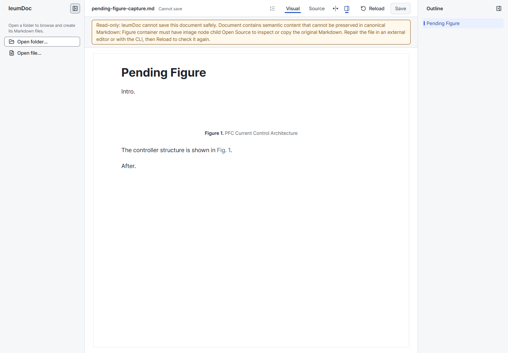
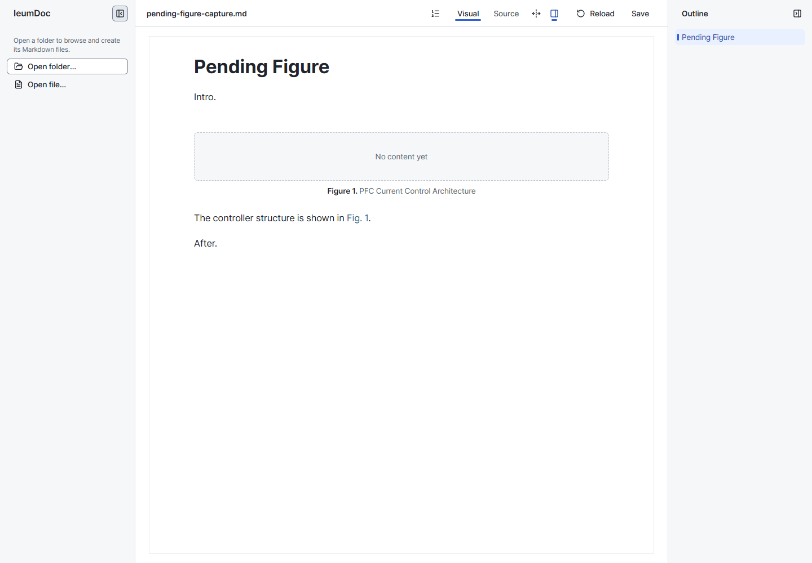
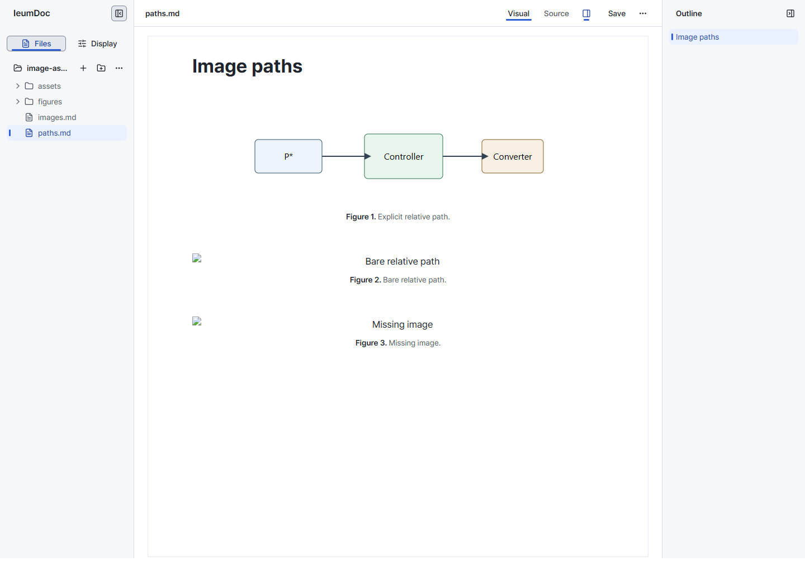
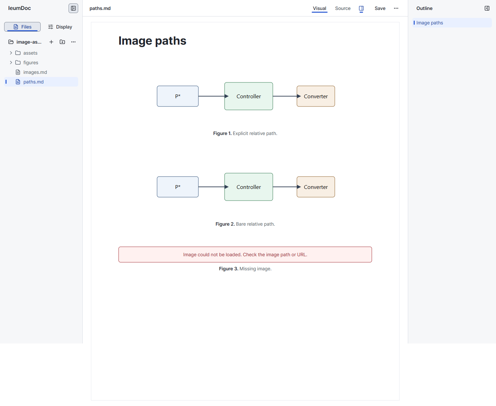

# Figure authoring v1

- Status: Implemented
- Last verified: 2026-10-14 (#212: empty-Figure paste/drop fill, existing-image insertion, single Undo/Redo and real-file Save → Reload in `image-assets`; changed-target cancellation/rollback in Editor tests. #211 / PR #229: normal media separators and standalone dot-segment transport in Editor path-table tests; Host traversal rejection, actual image loading/failure and unchanged Save → Reload paths in Editor tests and `image-assets`; Choose… image selection and existing pending Figure regressions).
- Scope: empty, pending and image Figures, under [ADR-0002](../adr/0002-document-persistence-semantic-ownership.md), [Document support](document-support-v1.md) and [Editing session and Save](editing-session-save-v1.md).

## Scope and completion

The MVP keeps the existing MyST Figure container and image authoring UI. Completion requires real-file Save → Reload with caption, label and reference preserved, then image connection and another Save → Reload. Core owns persistence validity; CLI and Editor use the same operations. No new Media model, Mermaid authoring, upload workflow, autosave or export pipeline is introduced.

Verification covers Core canonical round-trip and fail-closed cases, CLI writes and failure without writes, Editor session collection/history, and browser insertion, Apply/Cancel, Source, Save acknowledgement and existing image authoring.

## Persistent meaning

A Figure owns its caption, label, location and number. Content is optional: `contentKind` in the Core read model is `none` or `image`. Existing `imageUrl` and `imageAlt` fields remain available. Unsupported content, including Mermaid and subfigures, rejects native admission.

A pending Figure has no image. Its caption and label are optional: an empty Figure, with no image, caption or label, is a valid place reserved for content to come. Alt text requires an image. An image Figure may have neither caption nor label. Supported captions use the existing InlineContent contract. Connecting or removing an image updates the same container and preserves the label and caption. Removing an image with alt text requires clearing the alt text too.

```markdown
:::{figure}
:name: fig-pfc-control

PFC Current Control Architecture
:::

The controller structure is shown in [](#fig-pfc-control).
```

Label-only pending Figures omit the body. Caption-only Figures omit `:name:`. An empty Figure is written as `:::{figure}` followed by `:::`. No fake asset, sidecar or persistent draft flag is written. Pending Figures, empty ones included, receive normal Figure numbers as MyST numbers them; labeled ones may be reference targets.

Public `serialize` and `canonicalWriteError` validate the final state; an empty Figure is writable. Earlier versions refused a Figure with no image, caption or label; [#171](https://github.com/ieumbird/ieumdoc/issues/171) reversed this so that reserving a place does not require invented caption or label text. The limited pending writer handles a container with no content and at most a caption; existing whole-document semantic fingerprint, reparse and serializer diagnostic guards still apply. Legends, subfigures and unsupported contents keep their existing fail-closed boundary.

## Editor session states

| State | Session behavior | Save and Source |
| --- | --- | --- |
| Pending Figure | `/figure` and `+` insert an empty Figure; caption or label may be added later. Shows `No content yet`, normal metadata and caption. | Included from insertion; Reload restores a Figure with no image. |
| Completed image Figure | Valid image attached; existing image behavior. | Included. |

Insertion is one undo step and opens no form: the caret starts in the new Figure's caption, so a caption can be typed at once or the Figure left empty. Pasting an image with the caret in an image-free Figure's caption, or dropping an image on that Figure, fills its image using the same properties update as Apply, preserving its label, caption and document position. Caption and label may both be empty. Paste/drop on a Figure that already has an image, or on any other block, inserts a new image Figure after the target; it never overwrites an existing image. If the empty target Figure is deleted or changed while upload is pending, including another image being attached, completion cancels without changing the document and rolls back the created asset through the existing upload cancellation path. Read-only and concurrent-upload rejection rules remain in force.

Filling an empty Figure is one undo step: Undo restores that empty Figure, while Undo removes a newly inserted Figure. Both results persist through Save → Reload. Apply → Save → Undo → Save writes the Figure as it was before Apply, and Redo → Save writes the applied value again. Save preserves this history and the opening-snapshot replay contract. Deleting and undoing a Figure restores its attributes, including after saving the deletion. No new Core operation or CLI command is needed: filling reuses the existing Figure update path, already available as `update-figure --image`.

Edit opens the properties of any editable Figure. Apply accepts any combination of label, caption and image through Core validation, all-empty included. Alt without an image shows a validation error and retains the form. Edit connects or removes the image URL. Unapplied form fields survive Save/Source and are never implicitly applied. Save acknowledges only the submitted applied snapshot; later edits remain dirty under the existing session contract.

Choose… beside the Image field opens the [folder picker](folder-picker-v1.md#choosing-an-image) to choose an image on the Host, starting in the document's folder ([#208](https://github.com/ieumbird/ieumdoc/issues/208)). It only fills the Image field; Apply validates and commits it like a typed value. An image inside the document's folder fills its relative path, such as `./figures/diagram.svg`, and nothing is copied. One elsewhere is copied into `assets/` as a pasted image is, and the field gets that copy's path. Cancel, choosing again, or the form going away unapplied (Reload, closing the document, deleting the Figure) removes a copy the form made; a copy Apply put in the Figure stays. Closing the picker without choosing leaves the field unchanged. No CLI command is added: choosing is Host navigation, and `update-figure --image` already sets the path.

Relative image sources remain unchanged in document attributes and Markdown. Both the live NodeView and the editor's HTML serializer resolve document-relative paths through the Host media URL, with or without `./` (`assets/diagram.svg` and `./assets/diagram.svg` display the same image). Sources with a URL scheme, protocol-relative sources (`//host/...`), root-absolute paths and Windows drive/UNC paths retain their existing browser handling. Relative `../` paths still pass through the Host, which rejects access outside the document directory, including encoded traversal and symlink escapes; URL encoding must not let browser dot-segment normalization bypass that check. No path is normalized or prefixed in saved content.

After removing the optional leading `./` for display, ordinary paths use segment-by-segment encoding and keep `/` separators (`/document/assets/diagram.svg`), avoiding encoded-slash rejection by reverse proxies. Only paths with a literal `.` or `..` segment encode the complete path. A standalone dot segment receives a trailing slash in the request before encoding: `.` becomes `/document/.%2F`, while `..` and `./..` become `/document/..%2F`. The Host decodes and resolves these to the same filesystem location as the original path; the Editor makes no access decision. Literal percent escapes are encoded as text, so `%2e%2e/x` becomes `/document/%252e%252e/x` and reaches the existing Host rejection. All examples omit the document locator query. A proxy that blocks encoded slashes can still reject dot-segment requests before forwarding; normal image paths require no such proxy option. Query-based media transport was not added because this display fix can reuse the existing shared Vite/HTTP/Desktop handler unchanged.

If an image cannot load, the Figure shows `Image could not be loaded. Check the image path or URL.` in the existing error Notice, including at rest. The broken image is hidden; caption, numbering and properties remain available. Successful loading or changing the source clears the failed-source display state. This state never changes document attributes, dirty state, Source or Save, and adds no Core/CLI asset-existence check.

## CLI and readiness

```bash
pnpm ieumdoc insert-figure doc.md --at 2 --label fig-pfc-control --caption "PFC Current Control Architecture"
pnpm ieumdoc insert-figure doc.md --at 2 --label fig-label-only
pnpm ieumdoc update-figure doc.md --path 2 --image ./pfc-control.svg --alt "PFC current control diagram"
pnpm ieumdoc update-figure doc.md --path 2 --image "" --alt ""
pnpm ieumdoc inspect doc.md --format json
pnpm ieumdoc check doc.md --format json
```

`insert-figure --image`, `--caption` and `--label` are optional; with none of them it inserts an empty Figure. `--label` uses Core label validation in the same edit and single atomic file replacement. `update-figure` preserves omitted fields and the label. Invalid final states and duplicate labels fail without writes.

`inspect` adds `contentKind` to Figure JSON and `content=none|image|other` to text. Existing fields remain. `check` reports pending Figure paths and labels in `readiness.pendingFigures`, or warnings on stderr in text mode. Existing validation/writeability/reference fields and exit codes stay intact: pending alone is writable and exits 0. This is a warning about incomplete content, not a complete publication certification; asset existence and exporters are not checked. Save and format remain allowed. Official MyST can diagnose pending Figures as errors while its build still exits 0; this MVP does not implement Publish/Export.

Core and CLI `check` diagnose missing targets for both `[](#label)` links and role references ([#151](https://github.com/ieumbird/ieumdoc/issues/151), implemented in [PR #166](https://github.com/ieumbird/ieumdoc/pull/166)). Unresolved references are warnings, stay as written and do not block a lossless canonical write; [Section references](section-references-v1.md#scope) defines the diagnosis contract. The existing numbered role-reference UI remains. The prior spike remains historical evidence in [PR #150](https://github.com/ieumbird/ieumdoc/pull/150); its experimental code is not merged here.

## Visual verification

The same pending Markdown was opened at master `252de5c` and with this implementation in Chrome (1440×1000, DPR 1, zoom 1, same profile and preferences). Before, canonical preflight made the document read-only; after, the pending Figure is editable and visibly incomplete. Both retain caption and `Figure 1`. The new frame uses existing muted text/surface tokens and a dashed boundary; no global control style or document typography changes.

| Before | After |
| --- | --- |
|  |  |

Screenshots are manual presentation evidence. The `pending-figure` browser regression separately proves actual insertion/Apply/Source/history/Save/Reload and subsequent image connection; `layout-rules` and `quiet-document` check existing geometry and typography.

### Relative paths and load failure (#211)

The same clean `tmp/image-assets/paths.md` was opened before the fix at `2d5b2fb` and after it in this worktree's Vite server on port 5373. Both captures use the same checkout-specific persistent Chrome profile, 1440×1000 viewport, DPR 1, zoom 1, scroll top, no hovered/selected block and loaded Pretendard fonts. The first Figure uses `./assets/diagram.svg`, the second uses `assets/diagram.svg`, and the third uses the missing `assets/missing.png`. Before, the second and third showed broken images without an explanation. After, both valid sources load the same image and only the missing image shows an error Notice, with its caption retained.

| Before | After |
| --- | --- |
|  |  |

These captures are manual evidence, separate from the automated `image-assets` integration checks. The error Notice uses the existing danger text/surface/border and 14/20px UI type; it is visible at rest and adds no controls. The 375px collapsed-sidebar state was also inspected. The existing `figure-authoring`, `pending-figure`, `layout-rules` and `quiet-document` regressions protect properties, pending content and surrounding presentation.
