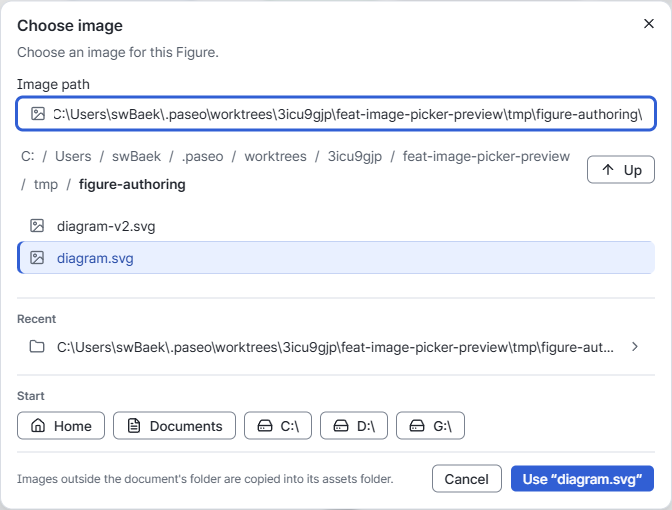
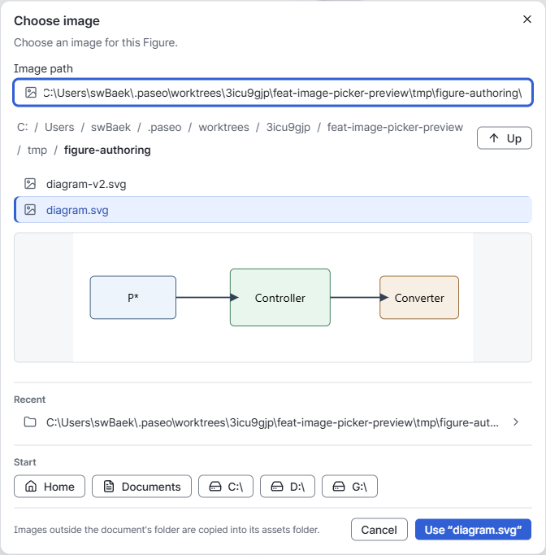
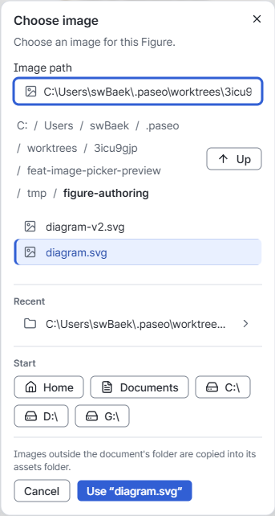
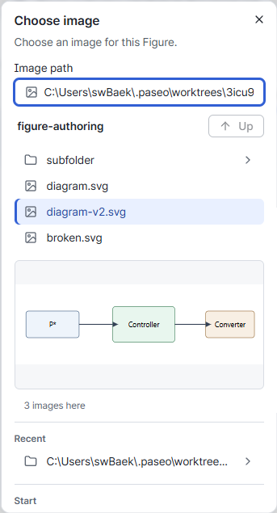
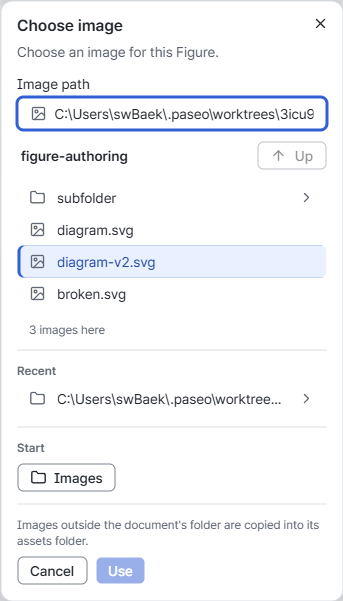

# Folder picker v1

- Status: Implemented
- Folder refresh verification: 2026-10-26 (#494: loaded-list refresh and asset parent updates; [behavior and verification](editor-ux-shell-v1.md#folder-refresh-494)).
- Last verified: 2026-10-26 (#522 option A: Editor 291 tests, typecheck/build, folder/navigation-memory/image/preview/layout/language/state regressions, real HTTP and crash recovery; [fail-first and manual comparisons](#option-a-verification-522)).
- Previous verification: 2026-10-26 (#480 active-image preview: Editor tests/typecheck/build, figure-authoring/folder-navigation/image-assets/file-preview/layout-rules/quiet-document browser regressions and same-state 1440px/375px manual comparison; details below).
- Previous verification: 2026-10-26 (#461 owner decision: click selection preserves sibling images; editing resumes filtering. Editor tests/typecheck/build and figure-authoring/folder-navigation/image-assets/layout-rules/quiet-document browser regressions).
- Previous verification: 2026-10-25 (#425 owner persistence decision: Editor tests/typecheck/build, folder-memory/navigation/command-center/document-tabs/editor-shell/quiet-document; [restoration evidence](editor-ux-shell-v1.md#section-persistence-decision-and-verification-2026-10-25)).
- Previous verification: 2026-10-25 (#425: collapsible folder sections; Editor tests/typecheck/build, folder-navigation/folder-memory/command-center/editor-shell/layout-rules/ui-language/quiet-document and [desktop/phone captures](editor-ux-shell-v1.md#section-disclosure-verification-and-captures)).
- Previous verification: 2026-10-24 (#385: Sidebar header entry, Close-only folder menus; folder-navigation browser check, Editor tests/typecheck/build and [same-state desktop/phone evidence](editor-ux-shell-v1.md#sidebar-open-folder-entry-385)).
- Previous verification: 2026-10-24 (#383: remembered document tabs reuse restored folder context; folder navigation/memory and tab browser regressions).
- Previous verification: 2026-10-24 (#371: concurrent explicit Opens in both response orders retain recent folders in the UI, storage and Reload; unavailable storage retains the page list; folder-memory browser regression).
- Previous verification: 2026-10-24 (#367 cross-tab follow-up: explicit Open replaces another tab's preference and survives Reload, tree-only updates do not write; folder-memory browser regression).
- Previous verification: 2026-10-24 (#367 review follow-up: same-path user Open/Close wins over late restoration, unchanged paths are not rewritten; folder-memory browser regression).
- Previous verification: 2026-10-24 (#367: delayed restoration/Open/Close, remembered paths and Reload, and unique nested New destinations; folder-memory browser regression).
- Previous verification: 2026-10-23 (#235 [ADR-0009](../adr/0009-multiple-opened-folders.md): Open adds a sidebar folder and opened folders are restored; folder-navigation and stable browser suite).
- Previous verification: 2026-10-16 (#204: Open/New retain tabs without work-loss confirmation; new-document, folder-navigation and image-assets regressions).
- Previous verification: 2026-10-14 (image choice through the `image-assets` browser regression; Vite full browser suite and HTTP two-root navigation, creation, narrow/wide layout and Save/Reload on 2026-10-13).
- Scope: choose a Host folder inside the existing Editor dialog, without an OS window, and create folders from it or the sidebar folder.
- Core, CLI, Markdown, document saving and each document's single Tiptap editor state are unchanged.

Vite, Windows Desktop and the standalone [HTTP Host](http-host-v1.md) reuse this picker and the same folder operations. It is the general document-navigation entry: choose a folder here, then choose a `.md` file in its sidebar tree. The Desktop start also offers recent folders and an explicit sample; `.md` execution arguments still open directly. See [Desktop distribution](desktop-distribution-v1.md).

## Behavior

- The expanded Sidebar header has one Open folder… icon button in a fixed position with any
  number of opened folders, also while Display is selected. Empty Files has no duplicate entry;
  per-folder menus contain Refresh and Close folder (#494). Start-screen and command-center Open folder remain.
  All use the existing picker/handler. The Sidebar button's accessible name and tooltip use the
  existing English/Korean translation; Open, Cancel and Escape return focus to that button.
  See the [ADR-0009 amendment](../adr/0009-multiple-opened-folders.md#amendment-2026-10-24-open-folder-entry-385)
  and [same-state visual evidence](editor-ux-shell-v1.md#sidebar-open-folder-entry-385).

- The path field determines the folder to open. Typing filters its parent's sub-folders;
  only user edits of the field set the filter. Selecting an image fills the path without
  filtering out sibling entries; editing that path resumes filtering (owner decision,
  2026-10-26, #461).
  Tab or Right completes into a match, Up/Down moves through matches, and Enter opens the
  typed path. Backspace at a trailing separator, Up and breadcrumbs navigate upward.
- Clicking a folder, a recent folder or a starting place navigates there. Opening requires
  Enter or the Open button, whose label identifies the typed folder. Cancel and Escape
  leave the sidebar and document unchanged.
- Home, Documents when present, and filesystem roots come from the Host. The Host supplies
  one level of folder/Markdown names and breadcrumbs; it remembers no browsing state.
- HTTP instead offers only configured allowed roots, with breadcrumbs/Up bounded by the most specific
  containing root. Paths name server folders. The path field can choose another allowed root.
  Recent folders outside current roots are hidden without deleting the preferences; Host validation
  remains authoritative for every request. No roots are merged into a Workspace.
- Open adds the folder to the sidebar's opened folders ([ADR-0009](../adr/0009-multiple-opened-folders.md));
  one already open is listed again in place, retaining its section collapse and child expansion
  (#425). Close removes that root's collapse record, so a later Open starts expanded; this differs
  from Reload/Desktop restart, which restore remembered section collapse. Only collapsed root paths
  are stored in origin-specific `ieumdoc.collapsedFolderSections`; child expansion/listings remain
  page state. Startup restoration never rewrites memory, including stale records: they are ignored
  and removed on the next user Open/Close, section toggle or navigation reveal. Writes during
  restoration wait for all roots, and each explicit action writes its current live list even if
  another tab changed storage since this tab's last write (#370). Startup tab reveal respects
  remembered collapse; explicit navigation reveal expands and remembers it. See
  [section visibility and reveal](editor-ux-shell-v1.md#collapsible-folder-sections-425).
  Recently opened folders are browser preferences, retained
  only after a successful Open. Overlapping successful Opens each update the latest recent list in
  completion order (most recently completed first), retaining up to five distinct paths. If browser
  storage is unavailable, the recent list still updates for this page. The opened folders' paths are remembered separately
  and listed again on start; neither enters a document or Host configuration. Quoted paths copied from Explorer are accepted.
- The folder-tree hook owns both the live opened list and its remembered paths. After a successful
  user Open or Close, it remembers the latest reduced list. During startup restoration, writing is
  deferred until all remembered paths have been tried, so pending folders cannot be lost. Restoration
  alone does not rewrite preferences: missing/refused folders stay remembered until the next user
  Open/Close, while remaining quietly absent from the Sidebar. A user change during restoration
  writes the final live list once restoration finishes, excluding those failed paths.
- Document tabs restore after this folder restoration, using the same outermost opened-folder
  context as explicit Open. Their separate path/order/active preference follows the same
  restoration-only no-write boundary; see [tab navigation memory](editing-session-save-v1.md#tab-navigation-memory-383).
- A successful user Open or Close of a Host-normalized path during restoration takes precedence
  over that path's older restoration response. In particular, Open then Close stays closed after
  the late response and Reload. Every successful explicit Open/Close remembers the current live list,
  even when its paths are unchanged or another browser tab has saved a different list. Expansion,
  collapse and listing refresh never write preferences, so they leave another tab's saved list intact. A cancelled
  restoration sends no further folder requests after its current request settles.
- An unreadable/missing location shows an error and retains the entered path. Earlier
  browse responses cannot replace a newer location; reopening refreshes the listing.
- New folder, beside the child-folder heading, shows a name row for the listed folder.
  Create makes that folder through the Host and moves into it, so Open names it; it opens nothing
  and changes no sidebar expansion, though a sidebar folder already listed is listed again.
  A rejected name keeps the row with its error. Cancel or Escape closes the row and returns focus
  to New folder; a second Escape closes the dialog.
- Shared product tokens control presentation. Long folder names and narrow viewports keep
  navigation and Open/Cancel reachable.

## Folder presentation (#522)

The [2026-10-26 owner decision](../reviews/folder-dialog-2026-10-26.md#소유자-결정-2026-10-26)
adopts option A with actual Root names retained. The folder mode has one reading column:
starting places, path, ancestor navigation when available, child-folder heading/New folder,
child list, recent folders when present, and the final Open action. Starting places and Recent
use quiet groups without section dividers; the footer retains one divider. The list is bounded
and scrolls for longer listings; the dialog itself scrolls when viewport height requires it.

| Element | Local Host | HTTP Host |
| --- | --- | --- |
| Description | Add a folder to the sidebar. / 폴더를 사이드바에 추가합니다. | Add a server-shared folder to the sidebar. / 서버가 공유한 폴더를 사이드바에 추가합니다. |
| Starting places | Shortcuts / 바로 가기 | Server shared folders / 서버 공유 폴더 |
| Path label | Folder path / 폴더 경로 | Server folder path / 서버 폴더 경로 |

The `Start` label and Markdown count are absent. Starting-place buttons retain their actual
Root name (including the current Root), with the full path as accessible description and tooltip.
The most specific starting place in the listing's breadcrumbs has `aria-current="location"`.
Only its background marks it current: no current-only font weight, text color, marker or border.
Keyboard focus remains an independent visible ring, also on that current Root. This explicit
Root-button decision does not redefine other list selection states.

At a Root, Up and the duplicate current breadcrumb are absent; the actual Root button and full
path identify the location. Below it, Up and ancestor breadcrumbs remain. The list heading is
`Sub-folders · click to navigate` / `하위 폴더 · 클릭하여 이동`, with the existing New folder
action beside it. Clicking still enters a folder; Enter/Open still opens the typed path.
The footer says `Choose documents in the sidebar after opening a folder.` /
`문서는 폴더를 연 뒤 사이드바에서 선택합니다.` The action identifies the quoted folder name:
`Open “name”` / `“name” 열기`, retaining the full typed path as its tooltip.

Folder mode lists folders only and adds no document-file opening. Image mode retains its
existing order, wording, count, Use action and preview; the new folder-only presentation does
not change image selection, sibling visibility, completion or Host boundaries. No Core or CLI
operation is needed because this change only presents existing interface/Host navigation.

### Option A verification (#522)

The new assertion in the existing `folder-navigation` scenario first failed on unchanged
product `93636fac`: `Folder picker must not count documents absent from its folder-only list`.
Its early exit also prevented later expected HTTP-refusal events, which teardown reported
separately. DOM, PNG and trace remain in the local `tmp/folder-dialog-522-evidence/fail-first`.

Final product `2ac8534a` includes master `b28541f` (#524). Folder-navigation, folder-memory,
image-assets, file-preview, layout-rules, ui-language, visual-states, figure-authoring and
quiet-document passed. The production `http-host` invocation passed both real two-Root navigation/
Save/Reload and its owned-browser-crash recovery/conflict check. Root assertions cover actual
names and accessible paths, `aria-current`, background-only current state, separate keyboard
focus and root switching without Open. Long-name/list coverage retains last-entry keyboard
navigation, a usable scrollable list, no horizontal overflow and a reachable Open action.

The first integrated batch exposed two test assumptions; original artifacts were preserved
before correction. A same-value `fill()` did not reset the active entry between viewport cases,
so the stress case now makes actual empty→path edits. Its keyboard/scroll assertions remain.
Layout rules waited for the intentionally removed current-folder breadcrumb; only that
readiness wait now uses the enabled New folder action. Typography, geometry and required-element
assertions remain unchanged. The targeted rerun passed; other passing scenarios were not rerun.

Manual captures use the checkout's persistent Chrome profile, this checkout's own port 5393,
bundled Pretendard, DPR/zoom 1, loaded fonts and unchanged fixture/interaction state. Folder
captures are full viewport at 1440×900 / 390×844, English and Korean; no open document/Recent/
New folder row, root path focused with caret at end, no active child, pointer `(0,0)` and scroll 0.
The read-only routes simulate HTTP/local places with eight folders and eight unlisted documents;
these captures do not replace actual HTTP security tests. Before is `93636fac`; After is
`2ac8534a`. The later base includes #524: Quiet Document's tab/sidebar/Outline differences belong
to that integration, while document pixels below the shell are unchanged. The selected image
dialog pairs at 1440/375px are pixel-identical; compact/1366px differences are confined to a
single clipped outer edge. These are manual comparisons, never screenshot assertions.

| State | Wide Before / After | Narrow Before / After |
| --- | --- | --- |
| HTTP-like, Korean | [Before](assets/folder-dialog-522/before-http-ko-1440.png) / [After](assets/folder-dialog-522/after-http-ko-1440.png) | [Before](assets/folder-dialog-522/before-http-ko-390.png) / [After](assets/folder-dialog-522/after-http-ko-390.png) |
| HTTP-like, English | [Before](assets/folder-dialog-522/before-http-en-1440.png) / [After](assets/folder-dialog-522/after-http-en-1440.png) | [Before](assets/folder-dialog-522/before-http-en-390.png) / [After](assets/folder-dialog-522/after-http-en-390.png) |
| Local, Korean | [Before](assets/folder-dialog-522/before-local-ko-1440.png) / [After](assets/folder-dialog-522/after-local-ko-1440.png) | [Before](assets/folder-dialog-522/before-local-ko-390.png) / [After](assets/folder-dialog-522/after-local-ko-390.png) |
| Local, English | [Before](assets/folder-dialog-522/before-local-en-1440.png) / [After](assets/folder-dialog-522/after-local-en-1440.png) | [Before](assets/folder-dialog-522/before-local-en-390.png) / [After](assets/folder-dialog-522/after-local-en-390.png) |
| Image dialog, English | [Before](assets/folder-dialog-522/before-image-selected-1440.png) / [After](assets/folder-dialog-522/after-image-selected-1440.png) | [Before](assets/folder-dialog-522/before-image-selected-375.png) / [After](assets/folder-dialog-522/after-image-selected-375.png) |
| Image 1366×768 / 375×667 | [Before](assets/folder-dialog-522/before-image-desktop-1366-768.png) / [After](assets/folder-dialog-522/after-image-desktop-1366-768.png) | [Before](assets/folder-dialog-522/before-image-compact-375-667.png) / [After](assets/folder-dialog-522/after-image-compact-375-667.png) |
| Quiet Document, English UI | [Before](assets/folder-dialog-522/before-document-1440.png) / [After](assets/folder-dialog-522/after-document-1440.png) | [Before](assets/folder-dialog-522/before-document-375.png) / [After](assets/folder-dialog-522/after-document-375.png) |

Manual review confirms real Root names, eight fully visible rows in the representative listing,
and actions inside both viewport sizes. [Hashes, environments, attempts and cleanup](assets/folder-dialog-522/verification.json)
record the comparison limits. Own Vite PIDs 9392/39500 and HTTP PID 24428 were stopped, port 5393
had no listener and no checkout-profile Chrome remained; the browser slot was released before
PR work. The persistent profile and account policy were retained.

## Choosing an image

A Figure's Choose… reuses this picker to choose an image file instead of a folder
([Figure authoring](figure-authoring-v1.md)). It starts in the open document's folder and lists
sub-folders and PNG, JPEG, GIF, WebP and SVG files instead of Markdown files; navigation, Recent,
starting places and the HTTP root limits are unchanged, and there is no New folder. Clicking an image
makes it the selected path and marks it selected in the list, keeping sibling images visible
until the user edits the field (#461). Tab/Right completion retains path filtering.
Use, or Enter, chooses it. Use is available only for an image the listing
shows; a typed folder path, with or without a trailing separator, only navigates, and Enter enters it. The Host then links
or copies the image as the [Asset Host Contract](filesystem-host-boundary-v1.md#image-choice-v1-208)
describes. An error, such as an unsupported or missing file, keeps the picker open with the path.

### Active image preview (#480)

Owner decision (2026-10-26): preview the currently keyboard-active or clicked image before Use.
Only that entry loads, through the existing read-only `/api/file-preview` Host capability,
using the listed folder as root. No thumbnails, new Host endpoint, persistence or document
semantic operation is added; this interface-only preview needs no Core/CLI operation.

The preview sits below the list with a bounded height and aspect ratio preserved. Below the
existing phone breakpoint (`width < 40rem`, 640px), its region is collapsed so it consumes no
list or footer space. Phone path/breadcrumb/place/footer wrapping varies with content; this
conservative width boundary reuses the shell's phone layout instead of adding a new height
threshold or measurement logic. At 1366×768 and 1440px the preview remains available.
It has the accessible label `Read-only image preview` and no focusable
controls. A folder or no active image shows no preview. Loading and failure use quiet text;
unavailable, damaged or unsupported images do not block choosing a path. Changing the active
entry replaces the preview and its load state, so an older response cannot appear for the new
entry. Previewing never changes the typed/chosen path, focus, filtering, completion or active
descendant behavior.

The compact follow-up extends the same Figure scenario at 375×667. A root-bounded listing
with a folder active supplies the pre-preview layout: list height must not decrease when an
image becomes active, and Cancel/Use must remain visible at dialog scroll position zero when
they were visible before. The fixture explicitly establishes that both actions fit before the
preview. Before the CSS fix, `Cancel stays visible without scrolling` failed on `1511568`;
afterward the scenario passed, retaining the strict overflow, desktop aspect/race and keyboard
checks. It also verifies that 1366×768 and 1440px retain the preview.

The dialog uses one `minmax(0, 1fr)` grid column and a shrinkable path-input row. A Linux CI
375px run exposed an intrinsic column wider than the dialog's padded content area (17px of
horizontal overflow); these bounds keep every section inside the available column without
clipping the dialog or weakening the overflow assertion.

The existing Figure browser scenario checks active-entry changes, out-of-order responses,
non-image and broken-image states, unchanged path/focus/active descendant and 375px overflow.
Its new clicked-preview assertion first failed on base `c232915` because no preview existed.
The extended scenario then passed with the implementation, including its original Apply/Save/Reload
and #461/#466 filtering, sibling selection and Tab/Right checks. The controlled delayed requests
use an equivalent trailing-separator root spelling so previously decoded images cannot bypass
the response-order test. Editor tests (286), typecheck, build and the folder-navigation,
image-assets, file-preview, layout-rules and quiet-document browser regressions passed. The
1440px/375px Quiet Document rest captures are byte-identical before and after.

Manual visual comparison uses this worktree's Vite Host on port 5380 and persistent Chrome
profile, English UI, Pretendard loaded, DPR/zoom 1, 1440×1000 and 375×1000 viewports. Both
states have `diagram.svg` clicked, siblings visible, path input focused, pointer outside the
dialog and dialog scroll at the top. Before captures are from base `c232915`; after captures
use the same fixture and state. Desktop adds the bounded preview below the list; phone widths
collapse it to preserve the pre-preview list/action space. These
dialog captures are manual presentation evidence, separate from automated overflow assertions.

| Viewport | Before | After |
| --- | --- | --- |
| 1440px |  |  |
| 375px |  |  |

The following same-state 375×667 follow-up uses the root-bounded listing described above,
`diagram-v2.svg` keyboard-active, the unchanged directory path focused, and dialog scroll zero.
Before is `1511568`; after collapses only the preview. Both retain the full four-row list
(128px in this fixture); Cancel/Use now fit without scrolling, as they did without an active
image. Manual review also confirmed the retained preview at 1366×768.

| Before compact fix | After compact fix |
| --- | --- |
|  |  |

## Exclusions

No native picker, upload, rename/delete/move, tree inside the dialog, search, watcher, workspace file,
new persistence service or other file-picker UI. Copying is limited to the image choice above. (Each opened folder is shown as a lazily listed tree in the sidebar; see
[Folder listing v1](filesystem-host-boundary-v1.md#folder-listing-v1-112).) The separate full-file-path dialog is removed (#190). No CLI parity command:
choosing a folder is interface/Host navigation, not a document semantic operation.

## New document in a sidebar folder

- The sidebar folder heading has a `+` (New file in folder) and New folder beside its `⋯` menu (Refresh and Close folder). General Open folder… stays in the Sidebar header.
- `+` opens the filename form without an unsaved-work confirmation. Success adds a new tab; existing
  sessions and drafts remain. Cancelling or failed creation adds nothing. The shared **Save / Don't
  save / Cancel** confirmation belongs to closing a dirty tab. See
  [Switching and recovery](editing-session-save-v1.md#switching-and-recovery).
- The New dialog's Location field shows and chooses the destination: all opened folders and
  every sub-folder listed in their trees so far, expanded or not. Each Host-normalized path appears
  once. In opened-folder order, then tree order, the first occurrence supplies its position and label
  (named from that opened folder); a later overlapping tree does not rename it.
  It starts at the open document's folder when that is inside the chosen folder, otherwise at
  the chosen folder. No hidden state chooses it: expanding or collapsing folders does not.
  A folder deeper than the tree has listed appears once its parent is expanded.
- The dialog accepts a single filename.
  An omitted `.md` suffix is added; separators and `.`/`..` are rejected so this
  entry point cannot choose another directory. It is the only New entry point; the former
  top-level full-path New was removed with the [sidebar chrome cleanup](editor-ux-shell-v1.md#structure).
- Creation uses the existing Host API and Core's canonical empty Markdown. Success
  opens a new document tab and lists its folder again, so it appears in the tree. On close, a successful
  New focuses its first paragraph; Cancel/Escape or a rejected New returns focus to the New button
  (see [Empty document start](editor-visual-language-v1.md#empty-document-start-133)). Existing files, pending
  operations keep their existing protections. Cancel/Escape in the filename form creates nothing.
- No workspace state or new Core/CLI operation is needed:
  this change supplies a destination to the existing document-creation flow.

Folder New coverage includes root/sub-folder creation, cancellation, rejected names, existing-file protection, unsaved work, real-file Save → Reload and narrow-layout reachability.

## New folder

- Both entry points create one folder directly inside an existing folder through the
  [Host folder creation](filesystem-host-boundary-v1.md#folder-creation-v1). Nothing is replaced:
  an existing file or folder of that name is an error. The name is a single portable name (rules
  in the Host contract); the dialogs reject separators and `.`/`..` before asking the Host.
- The sidebar's New folder uses the New dialog form: the same Location choices and starting
  destination as New file, then a folder name. Success expands the folders above the new folder
  and lists them again, so it appears (collapsed) and is at once a New file destination. The open
  document, unsaved work and drafts are untouched, so New folder is not blocked by them. Closing
  returns focus to New folder.
- No Core operation or CLI command: a folder holds documents but is not document content.
  Headless creation is the shell's `mkdir`, as for [folder listing](filesystem-host-boundary-v1.md#folder-listing-v1-112).

## Verification and historical evidence

The Host listing test covers browsing/crumbs; the Host creation test covers portable names, overwrite refusal and missing parents. The folder browser regression covers keyboard navigation, cancellation, recent-folder reload, quoted paths, errors, delayed responses, New folder in the picker and sidebar, and the sidebar/document flow. Preserve source fixtures when running these checks.

Future changes follow the [verification matrix](../../CONTRIBUTING.md#verification-matrix) and required CI. Keep the Host boundary, shell description and manual guide aligned, and close owned verification processes.

Historical local verification (2026-10-07) passed: 441 Core/CLI/Editor tests, all 36 browser regressions,
typecheck, production build and diff whitespace checks. The folder regression also
produced 1440px and 375px captures for visual review. Source fixtures remained unchanged.
