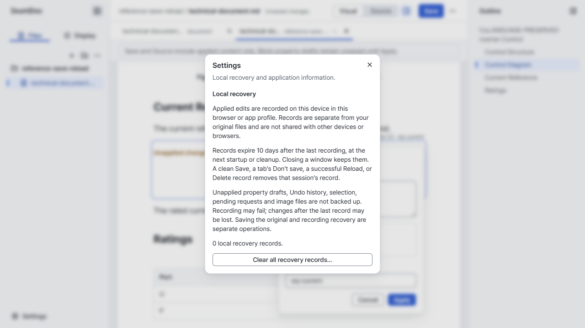
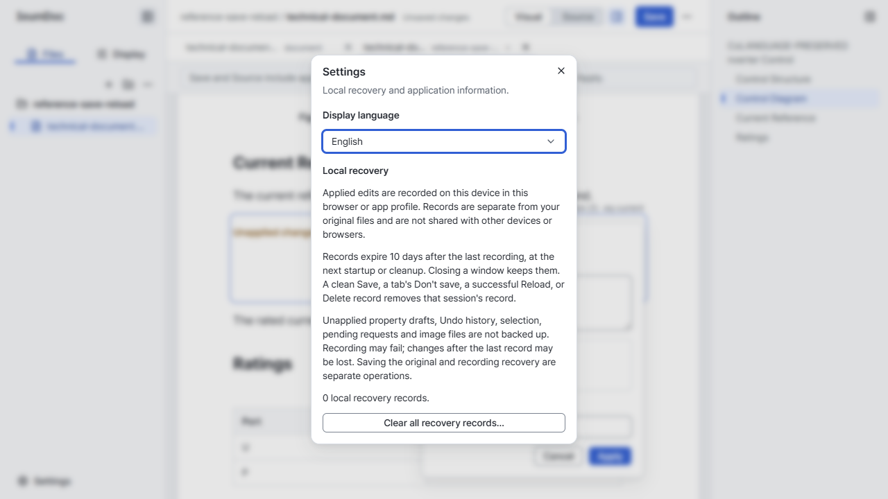
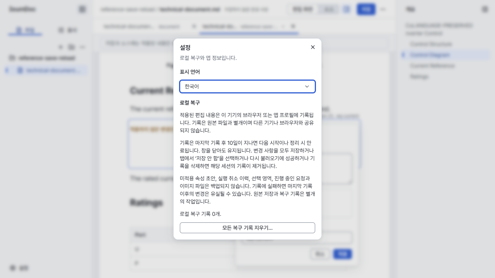
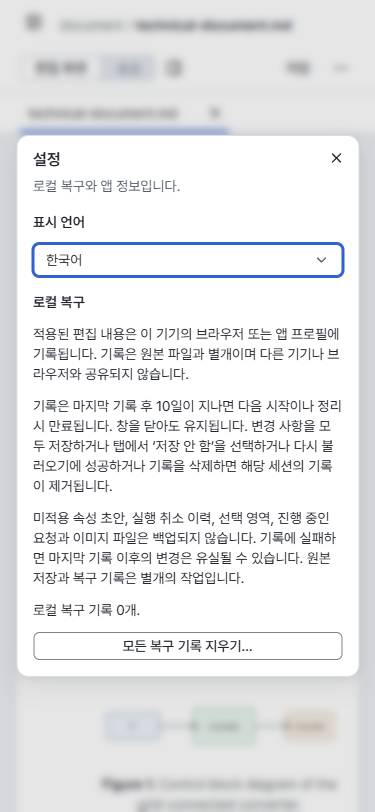

# UI language implementation plan (#256)

- Status: Historical
- Last verified: 2026-10-20 (approved implementation scope and verification record below).
- Scope: [Issue #256](https://github.com/litzio/litzio/issues/256), under [AGENTS.md](../../AGENTS.md). Current UI contract: [Editor UX Shell](editor-ux-shell-v1.md).

## Scope and decisions

Use i18next and react-i18next for Korean and English in the shared Web, HTTP and Desktop Editor. Bundle both resources; no remote translation backend or language detection plugin. Store the explicit choice in existing local preferences. Without a valid saved choice, use Korean for a Korean preferred browser/app language and English otherwise. Apply immediately; report preference persistence failure without undoing the current choice.

Translate shell, commands/search, property forms, accessibility labels, notices, recovery and update UI. Keep document content, canonical Markdown, command identifiers and Core/CLI semantics independent of UI language. This display-only feature adds no Core operation or CLI command. Unknown external errors retain their technical detail with a translated explanation; never classify errors by matching their English text.

## Sequence

1. Inventory user-facing strings and tests. Separate operation identifiers from English display strings before translation.
2. Add bundled, typed resources and the existing Settings language choice. Initialize before rendering; do not remount editors on language change.
3. Translate shell, menus/NodeViews/forms and dynamic notices/errors. Render application-owned messages from keys and parameters so existing messages follow language changes.
4. Verify language settings, key/parameter coverage, state guards, multilingual search and editing/session preservation. Update implemented contracts and this record with actual results.

## Completion and verification

- Both languages cover the supported UI, accessibility labels and page language; fallback must not hide missing translations in tests.
- Switching retains tabs, dirty edits, unapplied drafts, selection and Undo/Redo. Verify actual Save/Reload and conflict handling.
- Validate long Korean strings and narrow layouts, with same-state visual evidence.
- Run frozen install, dependency audit/reachability review, Editor tests, typecheck, build, docs and diff checks; use `pnpm browser:test` for relevant integration/visual regressions. Required CI must pass, including selected Desktop/update and HTTP jobs.
- Retain persistent browser profiles and close only verification processes started by this task.
- Deliver one cohesive PR linked to #256; no release publication is included.

## Implementation record

Both resources are bundled through i18next/react-i18next. Settings applies the local preference immediately, and the document root exposes the selected language. Operation state now uses stable identifiers; UI labels are resolved separately. Application notices and property errors retain message keys where owned by the UI; Core/Host diagnostics retain their original technical detail. Save failures add Korean guidance using the structured failure phase.

Language changes subscribe the React shell and NodeViews and redraw placeholder decorations without creating an editor transaction or replacing the editor. Document content, caption/reference notation, Core, CLI and Host semantics are unchanged. Commands retain stable IDs and accept Korean and English search terms.

Local checks: frozen installation, repository typecheck, Editor unit/integration tests (256 passed), Editor/CLI production builds, documentation and diff checks passed. The initial broad run identified an accidentally evaluated caret-padding getter and a test harness still expecting an English operation string; both were corrected and the two affected browser scenarios passed again.

The dependency audit reports 16 advisories (5 high, 10 moderate, 1 low) in existing dependencies. None names i18next, react-i18next or their newly added transitive packages; the lockfile does not upgrade existing dependencies. This work does not resolve or re-evaluate every existing advisory's runtime reachability.

The stable browser run passed 48 scenarios; `desktop-updates` exposed its old first-focus expectation (the recovery button). The first control is now the language selector. After updating that expectation, the complete update scenario passed. The final `ui-language --screenshots` run also passed, including a structured Save conflict whose guidance changes language without losing edits. Together these runs cover all 49 stable scenarios. The Vite development log reported intermittent ResizeObserver loop notifications; the browser harness reported no unexpected console/page errors.

## Actual screen comparison

Windows Chrome, 100% zoom, DPR 1, bundled Pretendard; base `1ec7c50` in a separate checkout. The 1280×720 captures use the same technical document, applied text edit, open Equation draft and Settings dialog. The baseline capture used that checkout's browser runner; final captures use `pnpm browser:test ui-language --screenshots`. The 375×812 image checks Korean wrapping after saving/reloading. Manual inspection found readable wrapping, visible controls and no horizontal overflow. The selector uses the shared 32px control token.

| Before | After (English) | After (Korean) |
| --- | --- | --- |
|  |  |  |

Production HTTP verification passed both scenarios: Host navigation/Save/conflict and owned-browser-crash recovery followed by Save/Reload/conflict. Packaged Desktop and installed-update validation are delegated to the PR's required CI jobs; this record does not claim a local installed-app run.
