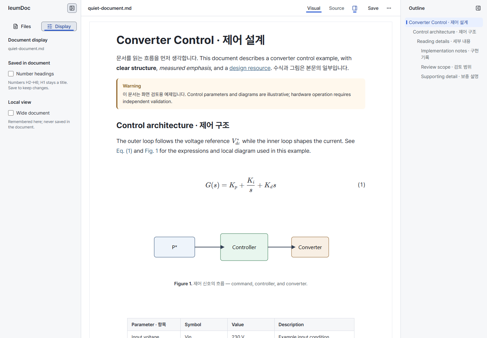

# Editor shell information architecture (#176)

당시 이름: 이음독(IeumDoc), 현재 Litzio

- Status: Historical
- Last verified: 2026-10-13 (implementation, real-product captures and acceptance walkthrough; verification results below).
- Scope: #176 implementation evidence. The linked design contracts, not this record, define current behavior.
- Related: [issue #176](https://github.com/ieumbird/ieumdoc/issues/176), [UX Shell](../design/editor-ux-shell-v1.md), [Layout Rules](../design/editor-layout-rules-v1.md), [Visual Language](../design/editor-visual-language-v1.md), [Heading numbering](../design/heading-numbering-v1.md).

## Concept drawings

The approved plan uses proposal C. These drawings are the three layouts compared beforehand. Each image is labeled 개념안 / 미구현 and does not describe current behavior.

| Proposal | Drawing |
| --- | --- |
| A 집중형 | [proposal-a.svg](../design/assets/issue-176/proposal-a.svg) |
| B 문서 속성형 | [proposal-b.svg](../design/assets/issue-176/proposal-b.svg) |
| C 도구 전환형 | [proposal-c.svg](../design/assets/issue-176/proposal-c.svg) |

## Approved plan

Use proposal C: one left sidebar switches between Files and Display; the right Outline remains independent. The TopBar owns document identity/status, Visual/Source, Outline visibility, Save and a File actions menu containing Reload.

Display identifies the current document and separates Number headings (saved in the document, H2–H6, engine Undo/Redo) from Wide document (this browser/device only). Keep existing disabled conditions, read-only Source and the existing Core-backed numbering and local width preference. Desktop Settings remains a separate application-level entry.

Files is the initial tool. Tool choice and sidebar/Outline visibility remain page state; width retains its existing local persistence. Switching tools preserves folder expansion, tree scroll and keyboard position. Closing the sidebar retains its active tool; Files and Display remain reachable from its collapsed rail. Switching shell tools must not remount the document editor or discard drafts, selection or history. Reopening a tool keeps focus on the opening control; Tab enters the selected content. Escape in Display returns focus to its tool control without changing document content.

Reuse existing total sidebar widths, right-panel docking/overlay behavior, controls and spacing tokens. Check the compact Display contents at the narrow sidebar width rather than allocating a second left panel. Add no tool/plugin framework, metadata editor, new document semantics, Core/CLI command or persistent layout system. CLI parity is unnecessary for these Editor-only navigation changes; the existing heading-numbering command is unchanged.

## Delivery and verification

1. Preserve same-state real-product Before captures before implementation.
2. Update Sidebar, TopBar, their App wiring and focused styles; preserve reload confirmation/focus and work-loss protection.
3. Extend existing shell, folder, outline, visual and layout regressions for the changed entry points and new tool-switching risks; retain assertions for saved content, disabled states, selection/history and draft protection.
4. Verify the workflow Outline navigation → numbering adjustment → Save → another file, at 1280/1440/1920px; verify controls/overlays at 1024/768/375px and existing breakpoint boundaries. Compare real-product After captures with the base. Evaluate the cost of switching Files/Display instead of inferring success from occupied screen space.
5. Update affected implemented contracts in the same PR. Run Editor tests, workspace typecheck, Editor build, docs checks, browser regressions and required CI; clean up only the processes started for this work.

Completion requires discoverable tool locations and reopening controls, preserved editing/save behavior and passing checks.

## Implemented result

Files and Display occupy one existing sidebar, with a horizontal tool row when expanded and icons in the existing 48px rail when collapsed. No second rail or new sidebar width is allocated. The active tool has a non-color marker; both tools remain reachable after collapse. The hidden tree stays mounted so expansion, scroll and the keyboard stop survive. The document editor is not remounted. Display uses native, labeled checkboxes and shows the target filename and two storage scopes. File actions uses the existing Base UI menu, and Reload's modal returns focus to its trigger.

The main production changes are Sidebar, DisplaySettings, TopBar, App wiring and focused CSS. Core, CLI, Host save logic, dependencies and document format are unchanged. Existing browser scenarios use File actions → Reload and Display → numbering/width; their original save/semantic assertions remain.

## Real-product visual evidence

Before: clean `d3ff0bf`, captured before implementation. After: the #176 implementation in this PR, captured with HEAD still `d3ff0bf` and the implementation applied in the worktree. Both use the runner's real API-backed scratch `quiet-document.md`, Windows Chrome, 100% zoom, DPR 1, scroll top, fonts/images loaded, and bundled Pretendard glyphs checked through CDP. Viewport height is 1000px. Captures were generated by `pnpm browser:test quiet-document --screenshots`; the Before files were copied aside before the After run. The original files below are unedited captures.

| State | Before | After |
| --- | --- | --- |
| 1440px, Files/default, Outline docked | [Before](../design/assets/issue-176/before-1440-rest.png) | [After](../design/assets/issue-176/after-1440-rest.png) |
| 768px, Files/default, Outline closed | [Before](../design/assets/issue-176/before-768-rest.png) | [After](../design/assets/issue-176/after-768-rest.png) |
| 375px, sidebar collapsed | [Before](../design/assets/issue-176/before-375-collapsed.png) | [After](../design/assets/issue-176/after-375-collapsed.png) |

Display at 1440px:

[Display at 375px](../design/assets/issue-176/after-375-display.png) shows the existing narrow-sidebar wrapping. At this width, an expanded sidebar still makes the document column too narrow for comfortable reading; collapsing it restores the writing space. This change preserves that existing geometry and does not claim a new mobile overlay design. Controls remain reachable, and no horizontal page overflow is allowed.

At 1440px the document position/width and its content typography remain the same; fewer TopBar controls give the filename more room. At phone width, fewer controls reduce header wrapping. Opening Display changes the sidebar's contents without moving or covering the document. Typography, block tools and original property-form behavior remain covered by quiet-document.

## Verification

| Check | Result |
| --- | --- |
| `pnpm install --frozen-lockfile` | Passed with Node 24.21.0 / pnpm 12.5.1 |
| `pnpm typecheck` | All workspace packages passed |
| `pnpm test` | 535 passed: Core 217, File commit 2, CLI 47, Editor 231, Desktop 38; existing Windows file-symlink/POSIX-mode cases skipped (2) |
| `pnpm --filter @ieumdoc/editor build` | Passed; existing large-chunk warning remains |
| `pnpm exec tsx --test scripts/check-docs.test.ts` | 5 passed |
| `pnpm issues:forms --check` / `pnpm issues:test` | Passed / 8 passed |
| `pnpm docs:check` / `git diff --check` | Passed |
| `pnpm browser:test` | 43 passed (4.7 minutes), including Desktop UI bridge checks |
| `pnpm browser:test quiet-document --screenshots` | Before and After passed; original captures above |
| Desktop-width acceptance walkthrough | Passed at 1280, 1440 and 1920px: navigate to Control architecture in Outline, open Display, change numbering, Save, open the other file through Files, return and confirm numbering persisted |

The walkthrough used the standard runner and scratch-file guard; its temporary scenario was removed after execution rather than adding duplicate permanent numbering tests. The existing `outline`, `folder-navigation` and shell scenarios own the lasting regressions.

After these checks, `master` advanced to `980f60e` (#201, HTTP Host). That change was integrated without conflicts. Its new production-HTTP browser scenario now uses File actions → Reload while preserving the real Save/Reload, image persistence, draft-protection and conflict assertions. The production CLI package build, offline packaged test, `pnpm browser:test http-host --screenshots`, workspace typecheck and documentation checks passed locally. The integration's complete test and CI results are recorded in the PR.

Focused coverage includes: no-document/busy/Source/read-only numbering restrictions; local width leaves document JSON/dirty state unchanged; keyboard entry/Escape; editor identity and selection/history; Equation and Figure forms; Reload cancellation and focus; short-window tree scroll/keyboard retention without another listing; right-panel docking/overlay; every TopBar control and Reload menu inside the phone viewport.

During validation, the layout measurement was corrected to wait for the existing matchMedia-driven Outline transition before measuring a resized screen. Hidden tree controls are deliberately excluded from collapsed geometry measurement, while required visible controls are individually required and their dimensions remain asserted. The caret regression now Tabs from File actions, the final header control, and retains all existing ProseMirror restoration/race assertions. Neither correction weakens the document, overflow or focus checks.

The integrated CI also exposed a setup race in the existing Desktop restart scenario. Replaying its 22-scenario shard locally showed that immediately after End, Chromium's DOM caret was at the paragraph end while ProseMirror still selected the table; the next automated keystroke replaced that selection before selectionchange arrived. The scenario now waits for the intended paragraph caret before preparing its dirty edit. The same 22-scenario shard then passed locally in 2.3 minutes. Its exact text, Source, Save, draft and restart assertions remain unchanged; no product behavior or test timeout was relaxed. The dedicated fast-caret regression remains unchanged by this correction.

## Assessment and limits

Changing numbering and then choosing another file now requires Display → Files, one tool-selection action each way. In exchange, numbering and width have labeled scope and Outline stays visible beside either tool on desktop. The walkthrough confirms the complete task is reachable and state-safe; it does not measure user discovery time or prove superiority over A/B in a user study. No A/B runtime variants or speculative panels were introduced.

The automation uses keyboard/pointer input and Chromium composition checks; physical touch, OS IME and screen-reader user studies were not repeated for this shell change. Actual release publication and installer changes are outside this issue. PR CI, including packaged Desktop regressions, is checked separately before delivery.
