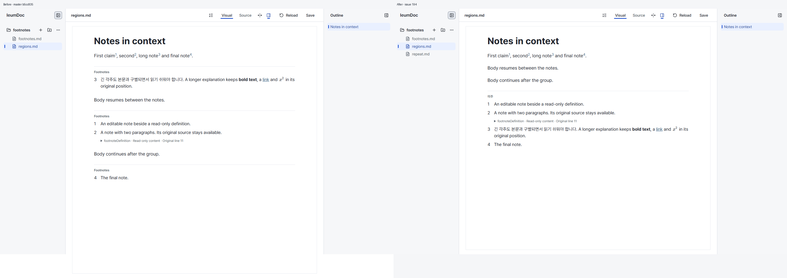
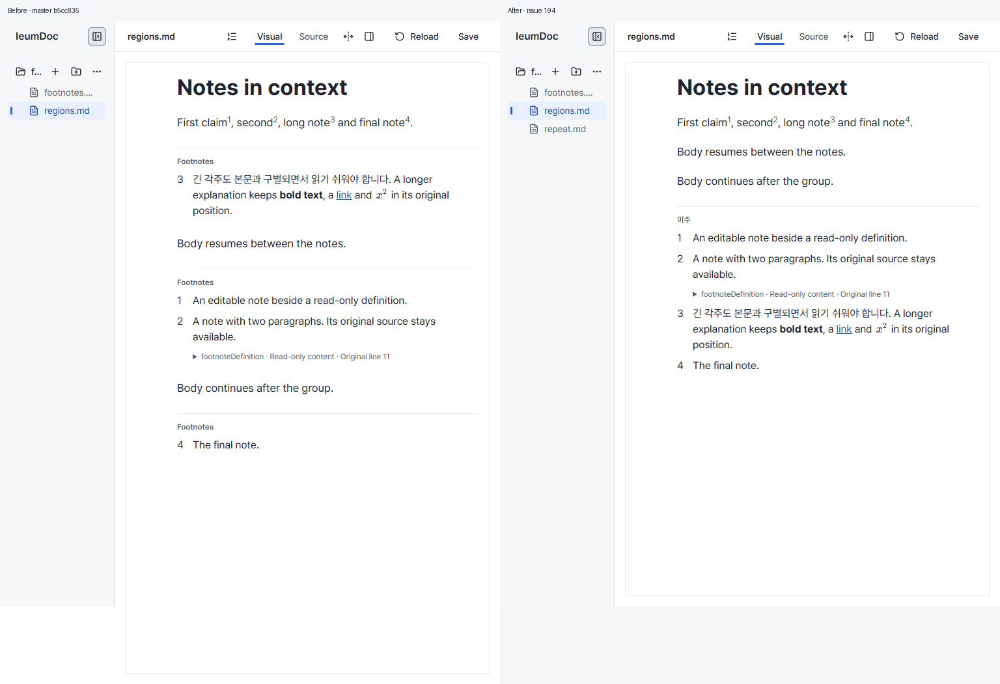
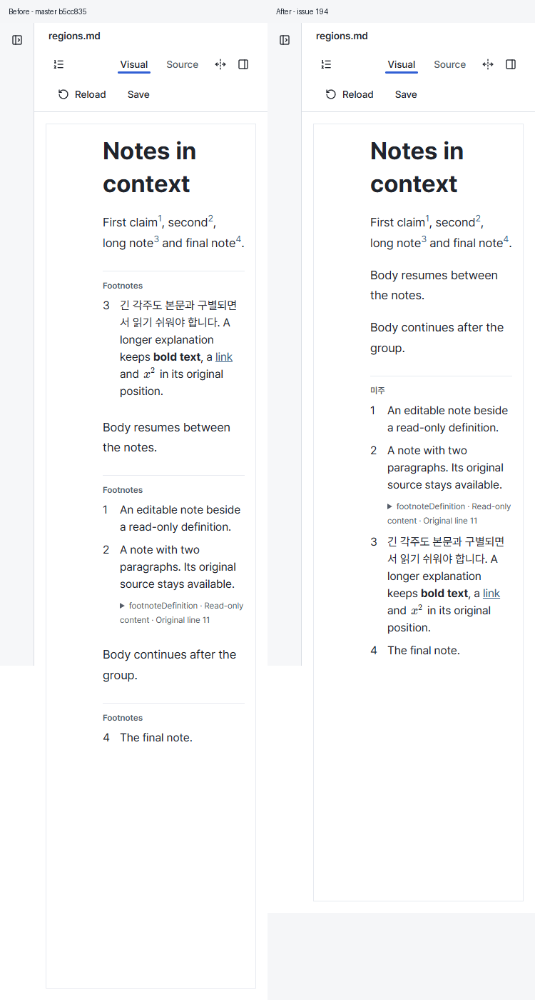

# Endnotes verification — 2026-10-12

- Status: Historical
- Last verified: 2026-10-12 (real Editor captures and automated source/interaction checks for #194).
- Authority: evidence only. Current behavior belongs to [Endnotes](../design/footnotes-v1.md) (v4 replaced the source-placement preservation and explicit conversion recorded here, 2026-10-13), [Visual Language v4.5](../design/editor-visual-language-v1.md) and [Layout Rules](../design/editor-layout-rules-v1.md).

## Actual Before / After

Before is clean `master@b5cc835`, captured before implementation with `pnpm browser:test footnotes --screenshots`. After is the #194 working tree, same `regions.md` source, viewport 1440/768/375 × 900, DPR 1, 100% zoom, scroll top, fonts ready, no hover or caret. At 375px the sidebar is collapsed. The short scratch document includes scattered definitions in source order c/b/a/d, references b/a/c/d, a long formatted definition and a preserved two-paragraph definition.

The images are actual full-page browser captures, paired left Before / right After with a 32px caption outside the captures. Full-page heights differ because three in-place runs became one trailing region. After also lists the new `repeat.md` regression fixture in the sidebar; the reviewed document content is identical.

The body reads continuously, followed by one `미주` heading and definitions 1–4. The existing 16/24px text, baseline numbers, 24px inset/separation and 8px definition spacing are retained. Preserved source remains accessible. All three widths were visually inspected and measured without horizontal overflow.

## Preservation and interaction evidence

The existing `footnotes` scenario now checks trailing display order, ordinary byte-identical Source/copy/Save → Reload, definition editing, insertion with one Undo, Enter back into body space, and the existing refused save after the last reference is removed. It also checks explicit **미주로 모으기**, dirty state, Undo/Redo before and after Save, repeated Save → Reload, repeated-reference return after edits, and preservation of a source draft while display ordering is pending.

Editor projection changes display order while retaining source locators. Ordinary saves preserve existing source anchors; the explicit action and CLI `collect-endnotes` use the same Core conversion. Core tests cover rich/preserved definitions, nested references, original-input preservation, idempotence and canonical refusals. CLI tests use actual files and check failed requests leave their bytes intact.

The draft regression exposed NodeView reconstruction during React option updates. Stable options for the existing keyed editor lifetime remove that warning path. Automatic endnote ordering also waits for dirty/busy property and source drafts, then resumes after Apply/Cancel; it does not dismiss a draft on selection movement.

`quiet-document --screenshots` produced 30 current Before/After pairs; all were pixel-identical. This includes existing typography, surfaces and overlay states unrelated to endnotes. The final PR records typecheck, unit, build, docs, browser and required CI results.

## Limits

This is an Editor endnotes presentation and explicit source-order conversion. The stored format remains MyST Markdown, and no export format, second editor or dependency was added. Physical phone/touch, screen reader, OS IME and PDF/Word output were not manually verified.
