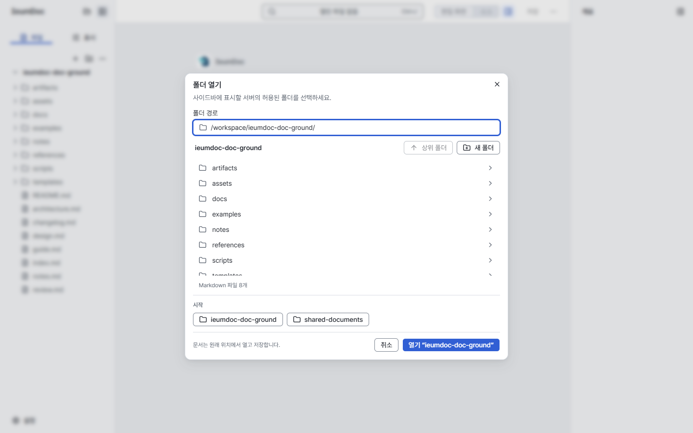
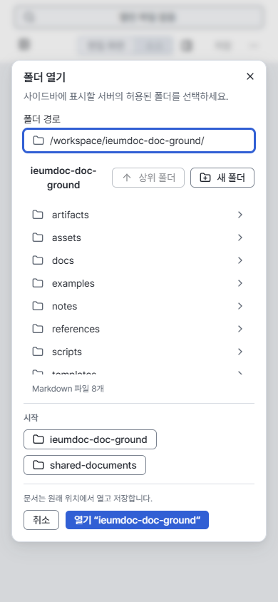
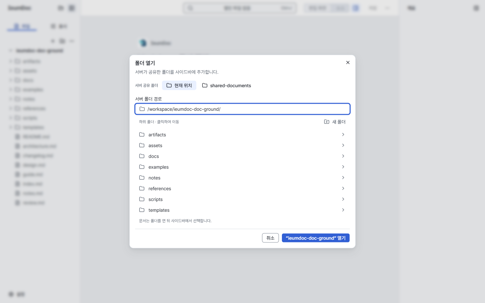
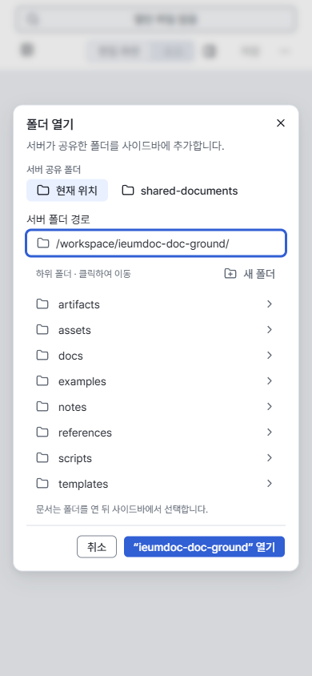
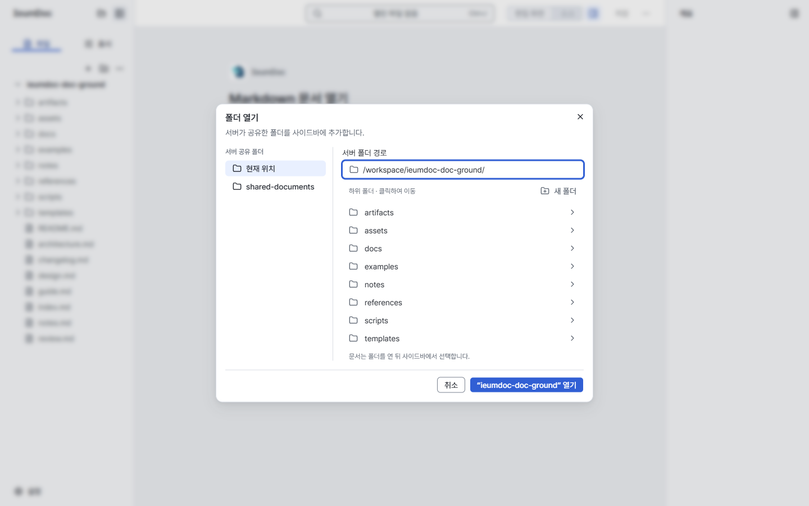

# 폴더 열기 창 — 소유자 결정용 시안

**A안(한 열 정리)을 추천합니다.** 현재의 폴더 이동·열기 동작을 유지하면서 이름 반복과 테두리를 줄이고, 폴더 안으로 이동하는 목록과 사이드바에 추가하는 열기 버튼을 구분합니다. B안은 공유 위치를 왼쪽에 분리해 자주 전환하기 좋지만 목록 폭과 반응형 배치의 비용이 더 큽니다. 두 안 모두 제안이며 제품에는 적용하지 않았습니다.

- Status: Historical
- Last verified: 2026-10-26 — 기준 코드·계약 대조, 한국어 1440×900 / 390×844 실제 브라우저 촬영과 수동 비교. 접근성·보안·전체 동작 검증은 아님.
- Scope: proposal / owner decision for [#522](https://github.com/ieumbird/ieumdoc/issues/522). 문서·PNG·manifest만 유지하며 현재 계약을 변경하지 않음.
- Authority: [Folder picker](../design/folder-picker-v1.md), [Visual Language](../design/editor-visual-language-v1.md), [Layout Rules](../design/editor-layout-rules-v1.md), [ADR-0005](../adr/0005-http-host.md), [ADR-0009](../adr/0009-multiple-opened-folders.md).
- Related: [디자인 통일 검토](design-consolidation-2026-10-26.md)의 B1/S2/P1 및 [#514](https://github.com/ieumbird/ieumdoc/issues/514), [#515](https://github.com/ieumbird/ieumdoc/issues/515), [#516](https://github.com/ieumbird/ieumdoc/issues/516).

## 소유자 결정 (2026-10-26)

소유자는 **A안(한 열 정리)을 채택**했습니다. 단, 공유 폴더(Root) 줄에서는 현재 Root도 `현재 위치`로 바꾸지 않고 `ieumdoc-doc-ground`, `shared-documents`처럼 **각 Root의 실제 이름을 유지**합니다. 현재 Root는 A1 목록 현재 표시 규칙([#515](https://github.com/ieumbird/ieumdoc/issues/515))에 맞춰 **배경만으로 표시**하며 키보드 포커스는 별도로 유지합니다.

나머지는 A안대로 진행합니다. 제안 문구, 파일 개수와 `시작` label 제거, Root에서 Up 숨김, 새 폴더가 있는 `하위 폴더 · 클릭하여 이동` 줄, 하단 안내 `문서는 폴더를 연 뒤 사이드바에서 선택합니다.`, `“name” 열기` 버튼을 유지합니다. 폴더 클릭은 이동, Enter/열기는 입력 경로 열기이며 **행동 계약 변경은 없습니다**. 이미지 선택기 재사용과 HTTP Root 제한도 그대로입니다.

이 문서는 **Historical**로 유지하며 구현은 [#514](https://github.com/ieumbird/ieumdoc/issues/514) 이후 별도로 진행합니다. 아래 비교·권고·PNG는 결정 전 시안을 보존한 기록입니다. A안 PNG의 `현재 위치` 문구와 이름 반복 2곳이라는 측정은 이번 조정을 반영한 결과가 아니며, 새 캡처는 만들지 않았습니다. 현재 제품·계약은 이 결정 기록만으로 바뀌지 않습니다.

## #522 구현 작업 계획 (2026-10-26)

- 범위: 위 소유자 결정에 따른 폴더 모드의 한 열 배치·영한 문구·Root 현재 배경·New folder 위치를 기존 JSX/CSS/번역 안에서 정리하고, 현재 [Folder picker 계약](../design/folder-picker-v1.md)을 함께 갱신한다. 실제 Root 이름과 전체 경로 접근성, 독립된 키보드 포커스를 유지한다.
- 제외: 문서 파일 열기, 이미지 선택/미리보기 의미, Host/API/권한, Core 문서 의미·저장·Editor engine/history/cursor, 다른 이슈의 목록 상태 규칙. 인터페이스 표현만 바꾸므로 Core operation과 CLI 명령은 추가하지 않는다.
- 완료: 기존 폴더 이동/Enter·Open, 최근 위치, New folder 오류·2단계 Escape·focus 복귀, HTTP Root 제한과 이미지 선택 재사용이 보존되고 승인된 문구·배치가 동작하며, PR의 필수 CI가 통과한다. 구현자는 병합하지 않고 소유자 승인·독립 검토를 기다린다.
- 검증: 기존 folder-navigation/HTTP 시나리오에 고유한 표현·Root 식별 검사를 보완하여 제품 변경 전 실패, 변경 후 통과를 기록한다. checkout 전용 persistent profile·자체 서버·브라우저 슬롯 승인 후에만 `pnpm browser:test`를 실행한다. Editor tests/typecheck/build, docs/diff 검사 및 folder-navigation/folder-memory/image-assets/file-preview/layout-rules/quiet-document와 실제 HTTP 검사를 수행한다. 동일 fixture·locale·wide/narrow 상태의 실제 Before/After 촬영은 자동 assertion과 분리하고, 자체 PID/profile/port를 정리한다.

## 비교 조건과 한계

기준은 master `f1ae47217c04b00f70ec72771640e8eeda1871b8`. 이 작업트리의 Vite(`127.0.0.1:5392`)와 기존 `pnpm browser:test` runner의 checkout별 persistent Chrome profile을 사용했습니다. 문서 시작·폴더·목록·시작 위치 API 응답만 고정한 **HTTP 유사 재현**이며 실제 HTTP Host의 접근 제한을 검증한 것은 아닙니다.

이슈 본문에는 원본 스크린샷 첨부와 실제 항목명이 없습니다. 명시된 `/workspace/ieumdoc-doc-ground/`, 하위 폴더 약 8개, Markdown 8개, 시작 위치 2개를 동일하게 구성했습니다. 폴더명(`artifacts`부터 `templates`)과 Markdown 파일명, 두 번째 Root(`/workspace/shared-documents`)는 대표 예시입니다. 원본 화면의 정확한 복원이라고 주장하지 않습니다. 정확한 목록·PNG SHA-256·임시 패치 해시·기준 소스 Git blob·화면별 치수는 [manifest](assets/folder-dialog-2026-10-26/manifest.json)에 있습니다.

세 화면 모두 같은 Root의 내용을 표시하고 열린 문서는 없으며 최근 폴더도 없습니다. 새 폴더 입력은 닫혀 있습니다. 경로 입력에 포커스와 끝 caret, 활성 목록 항목 없음, 포인터 `(0,0)`, dialog/list scroll 0입니다. 한국어·Pretendard·DPR/zoom 1에서 폰트 로딩 후 전체 viewport를 촬영했습니다. caret만 촬영에서 숨겼습니다. 배경이 더 드러나는 양은 dialog 높이 차이 때문입니다.

각 대안은 `FolderDialog.tsx`와 기존 styles에만 임시 적용해 실제 컴포넌트를 촬영했습니다. 이미지 모드는 기존 분기를 유지했습니다. 임시 패치와 촬영 시나리오는 커밋 전에 제거했습니다. 아래 PNG 6장이 최종본 전체이며 별도 HTML·제품 코드·테스트 코드를 남기지 않습니다.

## 같은 상태의 화면

| 화면 | 1440×900 | 390×844 |
| --- | --- | --- |
| 현재 |  |  |
| A — 한 열 정리 |  |  |
| B — 공유 위치 분리 |  |  |

| 실제 측정 | 현재 | A | B |
| --- | --- | --- | --- |
| Dialog 높이: desktop / phone | 596 / 676px | 575 / 583px | 531 / 587px |
| 목록 높이 / 끝 행 | 240px / 마지막 32px 행의 16px가 잘림 | 256px / 8개 행 전체 표시 | 256px / 8개 행 전체 표시 |
| 현재 폴더 이름의 반복(dialog 내부) | 4곳 | 2곳: 입력·열기 | 2곳: 입력·열기 |
| 테두리·나눔 | Root 버튼·비활성 Up·두 구역 구분선 | 경로 칸·하단 구분선 중심 | A + desktop 세로 구분선 하나 |

두 크기에서 가로 overflow가 없고, 대안의 마지막 행과 취소·열기가 스크롤 없이 보입니다. 8개 행 높이는 이번 고정 상태의 비교 조건입니다. 실제 채택 시 항목 수와 viewport 높이에 맞는 제한·스크롤을 설계해야 하며, 긴 목록을 무조건 펼치는 규칙으로 삼지 않습니다.

## A — 한 열 정리 (추천)

공유 위치 → 경로 → 하위 폴더 → 열기의 한 열입니다. 공유 위치는 테두리 없는 작은 버튼으로 묶고 현재 Root는 `현재 위치`로 표시합니다. 이름은 전체 경로와 열기 버튼에서 확인합니다. 현재 폴더를 다시 적던 목록 머리글을 없애고, `하위 폴더 · 클릭하여 이동`과 새 폴더를 한 줄에 놓습니다. Root에서는 실행할 수 없는 Up을 숨기며 하위에서는 Up과 상위 breadcrumb를 유지합니다. 최근 폴더가 있으면 목록 아래의 조용한 그룹으로 유지합니다.

제안 문구는 제목 `폴더 열기`, 설명 `서버가 공유한 폴더를 사이드바에 추가합니다.`, 위치 묶음 `서버 공유 폴더`, 현재 Root `현재 위치`, 입력 label `서버 폴더 경로`, 목록 안내 `하위 폴더 · 클릭하여 이동`, 목록 아래 `문서는 폴더를 연 뒤 사이드바에서 선택합니다.`, 버튼 `취소` / `“ieumdoc-doc-ground” 열기`입니다. `시작`, 보이지 않는 파일의 개수, `문서는 원래 위치에서 열고 저장합니다`는 제거합니다. 로컬 Host에서는 `바로 가기` / `폴더 경로` / `폴더를 사이드바에 추가합니다.`로 바꿉니다.

장점은 목록 폭을 보존하고, 휴대폰에서 레이아웃을 갈아 끼우지 않으며, 실제 여는 경로를 버튼에도 유지하는 것입니다. 단점은 공유 Root가 아주 많으면 윗줄이 늘어나고, `현재 위치`만으로 Root 이름을 알 수 없어 경로 칸을 함께 읽어야 한다는 점입니다. 채택 시 이 버튼의 접근성 이름에는 실제 Root 이름·전체 경로를 제공해야 합니다.

**행동 계약 변경 없음.** 행·Root·최근 폴더 클릭은 이동하고 Enter/Open은 입력 경로를 엽니다. 행을 선택만 한 뒤 여는 방식으로 바꾸지 않습니다. 파일 행을 추가하지 않습니다. 라벨·배치·현재 표시·Root의 비활성 Up 노출은 표현 계약의 제안이므로, 채택 구현에서 Folder picker와 Visual Language를 함께 갱신해야 합니다.

구현 크기는 **작음**: 기존 handlers/refs/listbox를 유지한 JSX 순서·CSS·번역 정리와 대상 browser 검사 보완입니다. Core/CLI/Host operation은 필요하지 않습니다. 키보드·이미지·HTTP·좁은 화면의 구체적 위험은 아래 표와 같습니다.

## B — 공유 위치 분리

Desktop에서는 공유 Root와 최근 폴더를 왼쪽, 경로·하위 폴더를 오른쪽에 둡니다. 취소·열기는 dialog 전체의 오른쪽 아래입니다. 휴대폰에서는 왼쪽 위치 묶음이 위로 올라와 A와 같은 읽기 순서가 됩니다. A의 문구·파일 개수 제거·조건부 Up·전체 행 표시를 공유하며 왼쪽 제목도 `서버 공유 폴더`, 현재 Root도 `현재 위치`입니다.

장점은 시작 위치와 현재 폴더의 내용을 공간으로 구분하고 Root 전환을 쉽게 찾는 것입니다. 단점은 같은 672px dialog에서 목록 폭이 줄고 세로 구분선과 빈 공간이 생기는 점입니다. 긴 Root 이름·경로와 최근 폴더가 늘면 이점이 줄어들며 휴대폰에서는 두 열의 이점이 사라집니다.

**행동 계약 변경 없음.** A와 같은 클릭 이동·입력 경로 Open·폴더 전용 목록입니다. 왼쪽 Root는 접근 경계별 시작 위치이며 여러 Root를 합친 Workspace가 아닙니다. 표현 계약 갱신 범위는 A와 같습니다.

구현 크기는 **중간**: A의 정리에 더해 두 열/한 열 전환, 위치·최근 그룹의 폭·스크롤·포커스 순서 처리가 필요합니다. 새 탐색 모델이나 overlay framework는 필요하지 않습니다.

## 채택 시 확인할 위험

| 항목 | A | B |
| --- | --- | --- |
| 키보드·포커스 | 입력 초기 focus, 행 클릭 후 입력 복귀, Escape/Cancel의 원래 트리거 복귀, New folder의 2단계 Escape를 보존. Root에서 숨긴 Up 때문에 Tab 순서가 달라짐. | A + 위치 rail로 이동하는 Tab/Shift+Tab 순서를 시각·DOM 순서와 일치시켜야 함. CSS로만 순서를 뒤집지 않음. |
| `aria-activedescendant` | 기존 combobox/listbox·option id를 유지. 활성 행은 아직 열 대상이 아님. S2 배경 표시와 별도 키보드 focus를 보존. | A + 위치 버튼은 listbox 옵션에 섞지 않음. 재배치해도 같은 list ref/id가 살아 있어야 함. |
| 경로 완성 | 입력 경로가 유일한 열 대상. Up/Down, Tab/Right, Enter, trailing separator Backspace, IME 처리·오래된 응답 무시를 보존. breadcrumb는 상위 경로만 남기되 current는 입력으로 명확히 전달. | A + 좁아진 칸에서 긴 경로 편집·caret 표시·상위 경로 wrapping을 확인. |
| 이미지 선택기 재사용 (#480) | 시안은 폴더 분기만 바꿈. 기존 이미지 선택·형제 목록 유지(#461), 미리보기·phone 숨김(#480), Use는 유지. 공통 CSS를 옮길 경우 이미지 높이·미리보기·footer 회귀를 따로 확인. 폴더용 안내를 이미지에 복사하지 않음. | A + rail 폭이 desktop 미리보기 공간을 줄일 수 있으므로 이미지 모드까지 두 열로 바꾸려면 별도 비교가 필요. 이번 시안은 제안하지 않음. |
| HTTP Roots | 공유 위치는 Host가 반환한 허용 Root만. 가장 구체적인 Root 위로 Up/breadcrumb가 나가지 않고 직접 입력·새 폴더·최근 폴더도 Host가 계속 검증. 숨긴 Up과 문구는 권한을 넓히지 않음. | A + Root rail의 항목을 병합·확장된 권한으로 해석하지 않음. Root를 바꾸는 클릭도 이동만 함. |
| Phone·긴 목록 | 390×844의 8개 행은 확인. 더 낮은 높이·많은 Root/최근 항목·긴 한글 이름·화면 키보드에서는 목록 scroll과 footer 도달성을 재검증. | A + 640px 전환 경계, rail의 세로/가로 전환, 포커스·스크롤 보존을 추가 확인. |

B1/P1에 맞춰 흰 dialog·중립 경계·기존 shadow, 32px 경로/행, 28px 동작, 6px control 반경, 14/20px UI·16px line SVG를 사용합니다. 12px dialog 표면 반경은 유지합니다. S2/#515의 현재 항목은 배경 한 가지로 제안하고 키보드 focus는 별도로 둡니다. #514의 공용 컨트롤 정리는 후속 구현과 맞춰야 하며, #516의 블록·표 메뉴 작업은 이 시안에 확장하지 않습니다.

## 권고와 검증 범위

**A 채택을 권고합니다.** 두 Root인 현재 문제에는 위치 rail보다 목록 폭과 단순한 한 열 흐름의 가치가 큽니다. B는 여러 Root를 자주 전환한다는 추가 근거가 있을 때 선택할 수 있습니다. 선택 후 별도 구현에서 표현 계약·번역과 관련 browser 검사를 함께 갱신합니다. 소유자의 선택 전에는 두 안 어느 것도 현재 요구사항이 아닙니다.

이번에는 current/A/B 각각 같은 runner로 수동 촬영을 했고, 각 상태에서 ArrowDown의 활성 id, ArrowRight의 폴더 이동, Up의 복귀, Escape의 닫기를 가볍게 확인했습니다. PNG 전체 6장도 직접 비교했습니다. 이것은 채택 구현의 회귀 테스트, 보조기기 검증, 실제 HTTP 보안·이미지 선택기·모바일 기기 검증을 대체하지 않습니다.

최종 검증은 `pnpm docs:check`, `git diff --check`. `git diff origin/master --stat` 및 경로 검사는 이 기록·색인·assets만 남았음을 확인했습니다. 기준 제품 두 파일은 원래 Git blob과 동일합니다. 직접 시작한 Vite PID 8720과 runner의 Chrome context는 종료했고, 포트 5392 listener 및 이 checkout profile의 Chrome 프로세스가 남지 않았음을 확인했습니다. 이 PR은 #522를 참조하며 닫지 않습니다.
