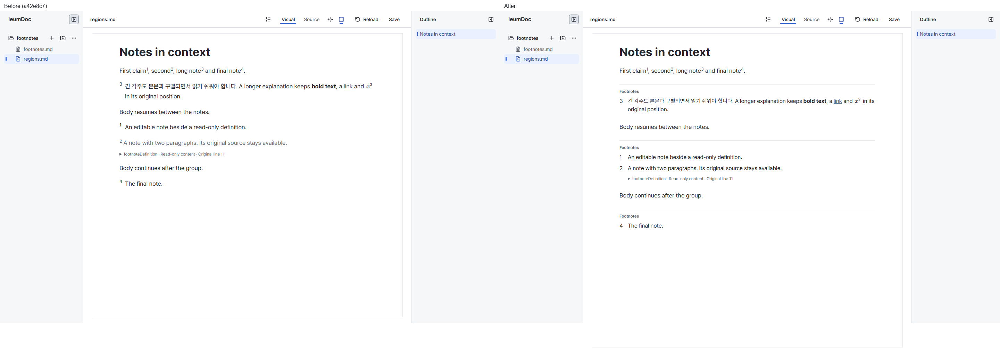
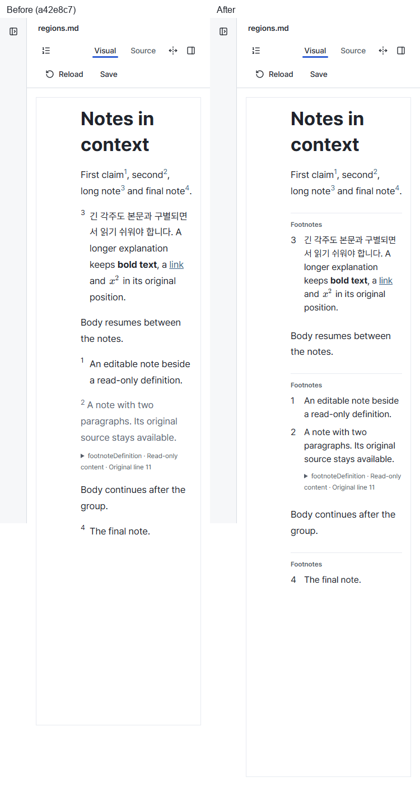

# Footnote region verification — 2026-10-12

- Status: Historical
- Last verified: 2026-10-12 (actual Windows browser captures and focused regression).
- Authority: evidence for #185; current behavior belongs to [Footnotes](../design/footnotes-v1.md), [Visual Language](../design/editor-visual-language-v1.md) and [Layout Rules](../design/editor-layout-rules-v1.md).

## Change and scope

Consecutive definitions at their original positions now share a subtle rule and `Footnotes` label. Definition text uses 16/24px, a baseline number in a 24px inset, 8px internal spacing and 24px separation from body text. Read-only definitions share the region while keeping their original source and Edit source. NodeView-only markers and a CSS pseudo-element express the grouping; no schema/group node, Core operation, CLI command or file meaning changes.

## Actual Before / After

Before is master `a42e8c72dce882f962a32c1f3ba3b6e62e800a76` with only the shared test fixture/capture setup added. Both sides use the same `regions.md` scratch fixture in this checkout, installed Windows Chrome with its reused persistent profile, DPR 1, 100% zoom, loaded app-hosted Pretendard, scroll top and no hover/caret. Viewports are 1440×900 and 375×900; full-page captures include natural content height. At 375px the sidebar is explicitly collapsed. The 768px capture was also inspected locally. Pair labels were added outside the original captures; Before is left and After right.

The fixture includes a long Korean/English note with bold, link and inline math, body paragraphs between definitions, an editable/read-only pair, and a final single definition. The source's definition order differs from its first-reference numbering order. Original-source disclosure is closed in the captures and remains available.

## Verification and limits

- Before implementation, the added `footnotes` presentation check failed: the first definition had no region heading/rule and inherited the 17px / 28.9px body typography. After implementation it passes at 1440/768/375px with no horizontal page overflow.
- Existing `footnotes` protection remains: computed numbers and navigation, read-only source Apply, direct editing, slash insertion and Undo/Redo, real-file Save → Reload and refusal when the last reference is removed.
- A paragraph inserted between the editable/read-only pair creates a new region; one Undo restores the original document and shared region. Viewport changes and visual grouping leave the editor JSON unchanged.
- The label is absent from native DOM selected text and original Markdown Source. Native Source copying preserves that text (Chromium omits the terminal newline; Windows clipboard newlines are normalized for comparison). Whole-definition copying retains the existing lossless-copy refusal and prior clipboard. Saving the unchanged presentation fixture preserves the exact Markdown, then Reload restores the same definition order and editor state.
- `layout-rules`, `continuous-editing`, `block-source-editing`, `property-drafts` and `new-document` pass. `quiet-document --screenshots` passes its geometry, overlay and actual-font checks; all 30 current captures are pixel-identical to the base. Only files produced by this baseline run were compared, excluding older captures left in the output directory.
- Editor tests (225), typecheck, production build, documentation links/index and diff whitespace checks pass. Full unit suites and required PR CI are recorded in the implementation PR.

These are real app presentation captures and automated interaction evidence. They do not claim physical phone, screen-reader or OS IME validation. The grouping does not gather scattered definitions at the document end.
