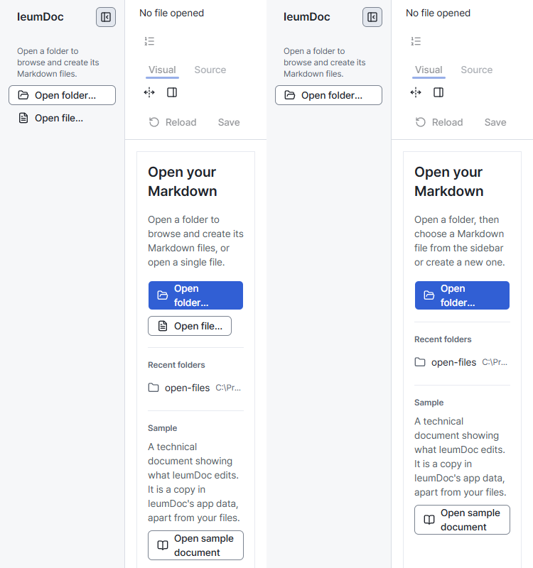
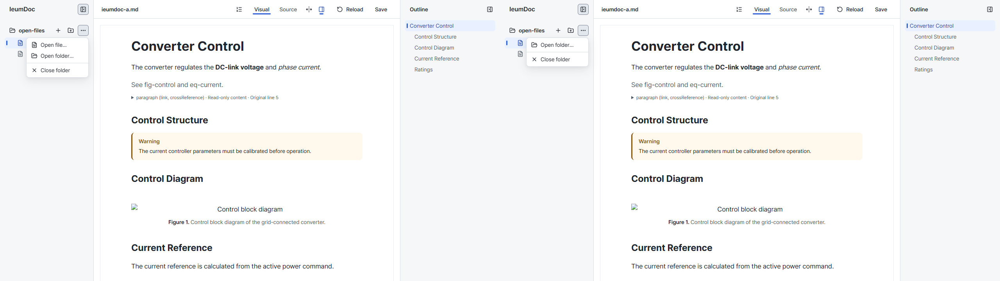

# Open File entry removal verification

- Status: Historical
- Last verified: 2026-10-12 (real Editor captures before/after #190; Windows packaged navigation and existing file-opening contracts).
- Authority: verification evidence only. Current behavior belongs to [Editor UX Shell](../design/editor-ux-shell-v1.md), [Folder picker](../design/folder-picker-v1.md) and [Visual Language](../design/editor-visual-language-v1.md).

## Scope and captures

Baseline: master `7e54017`. The changed Editor removes the separate file-path entry from the empty Sidebar, folder menu and document start. The existing Open folder actions, explicit sample and `.md` execution arguments remain.

Each comparison shows before on the left and after on the right. The actual Editor uses the same viewport and mocked start/document responses in `open-files`; the worktree prefixes in recent-folder paths differ. The missing diagram in the menu capture is an intentional existing fixture 404, not a product regression.

At 375px the start explains folder → sidebar file selection; its folder/sample actions stay inside the paper. Start captures at 768px and 1440px were also inspected. The folder menu now contains Open folder and Close folder, with the document and surrounding chrome unchanged.

The `quiet-document` comparison has 29 comparable captures after retiring the old file-path dialog capture. Seven are pixel-identical; all differences in the other 22 are confined to the removed Sidebar Open file control (x=27–117, y=142–158 or 158–174, depending on viewport). Document content, overlays and surrounding chrome have no pixel differences in these captures.

## Verification boundaries

The existing `open-files`, `folder-navigation`, `editor-shell` and `source-view-pending` regressions cover the three removed entry points, folder and sample selection, dialog focus return, and refusal to switch documents during unsaved edits, property drafts, Save or Source processing. Save → Reload and revision-conflict checks remain in the suite. Browser scripts use real folder selection and file clicks; same-file rereading uses the explicit Reload action.

Windows packaged regressions verify explicit sample selection, `.md` arguments, real-file editing/saving, assets, folder New and conflict/close protection. No Core semantics, CLI command or Host file-access policy changes are part of #190. These captures do not establish physical-touch or OS IME behavior.
