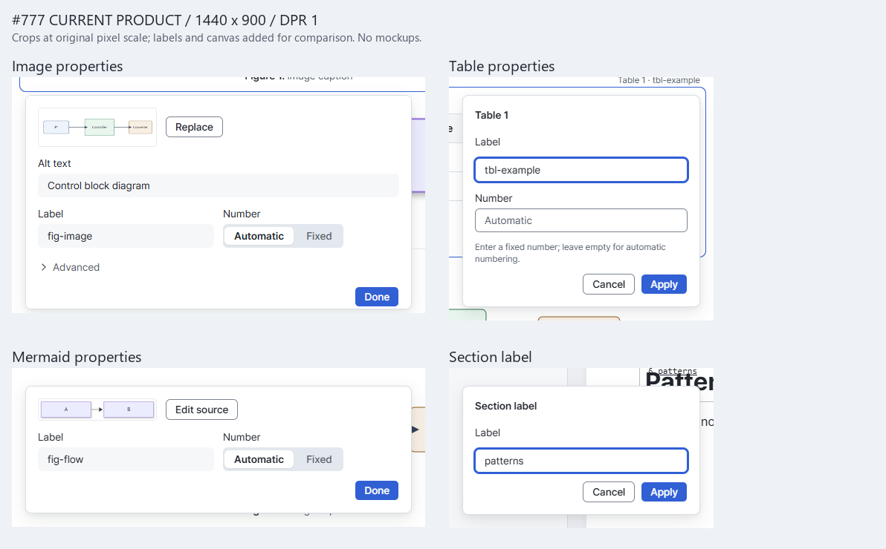
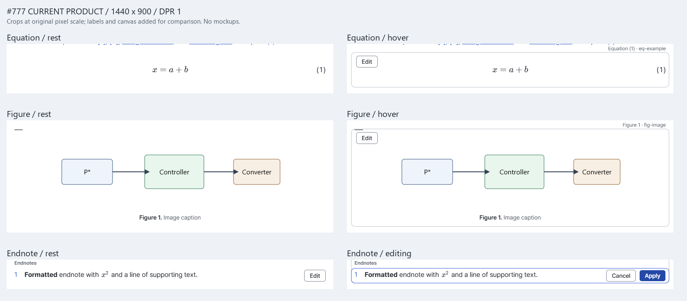
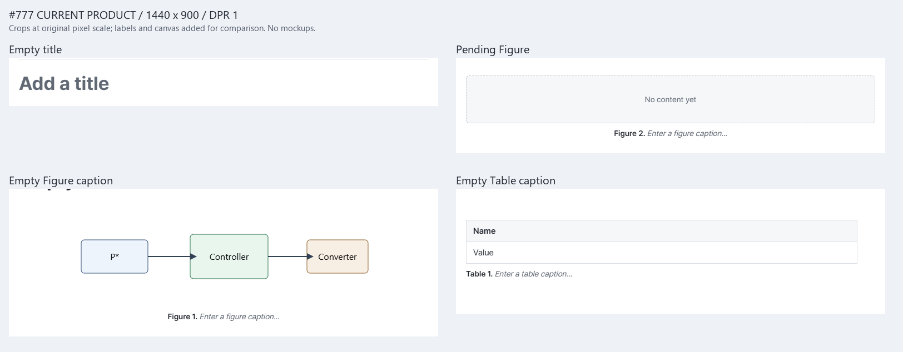
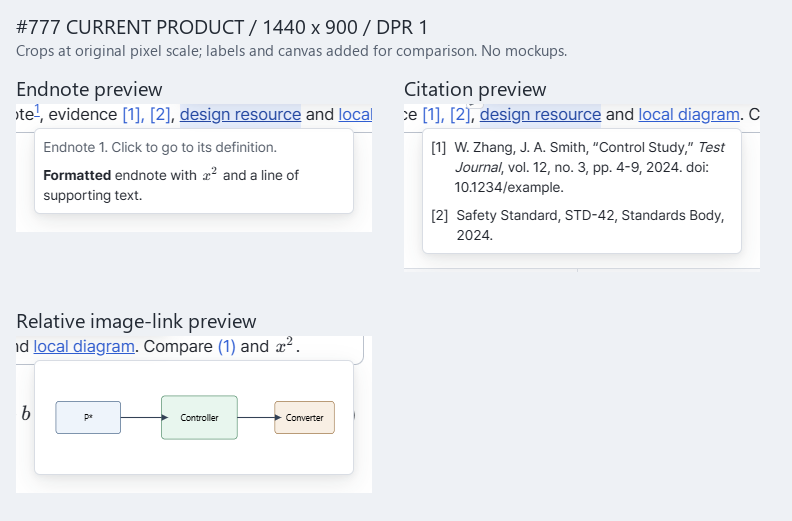

# 반복 UI 패턴 인벤토리와 목표 디자인 제안 — #777 1단계

- Status: Historical
- Last verified: 2026-10-30. 기준 `a4d2f64bbcefa48f436bce916aecd0772ad15e93`의 코드·Implemented 계약·이슈 댓글 대조와 실제 Vite Editor 수동 검토용 촬영. 동작 회귀 suite를 재검증했다는 뜻은 아니다.
- Scope: [#777](https://github.com/ieumbird/ieumdoc/issues/777)의 **1단계 인벤토리와 당시 목표 제안**. 제품 코드·화면·문서 의미 변경 없음. 승인 전 비교·질문은 역사적 근거로 보존하며 현재 구현 지침으로 사용하지 않는다.
- Authority: [AGENTS.md](../../AGENTS.md), [문서 상태 규칙](../contributing/documentation-governance.md), [ADR-0001](../adr/0001-single-document-editor-architecture.md), [ADR-0010](../adr/0010-supported-viewport-and-input.md). 현재 UI 권위는 [Visual Language][visual], [Layout Rules][layout] 및 아래 개별 계약이다.
- Related: [#776](https://github.com/ieumbird/ieumdoc/issues/776), [#740 소유자 결정][i740], [#757 그림 구현][i757], [#714 미주 결정][i714]. 2단계의 확정 목표·운영 규칙·불일치 추적은 [UI 패턴](../design/ui-patterns-v1.md)을 따른다.
- Lifecycle checked: 2026-10-30. [소유자 결정](https://github.com/ieumbird/ieumdoc/issues/777#issuecomment-6510554436)으로 P01–P06/P08–P12 추천이 채택되고 P07은 창 오른쪽 아래 알림 센터 안으로 대체되었다. 아래 추천·대안·질문·이후 단계는 당시 기록이며 새 목표나 미결 질문이 아니다. 캡처와 검증 결과는 다시 실행하지 않았다.

## 제안의 중심

현재 화면을 한 가지로 복제하는 것이 목표가 아니다. **짧은 속성 수정은 대상 가까이, 긴 내용 작성은 읽을 수 있는 폭에서, 문서 전체 설정은 문서 상단에서** 처리하는 방향을 추천한다. 같은 목적의 입력·확정·오류 표현은 맞추고, 목적이 다른 상호작용은 이유가 보이는 예외로 둔다.

우선 결정할 차이는 번호 컨트롤뿐만이 아니다. 그림의 Done·바깥 클릭 적용과 표의 Apply/Cancel·초안 유지, 미주의 상시 Edit와 그림의 hover Edit, 경고의 문서/블록 중복, 표의 하단 도구 배치까지 연결되어 있다. 짧은 속성 표면을 정리하면서 긴 원문 편집을 강제로 팝오버로 바꾸지는 않는 안이다. 아래 P01–P12마다 추천 하나와 대안을 기록했다.

## 조사 방법과 증거의 한계

- `apps/editor/src`의 NodeView, overlay/form, shell dialog, menu/navigation, CSS와 공용 primitive 사용처를 조사했다. 아래 표는 반복 패턴의 **서로 다른 표현과 경계**를 목록화한다. 번역별 문구, 같은 메뉴의 모든 행, OS 파일 선택창을 별도 패턴으로 세지는 않는다.
- 현재 제품 **37개 상태**, 1440×900 CSS px, DPR 1, 기본 Blue/Paper, 영어 UI, 로드된 Pretendard, Light 기준. 입력 면의 경계 비교에만 동일 그림 폼의 Dark를 추가했다. 이미지·Mermaid는 실제 렌더링이며 목업은 없다.
- 동일 작업 파일에서 rest/hover/폼 진입 직후를 비교했다. 다른 폼의 내용 길이와 최초 포커스는 각 실제 진입 동작 그대로다. 번호의 Fixed·오류·미주 편집은 별도 명시 상태다. 다른 상태를 같은 상태처럼 합치지 않았다.
- `01`–`37` 원본은 viewport 전체 화면, `-crop`은 **그 원본 화면과 같은 상태의 보이는 영역**이다. 비교판은 원래 픽셀 배율로 나란히 놓고 제목·여백만 추가했다. 부분 캡처에서 가려진 주변 콘텐츠의 위치는 전체 화면으로 확인한다.
- [촬영 manifest](../design/assets/ui-patterns-777/capture-manifest.json)에 이미지 크기·SHA-256, 비교판 구성, 세 scratch Markdown 원문과 자산 해시를 남겼다. fixture의 SVG는 `apps/editor/document/diagram.svg`, BibTeX는 `packages/core/test/fixtures/bibliography-v1.bib`다. 사진 속 데이터는 사용자 문서가 아닌 조사용 fixture다.
- `pnpm browser:test manual-inventory-777`의 임시 촬영 경로로 checkout 고정 persistent Chrome profile을 재사용했다. `STABLE_SCENARIOS`나 판정용 테스트에는 등록하지 않았고 임시 파일은 제출하지 않는다. 촬영 경로의 완료는 동작 검증 통과를 뜻하지 않는다.
- 초기 촬영에서 잘못 고른 오류 예제(공백 포함 label은 허용됨), hover하지 않은 절 label, KaTeX의 전체 wrapper 클릭, 링크 caret 준비 때문에 중단됐다. 실제 버튼/표시 수식 `.katex-html`과 기존 selection 준비 경로로 바로잡았다. **37상태 일괄 촬영은 15.0초**에 완료했다. 시각 검토에서 Mermaid 원문 폼 아래가 viewport 밖에 있어, 실제 preview 이미지 decode 뒤 폼을 가운데로 스크롤한 1상태만 추가 촬영했다(5.0초). 실패를 제품 결함이나 회귀 성공으로 계수하지 않는다.
- BadPasswordAttempts는 최초 0, 첫 새 고정 profile 실행 뒤 1, 이어진 재사용 실행들에서 1, 마지막 실행 전에는 0이었다. 임시 profile·동시 runner를 사용하지 않았다. runner가 자신이 시작한 Vite와 context를 종료했으며 5173 listener와 이 checkout의 검증 프로세스가 남지 않았음을 확인했다.
- 이 단계는 640px, 두 그룹, 키보드 전 과정, 한글 IME, 스크린리더, 실제 Electron/HTTP Host, 파일 쓰기·Save→Reload를 재검증하지 않는다. 2단계 구현의 지원 최소 폭은 ADR-0010의 **640px**이며 모바일 시안/검증을 추가하지 않는다. 캡처에 없는 recovery/Host 전용 상태는 아래에서 **코드 조사만**으로 표시했다.

## 사용처 지도

`P`는 아래 패턴 절이다. 파일 링크 뒤 이름은 해당 구현의 검색 가능한 symbol이다. 이슈는 결정·구현의 근거이며 단독으로 현재 계약을 대신하지 않는다.

| ID · 화면/사용처 | 컴포넌트·파일 위치 | 관련 현재 문서 절 · 결정/구현 | 패턴 · 현재 캡처 |
| --- | --- | --- | --- |
| U01 이미지·pending Figure 속성 | [editor-schema.tsx][schema] `ImageFigureView`, [figure-properties.tsx][figure] `FigureProperties` | [Anchored Figure properties][figure-contract] · #740/#757/#760 | P01–P07/P09 · 09–12, 29, 31, 35 |
| U02 Mermaid 속성 | [schema][schema] `MermaidFigureView`, [FigureProperties][figure] | [Figure contract][figure-contract] · #740/#757 | P01–P05/P09 · 13 |
| U03 Mermaid 원문 | [schema][schema] `MermaidFigureView`, [block-properties.tsx][forms] `PropertyForm`, [mermaid-preview.tsx](../../apps/editor/src/mermaid-preview.tsx) | [Mermaid Editor](../design/figure-authoring-v1.md#mermaid-editor) · #651 | P01–P07/P09 · 14 |
| U04 블록 수식 | [schema][schema] `EquationView`, [PropertyForm][forms] | [Equation editing](editor-visual-language-history-2026-10-30.md#equation-editing-comparison-637) · #637/#720 | P01–P07/P09 · 03–05 |
| U05 표 속성·caption·구조 도구 | [schema][schema] `TableView`/`TableCaptionView`, [table-tools.tsx][table-tools] | [Property entry](../design/table-interaction-v1.md#property-entry-557), [caption](../design/table-caption-v1.md#always-available-empty-caption-577) · #557/#517/#577/#721 | P01–P07/P09/P10 · 06–08, 28 |
| U06 미주 본문 | [schema][schema] `FootnoteDefinitionView`, [endnotes.ts](../../apps/editor/src/endnotes.ts) | [Endnotes / Editor][endnotes] · #714/#715 | P01/P03–P07/P09 · 15–16 |
| U07 인라인 수식 | [schema][schema] `InlineMathView`, [BlockProperties][forms] | [Continuous editing][editing] · #637(block와의 분리) | P01/P03–P05/P07 · 20 |
| U08 일반 링크 | [SelectionToolbar.tsx][inline] `LinkForm`, [DocumentEditor.tsx](../../apps/editor/src/DocumentEditor.tsx) | [Open ordinary links](../design/editor-ux-shell-v1.md#open-ordinary-links-725), [shortcuts](../design/editor-ux-shell-v1.md#shortcut-contract-381) · #725/#381 | P01/P03–P05/P07 · 21–22 |
| U09 인용 role·key 목록·후보 | [citation.tsx][citation] `CitationView`/`CitationForm` | [Citations / Editor][citations] · #265/#463 | P01/P03–P05/P07/P10/P11 · 18 |
| U10 교차참조 target | [cross-reference.tsx][reference] `ReferenceForm` | [Section references / Editor][sections], [Continuous editing][editing] · #281/#374 | P01/P03–P05/P07/P10/P11 · 19 |
| U11 절 label | [schema][schema] `LabelTargetView` | [Section references / Editor][sections] · #281/#374/#557 | P01/P03–P05/P07/P09 · 17 |
| U12 문서 제목·본문·빈 구조 블록 | [document-title.tsx](../../apps/editor/src/document-title.tsx) `DocumentTitle`, [schema][schema] caption/quote/list/admonition, [DocumentEditor.tsx](../../apps/editor/src/DocumentEditor.tsx) Placeholder | [Document title](../design/document-editing-v1.md#document-title-255), [empty structural elements](../design/document-editing-v1.md#empty-structural-elements-574), [caption hints](editor-visual-language-history-2026-10-30.md#empty-caption-hints-698) · #255/#722/#574/#698 | P03/P05/P06 · 01, 26–29; quote/list/callout는 코드 조사 |
| U13 문서 설정 | [shell/DocumentSettings.tsx][document-settings], [DisplaySettings.tsx](../../apps/editor/src/shell/DisplaySettings.tsx) | [Document settings placement][settings-contract] · #580/#669 | P01/P04/P05/P11 · 02 |
| U14 번호 입력과 집계 | [numbering-properties.tsx][number] `NumberField`/`NumberingNotice` | [Fixed numbers][numbering] · #720/#740/#776 | P02/P05/P07 · 05/07/11–14/30–31 |
| U15 미주·인용·상대 이미지 링크 읽기 | [ReadingPreview.tsx][reading], [ReferencePreviewContent.tsx](../../apps/editor/src/ReferencePreviewContent.tsx) | [Reading previews][reading-contract], [image links](../design/editor-ux-shell-v1.md#relative-image-link-previews-731) · #752/#731 | P08 · 23–25 |
| U16 문서/앱 메시지·저장 실패 위치 | [shell/MessageArea.tsx][messages], [ui/primitives.tsx](../../apps/editor/src/ui/primitives.tsx) `Notice`, [Bibliography.tsx](../../apps/editor/src/Bibliography.tsx), [mermaid-preview.tsx](../../apps/editor/src/mermaid-preview.tsx) | [Save failure guidance][save-errors], [Citations][citations] · #578/#474/#720 | P07 · 08/22/30–31; 저장 실패·복구·Host 오류는 코드 조사 |
| U17 텍스트 서식 toolbar | [SelectionToolbar.tsx][inline] | [Writing interactions][writing], [control exceptions](../design/editor-layout-rules-v1.md#deliberate-control-exceptions) · #514 | P03/P10/P11 · 37 |
| U18 블록 +/handle·slash·표 행/열·목록 형식 메뉴 | [BlockHandles.tsx](../../apps/editor/src/BlockHandles.tsx), [CommandMenu.tsx][menus], [table-tools.tsx][table-tools], [DocumentEditor.tsx](../../apps/editor/src/DocumentEditor.tsx) | [Unified action menus][menu-contract] · #516/#517/#734/#377 | P09/P10/P11 · 06; 메뉴 항목 변형은 코드 조사 |
| U19 코드 언어·callout 종류 | [code-language-input.tsx](../../apps/editor/src/code-language-input.tsx) `CodeLanguageInput`, [schema][schema] `AdmonitionView`, [block-commands.ts](../../apps/editor/src/block-commands.ts) | [Code language selection](../design/document-editing-v1.md#code-language-selection-verification-645), [menus][menu-contract] · #645/#516 | P05/P10/P11 · 코드 조사 |
| U20 파일/폴더·탭 동작 메뉴 | [shell/Sidebar.tsx](../../apps/editor/src/shell/Sidebar.tsx), [shell/DocumentActions.tsx][actions], [shell/DocumentTabs.tsx](../../apps/editor/src/shell/DocumentTabs.tsx) | [File context actions](../design/editor-ux-shell-v1.md#file-context-menu-505--504-pr-a), [UX Shell][shell] · #505/#504/#695 | P10/P11 · 01, 32; context menu 변형은 코드 조사 |
| U21 Visual/Source·Outline/Tables/Figures·탭·탐색 트리·검색 | [DocumentActions][actions], [shell/DocumentPanel.tsx](../../apps/editor/src/shell/DocumentPanel.tsx), [shell/Sidebar.tsx](../../apps/editor/src/shell/Sidebar.tsx), [shell/CommandCenter.tsx](../../apps/editor/src/shell/CommandCenter.tsx) | [Quiet segments](../design/editor-visual-language-v1.md#state-rules), [Command center](../design/editor-ux-shell-v1.md#command-center-363) · #620/#581/#719/#363 | P10/P11 · 01; 검색 결과·키보드 전이는 코드 조사 |
| U22 앱 Settings(모양·언어·복구·정보) | [shell/SettingsDialog.tsx][app-settings], [preferences.ts](../../apps/editor/src/preferences.ts) | [Dedicated Settings](../design/editor-ux-shell-v1.md#dedicated-settings-screen-594), [accent swatches](../design/editor-visual-language-v1.md#state-rules) · #594/#617/#665/#712 | P01/P05/P07/P11/P12 · 34; Desktop update/CLI 상태는 코드 조사 |
| U23 폴더/이미지 picker·새 문서/폴더·이름 변경 | [shell/FolderDialog.tsx][picker], [shell/NewDialog.tsx][new], [shell/FileActionDialog.tsx](../../apps/editor/src/shell/FileActionDialog.tsx) | [Folder picker][folder-contract], [file deletion and rename](../design/editing-session-save-v1.md#file-deletion-and-rename-505--504-pr-a) · #522/#553/#505 | P05/P06/P07/P12 · 33; picker/rename는 코드 조사 |
| U24 미저장 확인·삭제·저장 전 비교·복구 비교 | [shell/UnsavedChangesDialog.tsx][unsaved], [DangerConfirmation](../../apps/editor/src/components/ui/danger-confirmation.tsx), [shell/SaveCompare.tsx](../../apps/editor/src/shell/SaveCompare.tsx), [shell/RecoveryCompare.tsx](../../apps/editor/src/shell/RecoveryCompare.tsx), [shell/SourceCompare.tsx](../../apps/editor/src/shell/SourceCompare.tsx) | [Switching and recovery][lifetime], [Changes before saving](../design/editing-session-save-v1.md#changes-before-saving-655-stage-2) · #56/#296/#655 | P07/P12 · 36; 파괴/복구 상태는 코드 조사 |
| U25 파일 미리보기·단축키 안내·참고문헌 연결 | [shell/FilePreviewDialog.tsx](../../apps/editor/src/shell/FilePreviewDialog.tsx), [shell/KeyboardShortcutsDialog.tsx](../../apps/editor/src/shell/KeyboardShortcutsDialog.tsx), [Bibliography.tsx](../../apps/editor/src/Bibliography.tsx) | [File preview](../design/editor-ux-shell-v1.md#folder-files-and-image-preview-217), [shortcut guide](../design/editor-ux-shell-v1.md#curated-shortcut-guide-496), [bibliography connection](../design/citations-v1.md#connect-and-disconnect-bibliography-files-438) · #217/#496/#438 | P06/P07/P12 · 코드 조사 |

## P01 속성 편집 표면과 위치

사용처 U01–U13, U22. [속성 비교판](../design/assets/ui-patterns-777/compare-properties.png), [원문 비교판](../design/assets/ui-patterns-777/compare-source.png), [인라인 폼 비교판](../design/assets/ui-patterns-777/compare-inline.png).

| 현재 목적 | 위치·모양 | 차이가 만드는 문제 또는 이유 |
| --- | --- | --- |
| 이미지·Mermaid metadata | 520px 상한의 대상 전체 아래/위 팝오버, 썸네일·필드 2열, 반복 제목 없음 | 대상·caption을 남겨 문맥 보존. 같은 label/번호인 표와 대비됨 |
| 표·절 label·인라인 수식 | 공용 `BlockProperties`, anchor 끝 정렬, 제목 있는 세로 폼 | [표 전체 화면](../design/assets/ui-patterns-777/07-table-form.png)에서 셀 일부를 덮음. 인라인 수식은 읽기 폭 확보용 더 넓은 popover |
| 블록 수식·Mermaid 원문 | 본문 전체 폭의 source → preview → metadata | 긴 입력에 유리하나 단순 번호만 바꿀 때도 큰 편집면을 엶 |
| 미주 | 같은 자리의 본문 편집, 우측 버튼 | 읽기 흐름과 편집 위치 일치. 별도 popup으로 옮길 근거 없음 |
| 문서 설정 / 앱 설정 | 종이 상단 접힌 영역 / 전용 전체 화면 | 문서에 저장되는 값과 기기에 저장되는 값의 범위가 다름 |

이번 fixture에서는 [오른쪽 교차참조 폼의 Apply 영역이 Outline 뒤에 가리는 상태](../design/assets/ui-patterns-777/19-reference-form.png)도 관찰됐다. 비교판에서 오른쪽이 잘린 것은 합성으로 가린 것이 아니다. [useOverlayBounds](../../apps/editor/src/ui/use-overlay-bounds.ts)는 split에서는 group, 단일 group에서는 window를 경계로 쓰며, FigureProperties의 sidebar/Outline inset 제외와 다르다. 현재 위치 규칙이 사용자에게 보이는 가용 영역을 항상 뜻하지 않음을 보여 주는 관찰이다. 원인 전체와 수정은 별도 검증이 필요하다.

**추천:** 짧은 metadata는 대상 전체에 붙는 팝오버, 긴 원문은 본문 폭, 미주는 현재 자리, 문서/앱 설정은 현재 범위별 위치를 유지한다. **모든 작은 편집면은 Sidebar/Outline을 제외한 해당 문서 콘텐츠 viewport 안**에 배치한다. 수식은 label/번호만 고칠 수 있는 작은 속성 진입과 **원문 편집**을 분리하는 목표를 추천한다. 한 번의 수식 편집으로 원문과 번호를 같이 바꾸는 경로도 원문 폼 안에서 유지한다. 자동으로 오른쪽 공용 패널을 열지 않는다.

근거: 그림·caption을 보면서 확인하는 #740의 의도와 Quiet Document를 따른다. 작은 변경 때문에 수식 전체 높이가 바뀌는 비용을 줄이고, 긴 수식·Mermaid는 읽을 수 있는 폭을 보장한다. **영향 M–L:** 표/절 label 표면, 수식 진입 분리, 인라인 수식의 viewport 제한. FigureProperties의 배치·경계와 기존 PropertyForm을 재사용할 후보이지, 지금 범용 form engine을 만들자는 제안이 아니다.

대안 A는 모든 속성을 우측 inspector로 모으는 것: 연속 비교에는 좋지만 #740이 두 그룹·닫힌 패널·640px 발견성 때문에 거부한 A안을 뒤집어야 한다. 대안 B는 모두 본문 안에 펼치는 것: 입력 폭은 좋지만 작은 수정마다 본문을 밀고 #740의 D안 거부 이유와 충돌한다. **추천안도 #637의 수식 직접 원문 진입에 metadata 경로를 추가하는 결정**이므로 수식 진입은 소유자 확인 후 별도 구현한다.

## P02 자동·고정 번호

사용처 U01–U05/U14. [번호 비교판](../design/assets/ui-patterns-777/compare-numbering.png). 실제 호출은 [NumberField][number]의 `segmented=true`가 이미지·Mermaid metadata 두 곳, 기본값이 표·수식·Mermaid 원문 세 곳이다. pending Figure는 이미지 분기를 공유한다.

| 현재 | 자동 | 고정 | 주의점 |
| --- | --- | --- | --- |
| 그림/다이어그램 속성 | Automatic 선택, 값 입력 없음 | Fixed를 누르면 입력 표시 | Fixed에서 빈 채 완료해도 고정값 제거. 다음 진입은 Automatic |
| 표/수식/다이어그램 원문 | 빈 입력 + Automatic placeholder | 같은 입력에 문자열 | 항상 “비우면 자동” 안내가 필요함 |
| 문서 경고 | 적용된 문서의 Core report | 하나라도 고정값이 있으면 문서가 fixed mode | 미입력은 자동 fallback을 표시하면서 경고. 중복은 같은 종류 안에서 판정. 초안은 report에 포함되지 않음 |

**추천:** 다섯 폼 모두 **자동 / 고정 + 고정일 때만 값**. 자동 상태에서도 실제 표시 번호를 짧게 보여 주고, 혼합 문서 경고에는 “문서에 고정 번호가 있어 이 항목의 자동 번호를 확인해야 함; 저장 가능”처럼 원인을 설명한다. 이 UI는 Core의 현재 fallback과 warning을 전달하며 새로운 문서 모드를 만들지 않는다.

추가로 **고정을 선택했는데 값이 비면 완료를 막고, 자동으로 돌리려면 자동을 선택하게 하는 것**을 추천한다. 고정을 선택한 의도가 조용히 사라지는 일을 막는다. 이는 #757 계약의 “빈 고정 입력은 값을 지움”을 바꾸는 **Editor draft 제출 규칙 제안**이다. Core/CLI의 `updateEnumerator("")` 제거 의미나 혼합·중복의 저장 허용을 바꾸지 않는다. 소유자가 이 변경을 원치 않으면 세그먼트 통일만 먼저 할 수 있다.

**영향 M:** `NumberField`와 다섯 폼, 오류/초안·키보드 검증. #776의 직접 후속 범위. 대안 A는 모두 빈 입력으로 통일(S): 작은 수정이지만 #740의 세그먼트 결정 철회와 암묵 규칙을 계속 요구한다. 대안 B는 select(자동/고정)(M): 긴 번역에는 유리하지만 두 선택의 비교와 전환에 한 동작을 더 요구한다. 추천은 #740 결정 4의 확장과 일치하되, 빈 Fixed 처리만 새 승인이 필요하다.

## P03 편집 진입과 발견 가능성

사용처 U01–U12/U17. [rest·hover·편집 비교판](../design/assets/ui-patterns-777/compare-entry.png).

| 현재 | 보이는 진입점 | 클릭·키보드 역할 |
| --- | --- | --- |
| Figure/Equation | hover·focus/선택 때 Edit | 미리보기 단일 클릭은 선택, 더블클릭/블록 Enter는 편집 경로 |
| Table | 행·열 handle, 하단 Edit, 위 metadata | 셀/캡션은 직접 편집; metadata 클릭 선택·더블클릭 속성; 블록 Enter도 진입 |
| Endnote | **항상 Edit**, 편집 중 Cancel/Apply | 클릭은 읽기 선택. 더블클릭·선택 후 Enter로 기존 미주 편집을 열지 않음 |
| Citation/reference/section label | 작은 pencil 또는 label, hover/선택/focus 맥락 | 참조 클릭 이동/선택과 편집 버튼을 분리 |
| Inline math / link | 수식 더블클릭 / 선택 toolbar·단축키 | 문서 글자 크기의 콘텐츠를 32px 버튼으로 바꾸지 않음 |

**추천:** 블록은 선택만으로 폼을 열지 않고 hover·키보드 focus·선택에서 같은 위치의 Edit를 제공한다. 더블클릭은 단축 경로이고 유일한 진입이어서는 안 된다. 표·수식·그림의 Edit 명칭/위치를 P09로 맞추되 **미주의 상시 Edit와 버튼 전용 진입은 유지**한다. 읽기 전용 문장처럼 보이는 미주에서 편집 가능성을 잃지 않기 위해서다.

**영향 M:** 표 상단 진입, inline 수식의 키보드 진입 안내, Figure/Equation/label 상태 점검. 초점·IME는 기존 엔진 경로를 보존한다. 대안 A는 모든 Edit 상시 표시: 발견성은 좋지만 본문 전체에 도구가 쌓인다. 대안 B는 모두 hover 전용: 조용하지만 **#714의 상시 우측 버튼과 버튼 전용 편집 결정에 충돌**한다. 이 대안의 채택에는 소유자의 명시적 변경 결정이 필요하며 현재 추천하지 않는다.

## P04 적용·취소·완료·바깥 클릭

사용처 U01–U13/U23–U24. [폼 비교](../design/assets/ui-patterns-777/compare-inline.png), [설정·확인창 비교](../design/assets/ui-patterns-777/compare-settings-dialogs.png). 사진은 버튼 표현, 아래 동작은 코드/계약 대조다.

| 현재 표면 | 버튼 | Esc | 바깥 클릭/blur |
| --- | --- | --- | --- |
| 그림 metadata | Done | 취소 | **pointer click 적용**. keyboard focus 이동만으로 적용하지 않음. 오류 시 유지 |
| 수식·표·Mermaid 원문·절 label·인라인 수식 | Apply / Cancel | 취소 | 초안 유지, 적용하지 않음 |
| 미주 | Apply / Cancel | 소유한 메뉴/폼 처리 뒤 취소 | 정의와 소유한 도구 밖 선택/초점 이동도 적용. Enter 적용, Shift+Enter 줄바꿈 |
| 링크·인용·교차참조 폼 | Apply, Remove; 링크 Open, 인용 Add | 닫음 | 폼 밖 blur/해당 dismissal은 닫음. **폼 값은 미적용**. 보이는 Cancel 없음 |
| 제목·캡션·문서 설정 | 별도 Apply 없음 | 각 interaction의 의미 | 이미 engine에 반영; 디스크 저장은 Save |
| 새 파일·닫기·삭제 | Create 또는 Save/Don't save/Cancel 등 | 안전한 닫기/취소 | 파일 쓰기를 확정하지 않음 |

**추천:** (1) 짧은 metadata: Done·Esc 취소·유효한 pointer 바깥 클릭 적용, (2) source/복합 inline 내용: Apply/Cancel·Esc 취소·바깥 클릭 초안 유지, (3) 직접 본문/문서 설정: 즉시 적용+Undo. 미주는 #714대로 in-place 편집·바깥 적용·취소를 유지하며 두 버튼을 유지한다. 버튼명은 미주도 “완료/취소”로 바꾸어 **편집 종료와 파일 Save를 구별**하는 안을 추천한다.

가장 큰 개편은 링크·인용·교차참조의 입력을 blur 때 조용히 버리는 대신 **Cancel을 보이고 명시적으로 마칠 때까지 초안을 보존**하는 것이다. 값 여러 개를 조합하는 citation과 새 대상을 고르는 reference를 단순 metadata로 취급하지 않는다. 같은 문서 내 다른 폼·탭·Save·close와의 충돌은 기존 draft/work-loss 구조로 해결 가능한지 구현 전에 확인해야 한다.

**영향 L:** 표/label Done 전환, inline 세 종류의 초안 생명주기, 수식 속성 분리, 미주 문구. #740은 metadata에 유지, #714는 행동 유지·버튼명만 변경 제안. 링크/인용/reference의 현재 dismissal 계약은 변경된다. 대안 A는 모든 폼 Apply/Cancel·밖에서 유지: 이해는 쉽지만 #740 완료 하나/바깥 적용을 철회한다. 대안 B는 모든 폼 밖에서 적용: 가볍지만 미완성 원문과 복합 후보 선택까지 확정하므로 추천하지 않는다.

## P05 입력칸·placeholder·필드 위계

사용처 U01–U14/U19/U22–U23. [Light/Dark와 입력 경계 비교](../design/assets/ui-patterns-777/compare-fields-theme.png).

| 현재 | 평소 경계·바탕 | label·hint |
| --- | --- | --- |
| 그림 속성 | 투명 border + subtle fill, hover/focus 때 border | 명시 label, None/Describe…, 고급에 filename |
| 표·절 label·inline 폼 | 공용 Input의 상시 border와 surface | 명시 label, number 안내 상시 |
| 수식·Mermaid | 넓은 code surface, multiline, source focus ring | 원문 label + preview + bordered metadata |
| 제목·캡션·미주 | 문서 surface에 직접 입력 | 제목 placeholder, caption italic hint, 편집 중 미주 outline |
| 모달·Settings | 경로 wrapper/상시 border/select/checkbox | 설명과 label이 값과 분리되어 있음 |

**추천:** 속성 폼의 짧은 text field는 그림처럼 **subtle fill + hover/focus border**, label은 항상 보인다. source는 code surface를 유지한다. 경로 입력·새 문서 이름처럼 독립적인 모달의 핵심 입력은 명확한 상시 경계를 유지한다. “경계 없는 입력”을 문서 전체 CSS 규칙으로 전파하지 않는다. 안내는 항상 필요한 제약만 label 근처에, 오류는 P07로 둔다. placeholder는 예시·빈 값 표시이며 label/필수 조건을 대신하지 않는다([WAI Form Instructions](https://www.w3.org/WAI/tutorials/forms/instructions/)).

**영향 M:** 표/label/inline·원문 metadata의 스타일과 hint, Dark와 focus 상태. 32px field·28px action·6px control radius와 token palette를 재사용한다. 대안 A는 모든 필드 상시 border: 높은 발견성 대신 작은 속성면의 중첩 경계가 돌아오며 #740과 충돌. 대안 B는 fill도 제거: 가장 조용하지만 빈 label/alt/number의 입력 위치가 사라진다. 추천은 #740 확장이며 문서용 title/caption과 UI field의 의도적인 크기 차이는 유지한다.

## P06 빈 상태와 작성 시작

사용처 U01/U03–U06/U12/U21/U23/U25. [빈 상태 비교판](../design/assets/ui-patterns-777/compare-empty.png).

| 현재 | 표현 | 구별할 의미 |
| --- | --- | --- |
| 제목 없음 | 큰 `Add a title` slot | 선택 metadata인데 첫 H1과 같은 큰 강조처럼 보임 |
| 빈 caption | muted italic hint, 선택하면 숨김, 번호·최소 click 영역 유지 | Figure/표/pending/Mermaid 모두 같은 본문 작성 자리 |
| 빈 수식·pending Figure | `Enter an equation` / `No content yet` | 입력 유도와 상태 설명의 강도가 다름 |
| 빈 paragraph/list/quote/callout | 해당 text surface의 입력 prompt | 실제 콘텐츠로 저장되지 않는 표시 |
| 빈 검색/목록/참고문헌·폴더 없음 | 결과 없음·연결 안내·Open folder 등 | 내용을 작성하는 빈칸과 자원/결과가 없는 상태는 다름 |

**추천:** 빈 상태는 “무엇이 비었는가 + 다음 행동 하나”로 표현한다. caption의 현재 규칙은 공통 기준 후보로 유지한다. 제목 없음은 **기존 slot 높이를 유지한 작은 UI 크기의 ‘제목 추가(선택)’**로 낮추고 입력 시 title typography로 전환한다. 제목을 H1에서 추론하거나 두 값을 합치지 않는다. pending Figure는 상태 문구만 두기보다 **이미지 선택 / Mermaid 작성**을 눈에 보이는 진입으로 제안한다. 파일 선택을 바로 확정하거나 임의 내용을 넣지는 않는다.

**영향 M:** title의 empty 표현, pending Figure의 명시적 진입 두 경로, 빈 목록 문구 검토. #698의 caption·선택·clipboard 규칙 유지. 제목 제안은 #255/#722의 기존 큰 title slot 표현을 바꾸므로 소유자 결정 필요; title/frontmatter 의미는 유지한다. 대안 A는 현행 유지(S): 동작 변경이 적지만 optional title의 시각적 강도와 pending 발견성 문제가 남는다. 대안 B는 비면 전부 숨김: 글은 조용하나 작성 시작점을 잃고 #577/#698의 항상 접근 가능한 caption과 충돌한다.

## P07 폼 오류·비차단 경고·문서 단위 알림

사용처 U01–U16/U22–U25. [오류·경고 비교판](../design/assets/ui-patterns-777/compare-feedback.png).

| 현재 | 표현·지속 | 비교에서 드러난 차이 |
| --- | --- | --- |
| label/수식/그림 오류 | 폼 안 `Notice(error)`/alert, 값 유지 | 공용 notice 면. 오류가 input과 프로그램상 연결되는지는 사용처별 점검 필요 |
| 링크 오류·citation/ref 상태 | 작은 text error 또는 상태 문구 | 같은 수정 가능한 입력 오류가 공용 Notice와 다른 밀도 |
| 번호 경고 | 문서 count + 해당 Number 아래 warning | Automatic 선택인데 missing fixed 경고를 동시에 볼 수 있음. 적용된 값 기준임을 알기 어려움 |
| MessageArea | error는 해소/닫기, standing warning은 지속, 일회 notice는 5초 | 문서 내용 상단 번호 notice와 shell 메시지의 표시 위치가 다름 |
| 저장 실패 | summary + Go to problem + 상세 | 단순 폼 오류와 달리 여러 블록/파일에 걸친 문제 |

**추천:** 수정 가능한 오류는 관련 필드 바로 아래의 짧은 오류문, `aria-invalid`/설명 연결과 값 보존을 공통 목표로 한다. 복수 필드/Host 실패는 폼 Notice. 문서 상태는 **한 scope에 요약 하나 + 해당 위치로 이동**, 상세는 문제 블록 가까이 둔다. 색만으로 error/warning을 구별하지 않고 “적용 불가”와 “저장 가능”을 문장으로 구별한다. 번호 경고에는 **적용된 문서 기준**임을 짧게 밝혀 현재 입력 중인 draft와 혼동하지 않게 한다.

근거는 오류 위치와 수정 방법을 알려 주는 [WAI User Notification](https://www.w3.org/WAI/tutorials/forms/notifications/), 기존 #578의 위치 이동과 #720의 비차단 경고다. 경고를 자동으로 지우거나 저장 거부를 완화하지 않는다. **영향 M–L:** 링크/citation/label/number 필드 연결, 문서 번호 요약의 대상 이동, MessageArea와 notice 분류. 대안 A는 모두 상단 banner: 집중되지만 수정할 입력과 멀어진다. 대안 B는 모두 필드 아래: 국소적이지만 닫힌 폼·문서 전체 오류를 놓친다. 추천은 저장 허용/거부 결정을 바꾸지 않는다.

## P08 읽기 미리보기

사용처 U15, U08–U10의 읽기 진입. [미리보기 비교판](../design/assets/ui-patterns-777/compare-reading.png).

| 현재 | 내용 | 공통 행동 |
| --- | --- | --- |
| 미주 | 본문 서식·수식·참조의 읽기 표현 | 실제 포인터 이동/읽기 caret에서 열림, focus·selection을 가져오지 않음 |
| 인용 | bibliography 서지정보·누락/불완전 상태 | 편집 버튼/선택창과 분리 |
| 상대 이미지 링크 | 로드한 이미지 또는 Image not found | viewport 안에 표시, 외부 링크 실행 아님 |
| 일반 link/문서 reference | URL/target의 기존 tooltip·이동·편집 | 위 세 hover card와 같은 콘텐츠 preview가 아님 |

**추천:** 현재 `ReadingPreview`를 세 읽기 유형의 기준 후보로 삼는다. 동일 폭 상한·간격·그룹 경계·Esc dismiss·입력 중 억제를 유지하고 오류도 읽기 정보로 표현한다. 카드 안에 Edit/Apply·재귀 preview를 넣지 않는다. 데이터가 긴 미주/서지정보는 문맥을 해치지 않는 최대 높이와 명시적 생략 표현을 별도 검토할 수 있으나, 이번 단계에서 콘텐츠를 숨기기로 결정하지 않는다.

**영향 S:** 공통 표면·fallback 문구 점검. 새 preview 엔진 없음. 대안 A는 클릭해서 고정되는 inspector: 긴 내용에는 좋지만 focus 없는 읽기 보조라는 #731/#752 계약을 바꾼다. 대안 B는 모두 브라우저 title tooltip: 단순하지만 서식·수식·다중 서지항목을 읽기 어렵다. 추천은 기존 소유자 결정과 충돌하지 않는다. 교차참조까지 preview를 확장하는 일은 현재 세 유형의 일관화와 분리한다.

## P09 메타데이터와 블록 도구

사용처 U01–U06/U11/U18. [도구 비교판](../design/assets/ui-patterns-777/compare-tools.png), [진입 상태 비교](../design/assets/ui-patterns-777/compare-entry.png).

| 현재 | 위쪽 | 아래/옆 | 상태 |
| --- | --- | --- | --- |
| Figure/Equation | 우측 `Figure 1 · label`/종류·label, 좌측 Edit | caption 또는 표시 수식 | rest 숨김, hover/focus/selection에 도구 표시 |
| Table | 우측 metadata, column handles | row handles, caption 아래 Append row·Edit·Actions·Delete | 같은 속성 Edit가 하단에 있음 |
| Endnote | 본문 번호가 복귀 링크 | 우측 상시 Edit, gutter action(드래그 없음) | 예외가 의도된 읽기 모델 |
| Section label | 다음 heading에 붙는 § label | 클릭하면 label 폼 | 본문 텍스트와 별도 metadata |

**추천:** 그림·수식·표의 속성 진입은 **같은 위쪽 Edit/metadata 행**에 모으고, 표의 구조 도구(행·열·Append)는 grid에 남긴다. Table 하단의 독립 Delete는 More/actions 안으로 모아 구조 선택과 삭제를 분리한다. 도구를 보여도 본문 높이는 바꾸지 않는다. 번호/label을 form 제목에 중복하지 않고, 미주 우측 버튼과 참조 복귀 번호는 예외로 유지한다.

**영향 M:** TableTools 하단 동작·Table NodeView metadata와 hover 경로, 수식/그림 Edit 정렬. 기존 menu command와 표 열/행 geometry 재사용. **#517/#721의 하단 action 배치와 #557의 표 진입을 일부 개편**하는 제안이다. 기존 이유(넓은 표를 가로 스크롤하기 전에도 도구에 접근, caption과 안 겹침)를 새 상단 배치가 충족해야 한다. 대안 A는 현행 하단 유지(S): 표 전용 구조 문맥은 명확하지만 속성 진입 불일치가 남는다. 대안 B는 모든 블록에 고정 toolbar: 발견성은 높으나 Quiet Document와 상충한다.

## P10 메뉴와 선택 도구

사용처 U17–U21. [File menu·텍스트 toolbar·표 도구 비교](../design/assets/ui-patterns-777/compare-tools.png).

| 현재 | 도구 표현 | 선택·확정 |
| --- | --- | --- |
| block/slash/table/list-format | `CommandMenu`, group/separator, icon·위험 tone·current | 실제 대상별 command 실행, keyboard 이동 |
| file/folder/document actions | shared DropdownMenu/ContextMenu | 파일/문서 scope와 disabled·위험 상태 |
| code language/reference style | radio/check 선택 메뉴 | 현재 값 체크, 선택 즉시 반영 |
| selection toolbar | 작고 수평인 toggle/action 줄 | Bold 등의 pressed와 Link 같은 폼 열기를 구별 |
| citation key / Command Center | 후보·검색 결과 목록 | 검색 중 active와 이미 선택된 key/current file을 구별 |

**추천:** #516의 공용 메뉴 행을 기준 후보로 유지하며 같은 action의 icon/문구/disabled 이유를 맞춘다. 선택값 menu에는 current check, 서식에는 pressed, 실행에는 동사 이름을 쓴다. “모양이 비슷하다”는 이유로 검색 combobox·tree·toolbar를 동일 menu 컴포넌트로 합치지 않는다.

**영향 S–M:** 공용 menu/action 정의를 이용한 사용처 대조와 남은 예외 기록. 대안 A는 모든 메뉴에 icon 제거: 조용하지만 기존 icon·danger 의미 전달을 바꾸고 #516 결정과 충돌. 대안 B는 모두 고정 toolbar: 발견성 대신 공간과 탐색 비용이 커진다. 추천은 기존 기준을 확장하는 것으로 신규 추상화나 메뉴 엔진 교체를 요구하지 않는다.

## P11 선택값·보기 모드·탐색의 구별

사용처 U09–U10/U13–U14/U19–U22. [전체 shell](../design/assets/ui-patterns-777/01-document-rest.png), [문서 설정](../design/assets/ui-patterns-777/02-document-settings.png), [앱 설정](../design/assets/ui-patterns-777/34-settings.png), [번호 비교](../design/assets/ui-patterns-777/compare-numbering.png).

| 현재 | 모양 | 의미·저장 범위 |
| --- | --- | --- |
| Visual/Source | quiet segment / pressed | 같은 문서의 보기, 문서 의미 아님 |
| Outline/Tables/Figures | 같은 segment face / tablist | 탐색 panel 종류 |
| Auto/Fixed | 같은 face지만 field 높이 | 문서 number draft |
| 파일 tab / 트리·Outline current | 하단 marker / selected surface+600 | 열린 문서/위치, keyboard focus와 별개 |
| Theme·언어 / accent | select / swatch radio | 기기 preference, 문서 설정과 분리 |
| Heading numbering / reference style | checkbox / radio menu | 문서에 적용되는 의미, Save 필요 |

**추천:** **짧은 상호배타 값은 segment, 많은 값은 선택 메뉴, on/off는 checkbox**를 기본으로 하되, 보기·탐색·문서 값의 accessible role과 persistence는 구분한다. Number는 입력 field 높이(32px), shell view toggle은 compact track(28px)을 유지해 둘의 우선순위가 보이게 한다. current와 keyboard focus의 독립된 단서는 유지한다.

**영향 S–M:** Number 공통화, 새 선택값에 대한 분류 기준, 여러 메뉴의 현재 값 표시 점검. Core numbering/reference settings를 UI가 재해석하지 않는다. 대안 A는 모두 select: 압축되지만 두 상태 비교가 느려진다. 대안 B는 모든 값을 segment로 펼침: 긴 언어·코드 목록과 640px에 부적합. 추천은 #620/#515/#581/#617의 표현과 충돌하지 않으며 향후 새 선택값에 적용할 판단 기준이다.

## P12 모달·파일 작업·복구와 설정 범위

사용처 U22–U25. [설정/모달 비교판](../design/assets/ui-patterns-777/compare-settings-dialogs.png), [앱 Settings 원본](../design/assets/ui-patterns-777/34-settings.png).

| 현재 | 확정 방식 | 바깥/취소의 의미 |
| --- | --- | --- |
| New/rename/folder/image picker | 구체적인 Create/Rename/Open/Choose | 닫기로 파일 작업을 확정하지 않음; busy guard |
| 미저장 tab 닫기 | Save / Don't save / Cancel | 원래 편집으로 돌아가는 Cancel이 독립 선택 |
| Delete/clear | 파괴적 action과 Cancel | 별도 danger presentation |
| Save/recovery 비교 | source diff+구체 action | 비교와 저장/복구를 분리; 파일 상태에 따라 가능 동작 제한 |
| file preview/shortcut guide | 읽기 dialog | 문서 의미를 바꾸지 않음 |
| 앱 Settings | 전체 화면, Back, category | 기기 설정은 즉시 반영. 문서의 Save와 별개 |

**추천:** 파일·복구·파괴 작업은 대상과 결과가 보이는 명시적 action을 유지하고 metadata의 Done/밖에서 적용 규칙을 이식하지 않는다. 제목→대상→설명/문제→행동 순서, 안전한 취소·focus 복귀, busy 동안 중복 실행 방지를 공통 기준 후보로 삼는다. Settings는 전용 화면을 유지한다. 범위가 다른 것을 “설정”이라는 이름만으로 한 화면에 합치지 않는다.

**영향 S:** 현재 dialog/Notice/버튼 재사용 점검, 파일 경로·오류 문구와 focus 문서화. 대안 A는 모든 작업 toast/undo로 전환: 가볍지만 파일/복구 변경의 되돌림 보장이 없어 기존 세션·Host 계약을 뒤집는다. 대안 B는 모든 값 modal Apply: 범위는 명료하지만 사소한 preference까지 확정 단계를 추가한다. 추천은 #56/#296/#505/#594/#655의 현재 경계와 충돌하지 않는다. 실제 삭제·복구·업데이트는 촬영을 위해 실행하지 않았다.

## 기존 결정과 문서 불일치 판정

| 항목 | 판정과 이 단계 처리 |
| --- | --- |
| #740의 그림 → 수식·표 확장 | 승인된 방향이지만 후속 구현이 아직 없음. #776은 번호의 첫 사례이며 인벤토리의 차이를 “모두 허용된 예외”로 정당화하지 않음 |
| #714 상시 Edit / 버튼 전용 진입 | 의도된 예외. P03 추천에서 보존; 숨기는 대안을 채택하려면 결정 변경을 명시 |
| Visual Language State rules의 Figure Apply/Cancel 서술 | #757 이후 Done/밖에서 pointer 적용과 충돌하는 옛 현재형 문장. 제품 변경 없이 현재 Figure contract로 연결을 바로잡음 |
| Visual Language Rest의 일괄 “persistent Edit 없음” | #714의 상시 미주 버튼 예외를 현재 계약 링크와 함께 명시 |
| Heading numbering의 모든 폼이 빈 입력이라는 서술 | #757 이후 Figure 두 폼과 불일치. 현행 다섯 사용처의 차이로 정정하고 #776/#777에 연결. 세그먼트를 아직 쓰지 않는 폼을 구현한 것처럼 쓰지 않음 |
| Layout Rules/Visual Language의 code language Input / 표 14px 요약 | #645 Button, #558 표 15/22 계약과 충돌. 기존 확정값으로 문구만 정정. 표 Edit도 현재 폼의 label/number로 표기 |
| Heading numbering의 Settings → 문서 설정 링크 | #669에서 제거된 진입점. 현재 Command Center 경로만 남김 |

이 정정은 새로운 목표의 채택이 아니다. Historical 캡처·검증 당시 설명은 덮어쓰지 않는다.

## 이후 단계와 검증 경계

규모 S는 1–2 표현/문구 중심, M은 여러 사용처와 interaction 변경, L은 초안/선택/세션 생명주기까지 검토할 변경이다. 일정이나 코드 줄 수 추정은 아니다.

1. 아래 질문으로 소유자가 목표와 예외를 결정한다. P02/P04/P09/P06의 빈 제목은 기존 결정을 바꾸는 지점을 먼저 확인한다.
2. 2단계에서 짧은 패턴 문서를 작성한다. 각 패턴에 사용/비사용 조건, **기준 후보와 실제 채택 구현의 구별**, 사용처 U ID, 결정 링크, 알려진 불일치·후속 이슈를 넣는다. AGENTS 저장소 지도와 docs index에 그때 연결한다. 이번 Draft를 Implemented로 올리지 않는다.
3. 첫 구현 후보는 #776(NumberField 다섯 폼). P01/P04의 수식·복합 inline 초안 개편은 별도 범위로 자른다. P09 표 도구는 caption/가로 스크롤·키보드 보호를 따로 다룬다. 이 단계에서는 미래 구현 이슈를 임의로 생성하지 않는다.
4. 한 화면 구현 후 같은 패턴의 모든 U ID를 점검하고, 아직 목표와 다르면 불일치 목록에 남기는 운영 규칙을 2단계에서 제안한다. 기존 CI나 테스트를 현재 개편안에 맞춰 약화하지 않는다.
5. 구현 검증은 기존 보호 범위를 보완한다. `reference-save-reload`는 번호 의미·저장 경계, `property-drafts`/`save-during-edit`는 초안, `mermaid-authoring`/`equation-insertion`은 원문/진입, `footnotes`는 미주 예외, `link-authoring`/`citation-authoring`/`cross-reference`는 inline, `table-authoring`/`table-caption`은 도구, `layout-rules`/`quiet-document`는 geometry의 출발점이다. 캡처만 하는 순회는 별도 수동 검토로 둔다. 실제 새 결함을 잡지 않는 계층별 중복 테스트는 추가하지 않는다.
6. UI-only 변경에는 새 CLI command가 필요 없다. 번호/문서 의미를 바꾸기로 별도 결정하면 Core operation·CLI 얇은 표면을 먼저 검토한다. single-document engine·기존 history/selection/draft를 우회하지 않는다.

과거 [#92](https://github.com/ieumbird/ieumdoc/issues/92)는 수식·그림의 요약/폼 패널을 통일하려던 결정이다. 이후 #637의 본문 원문 편집과 #740의 가벼운 metadata가 목적별로 갈라졌다. 따라서 #92의 동일 패널을 지금 그대로 복원하기보다, 각 목적의 현재 결정과 남은 차이를 함께 판단한다.

외부 자료는 [Brad Frost의 interface inventory](https://bradfrost.com/blog/post/interface-inventory/)에서 서로 다른 표현을 캡처·분류하는 방법, [GOV.UK Patterns](https://design-system.service.gov.uk/patterns/)에서 사용자 과업별 사용 맥락을 문서화하는 방법을 참고했다. 이 자료가 이음독의 popup/완료 동작을 정해 주는 것은 아니다. 외부 제품 실행 결과나 사용성 실험으로 주장하지 않는다. 외부 페이지 확인일은 2026-10-30이다.

## 소유자가 결정할 질문

| 패턴 | 짧은 결정 질문 · 추천 |
| --- | --- |
| P01 편집 표면 | **짧은 속성은 대상 popup, 원문은 본문 폭**으로 나누고 수식의 metadata 진입을 분리할까요? 추천: 예. 공용 오른쪽 inspector는 기본으로 두지 않음 |
| P02 번호 | 다섯 폼을 **자동/고정**으로 맞출까요? 추천: 예. 별도 질문: **빈 Fixed는 오류, 자동 선택으로만 해제**하는 제출 규칙도 채택할지 |
| P03 진입 | 일반 블록은 hover/focus/선택 Edit, **미주는 상시 Edit·버튼 전용** 예외를 유지할까요? 추천: 유지 |
| P04 확정 | metadata Done/밖에서 적용, 원문·복합 inline Apply/Cancel/밖에서 유지로 나눌까요? 추천: 예. **링크·인용·교차참조 초안 유지와 미주 ‘완료/취소’ 명칭**은 현재 계약 변경 승인 필요 |
| P05 필드 | 속성 입력은 **subtle fill+hover/focus border**, 독립 모달 입력은 명확한 border로 구분할까요? 추천: 예 |
| P06 빈 상태 | **작은 ‘제목 추가(선택)’와 pending Figure의 보이는 작성 진입**을 채택할까요? 추천: 예. title slot·문서 의미와 caption hint는 보존 |
| P07 알림 | **필드 가까운 오류 + scope별 문서 요약/위치 이동**, 저장 허용 여부 명시를 기준으로 할까요? 추천: 예 |
| P08 읽기 | 현재 **focus를 가져오지 않는 읽기 카드**를 기준으로 유지할까요? 추천: 유지, 카드 내 편집 도구는 추가하지 않음 |
| P09 도구 | 표 속성 Edit를 그림·수식과 같은 **상단 행**으로 옮기고 Delete를 actions로 모을까요? 추천: 예. #517/#721 배치 변경 승인 필요 |
| P10 메뉴 | action/값선택/검색의 역할을 나누고 **기존 공용 메뉴 행**을 기준으로 할까요? 추천: 예 |
| P11 선택 | **짧은 값=segment, 많은 값=menu, on/off=checkbox**, 탐색·보기·문서 값의 의미는 분리할까요? 추천: 예 |
| P12 모달 | 파일·복구·파괴 작업은 **명시적 동사 action과 취소**, 앱 Settings는 별도 화면을 유지할까요? 추천: 유지 |

[visual]: ../design/editor-visual-language-v1.md
[layout]: ../design/editor-layout-rules-v1.md
[shell]: ../design/editor-ux-shell-v1.md
[editing]: ../design/document-editing-v1.md#continuous-editing
[figure-contract]: ../design/figure-authoring-v1.md#anchored-figure-properties-757
[numbering]: ../design/heading-numbering-v1.md#fixed-numbers-720
[endnotes]: ../design/footnotes-v1.md#editor
[citations]: ../design/citations-v1.md#editor
[sections]: ../design/section-references-v1.md#editor
[settings-contract]: ../design/editor-ux-shell-v1.md#document-settings-placement-554
[reading-contract]: ../design/editor-ux-shell-v1.md#endnote-and-citation-reading-previews-752
[writing]: ../design/editor-ux-shell-v1.md#writing-interactions
[menu-contract]: ../design/editor-ux-shell-v1.md#unified-action-menus-516
[save-errors]: ../design/editing-session-save-v1.md#save-failure-guidance-220-578-phase-1
[lifetime]: ../design/editing-session-save-v1.md#switching-and-recovery
[folder-contract]: ../design/folder-picker-v1.md
[schema]: ../../apps/editor/src/editor-schema.tsx
[figure]: ../../apps/editor/src/figure-properties.tsx
[forms]: ../../apps/editor/src/block-properties.tsx
[number]: ../../apps/editor/src/numbering-properties.tsx
[table-tools]: ../../apps/editor/src/table-tools.tsx
[inline]: ../../apps/editor/src/SelectionToolbar.tsx
[citation]: ../../apps/editor/src/citation.tsx
[reference]: ../../apps/editor/src/cross-reference.tsx
[document-settings]: ../../apps/editor/src/shell/DocumentSettings.tsx
[reading]: ../../apps/editor/src/ReadingPreview.tsx
[messages]: ../../apps/editor/src/shell/MessageArea.tsx
[menus]: ../../apps/editor/src/CommandMenu.tsx
[actions]: ../../apps/editor/src/shell/DocumentActions.tsx
[app-settings]: ../../apps/editor/src/shell/SettingsDialog.tsx
[picker]: ../../apps/editor/src/shell/FolderDialog.tsx
[new]: ../../apps/editor/src/shell/NewDialog.tsx
[unsaved]: ../../apps/editor/src/shell/UnsavedChangesDialog.tsx
[i740]: https://github.com/ieumbird/ieumdoc/issues/740#issuecomment-6494575173
[i757]: https://github.com/ieumbird/ieumdoc/issues/757
[i714]: https://github.com/ieumbird/ieumdoc/issues/714
